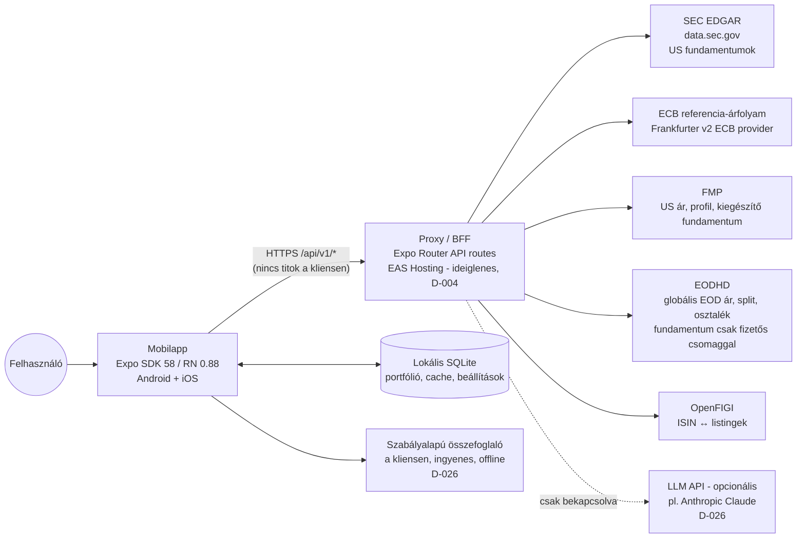
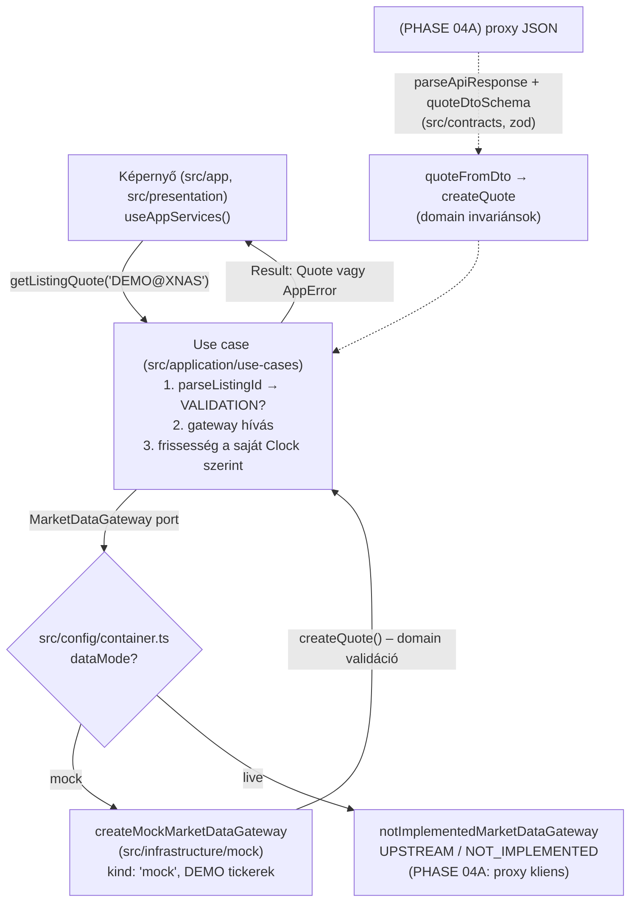
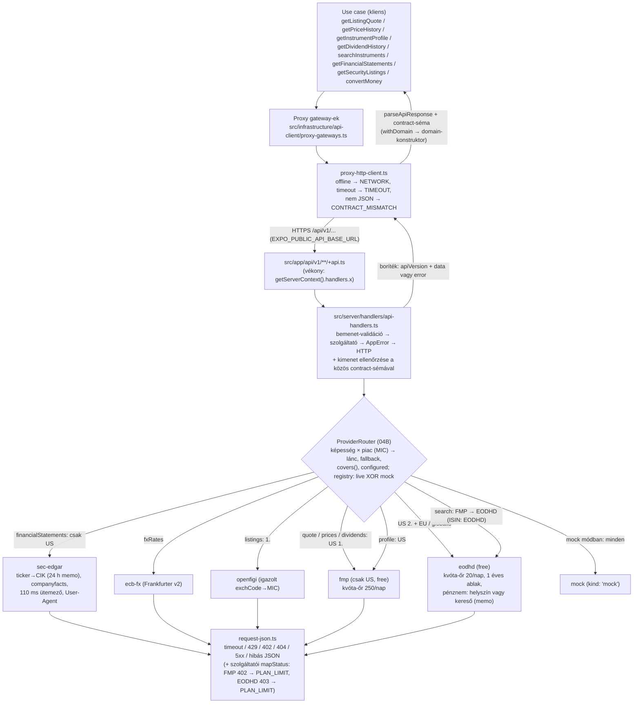

# Architektúra – Stock & ETF Analyzer

> Állapot: **részben megvalósítva** (PHASE 04B, 2026-11-21). A 3., 4.4–4.5, 5., 6.3 (a 10 végpont), 6.4 (ProviderRouter, kvóta, csomagmátrix) és 7. fejezet a **tényleges kódot** írja le; a cache (11.) és az offline működés (12.) még terv.
> Kapcsolódó dokumentumok: [DECISIONS.md](DECISIONS.md), [DATA_SOURCES.md](DATA_SOURCES.md), [DATA_DICTIONARY.md](DATA_DICTIONARY.md), [REQUIREMENTS.md](REQUIREMENTS.md).

## 1. Alapelvek

1. **A számítás determinisztikus, az AI csak magyaráz.** A numerikus igazság forrása a calculation engine. Az AI csak validált, strukturált eredményt kap.
2. **A hiányzó adat nem nulla.** Minden érték státusszal együtt utazik (`Metric<T>`, lásd DATA_DICTIONARY 2.).
3. **Provenance mindenhol.** A forrás, a lekérés ideje, az időszak, a pénznem, az egység és a típus (reported/calculated/estimated/ai_interpretation/user_input/mock) a UI-ig megmarad.
4. **Vékony szerver, okos kliens.** A szerver (proxy) csak lekér, kulcsot tart, validál, normalizál és cache-el. A számítás, a pontozás és a portfólió a kliensen fut, offline is.
5. **A szolgáltató cserélhető.** A szolgáltatóspecifikus formátum nem jut át a proxy normalizálási rétegén. A kliens csak a saját szerződésünket (contract DTO) látja.
6. **Kevés réteg, de szigorú irány.** Clean Architecture-lite: csak ott van interfész, ahol cserélhetőséget vagy tesztelhetőséget ad (szolgáltató, tároló, AI, óra, napló).

## 2. Rendszerkontextus



**Bizalmi határok:**
1. Kliens ↔ proxy: mindkét oldal validál. A kliens a contract sémát, a proxy a kérés paramétereit és az AI bemeneti DTO-t ellenőrzi.
2. Proxy ↔ külső szolgáltató: a szolgáltatói válasz megbízhatatlan adat. Zod-validáció után normalizálunk.
3. LLM kimenet: megbízhatatlan adat. JSON séma és zod-validáció után jelenhet meg.

## 3. Rétegek és függőségi szabályok

```
              ┌───────────────────────────────────────────────┐
              │ src/app (Expo Router route-ok, VÉKONY)          │
              │ src/presentation (komponensek, hookok, theme,   │
              │                   formatterek, view-modellek)    │
              └───────────────┬───────────────────────────────┘
                              │ csak use case-eken át
              ┌───────────────▼───────────────────────────────┐
              │ src/application (use case-ek, portok/interfészek)│
              └───────┬───────────────┬───────────────┬───────┘
                      │               │               │
     ┌────────────────▼──┐  ┌─────────▼────────┐  ┌───▼──────────────┐
     │ src/scoring        │  │ src/calculations  │  │ src/contracts     │
     │ (tiszta szabályok) │─►│ (tiszta képletek) │  │ (zod sémák, API   │
     └────────┬──────────┘  └─────────┬────────┘  │  DTO-k, közös)    │
              └──────────┬────────────┘           └───┬──────────────┘
                 ┌───────▼────────┐                   │
                 │ src/domain      │◄──────────────────┘ (csak típusok/enumok)
                 │ (tiszta TS)     │
                 └────────────────┘
  src/infrastructure (kliens adapterek: proxy kliens, SQLite, napló) ──► application portok
  src/server (CSAK szerver: szolgáltató adapterek, AI kliens, titkok) ──► contracts, domain
  src/config (composition root – összeköt mindent)
```

| Réteg | Mappa | Importálhat | NEM importálhat |
|---|---|---|---|
| Domain | `src/domain` | csak saját magát | React, React Native, Expo, `fetch`, zod, bármilyen külső csomag |
| Calculations | `src/calculations` | `domain` | minden mást |
| Scoring | `src/scoring` | `domain`, `calculations` (típusok, eredmények) | minden mást |
| Explanation | `src/explanation` | `domain`, `calculations`, `scoring`, `contracts` (típusok) | RN, Expo, `fetch`, `server`, `infrastructure` |
| Contracts | `src/contracts` | `zod`, `domain` (enumok/típusok) | RN, Expo, `server`, `infrastructure` |
| Application | `src/application` | `domain`, `calculations`, `scoring`, `contracts` (típusok) | RN UI, konkrét `infrastructure`, `server` |
| Infrastructure (kliens) | `src/infrastructure` | `application` portok, `domain`, `contracts`, `expo-sqlite`, `fetch` | `presentation`, `src/app`, `server` |
| Server (proxy) | `src/server` és `src/app/api/**/+api.ts` | `contracts`, `domain`, szerveroldali SDK-k, `process.env` titkok | `presentation`, `infrastructure`, natív Expo modulok |
| Presentation | `src/presentation`, `src/app` (nem `api`) | `application` (hookokon át), `domain` típusok | `infrastructure`, `server`, közvetlen `fetch` |
| Config | `src/config` | mindent (összekötés) | – |

**Megjegyzések a táblázathoz (PHASE 03, D-038):**
- Az `src/app` route-jai importálhatják a `src/config`-ot. A gyökér layout itt hozza létre a szolgáltatásokat (ez a composition root belépési pontja), az `about.tsx` pedig innen olvassa a nyilvános env-et. A `src/presentation` viszont **nem** importálhat `config`-ot: adatot csak a `useAppServices()` hookon át kap.
- A `presentation` és az `src/app` a `contracts`-ot sem importálja: a DTO-k a UI elől rejtve maradnak.
- A tesztfájlokra is ugyanezek a szabályok vonatkoznak. Ezért az application tesztjei kézzel írt fake portokat használnak. A valódi adapterekkel összekötött tesztet a `src/config/container.test.ts` tartalmazza.

**Kikényszerítés (megvalósítva, `eslint.config.js`):**

| Szabály | Mit tilt | Hol |
|---|---|---|
| `import/no-restricted-paths` (zónák) | rétegek közti tiltott importirány (a fenti táblázat) | minden `src/**/*.ts(x)` |
| `no-restricted-imports` – regex | **bármilyen** külső csomag (React, Expo, zod…) | `src/domain` |
| `no-restricted-imports` – csoportok | `react*`, `react-native*`, `expo*`, `@expo/*` | `src/contracts`, `src/application` |
| `no-restricted-globals` | `fetch`, `XMLHttpRequest`, `WebSocket`, `EventSource` | `domain`, `contracts`, `application`, `presentation`, `src/app` (kivéve a jövőbeli `src/app/api/**`) |

**PHASE 04A kiegészítés (D-038 következményei, megvalósítva):**

| Zóna | Mit tilt |
|---|---|
| `src/server` | `src/app`, `src/presentation`, `src/infrastructure`, `src/config`, `src/application` importját (csak `domain` + `contracts`); UI/Expo-csomagokat (`no-restricted-imports`) |
| `src/config` | `src/server` importját (a kliens composition rootja sem húzhat be szerverkódot) |
| `src/app/api/**` (`+api.ts`) | saját zónakészlet: a `src/server`-t importálhatja, a kliensoldali rétegeket (`infrastructure`, `presentation`, `config`, `application`, `contracts`) nem; a `fetch` itt megengedett |
| `src/app` (többi) és `src/presentation` | továbbra sem érheti el a `src/server`-t |

Igazolás: 4 szándékosan hibás ideiglenes fájl 4 várt hibát adott, a valódi `health+api.ts` (szerver-import) átment; a próbafájlok törölve (phase-04 útmutató, 9. lépés). A végponttól végpontig integrációs teszt (`src/__tests__/proxy-integration.test.ts`) zónán kívül van, ezért importálhatja a klienst és a szervert is.

A szabályok működését szándékosan hibás importokkal igazoltuk: 8 várt hiba jelent meg, a próbafájlokat utána töröltük. A kimenet a [phase-03 útmutató](phases/phase-03-architecture-domain-model.md) 7. lépésében olvasható. Új csomag nem kellett: az `eslint-plugin-import` és a TypeScript import-resolver az `eslint-config-expo`-ból jön.

**Kritikus szabály:** kliensoldali kód (`src/app` nem-`api` fájljai, `src/presentation`, `src/infrastructure`) **soha** nem importál `src/server`-ből. Az Expo dokumentáció szerint a kliens kódba importált titok bekerülhet a bundle-be. A titkokat csak a `+api.ts` fájlok és az általuk importált szerverkód olvashatja (DATA_SOURCES 9.).

## 4. Adatfolyam (data flow)

### 4.1 Fő pipeline

```
 SZERVER (proxy)                                              │ KLIENS (mobilapp)
                                                              │
 [1] PROVIDER                                                 │
     külső API nyers válasza (JSON/CSV), szolgáltatóspecifikus │
     hiba: timeout / 429 / 5xx / hibás ticker → AppError       │
            │                                                 │
            ▼                                                 │
 [2] DTO VALIDATION                                           │
     szolgáltatónkénti zod séma (pl. SecCompanyFactsDto)      │
     sikertelen → UPSTREAM_INVALID hiba; NINCS pótlás/kitalálás│
            │                                                 │
            ▼                                                 │
 [3] NORMALIZATION                                            │
     • dátum → ISO 8601; időszak → FY/Q1..Q4 + start/end      │
     • pénznem → ISO 4217; egység → alapegység (nem ezres)     │
     • előjel-konvenció (pl. CapEx pozitív kiáramlás)          │
     • hiányzó mező → MISSING státusz (nem 0, nem kitalált)    │
     • provenance: source, fetchedAt, asOf, period, kind        │
     kimenet: CONTRACT DTO (src/contracts), szolgáltatófüggetlen│
     → proxy cache (megosztott, rate limitet kímél)            │
            │                                                 │
            └──────────────── HTTPS /api/v1 ──────────────────┼──►
                                                              │ [3b] CONTRACT VALIDATION
                                                              │      ugyanaz a zod séma (bizalmi határ)
                                                              │      → lokális cache (SQLite) provenance-szel
                                                              │            │
                                                              │            ▼
                                                              │ [4] DOMAIN MODEL
                                                              │      mapper: contract → domain
                                                              │      (Instrument, PriceSeries, FinancialStatement,
                                                              │       FxRate, Position… mind Metric<T>-vel)
                                                              │            │
                                                              │            ▼
                                                              │ [5] CALCULATION ENGINE
                                                              │      tiszta függvények → MetricResult
                                                              │      (OK | N/A | N/M | MISSING | INSUFFICIENT_DATA
                                                              │       | INVALID_INPUT) + képlet + bemenetek
                                                              │            │
                                                              │            ▼
                                                              │ [6] SCORING / DECISION
                                                              │      konfigurált súlyok és szabályok →
                                                              │      ScoreBreakdown + Decision + AnalysisConfidence
                                                              │      (a confidence adatteljességet jelent, NEM
                                                              │       hozam-valószínűséget)
                                                              │            │
                                                              │            ▼  (csak felhasználói kérésre)
  [7] AI EXPLANATION  ◄──── POST /api/v1/ai/explain ──────────┼── AiInputDto: csak számított, validált értékek,
      szigorú bemeneti séma + méretkorlát                     │   státuszok, feltevések, források, időbélyegek
      LLM hívás strukturált JSON kimenettel                    │
      zod-validáció; hiba → AI_INVALID_OUTPUT                  │
      ─────────────── AiAnalysis (kind=ai_interpretation) ────┼──►
                                                              │            ▼
                                                              │ [8] UI
                                                              │      view-model + közös formatter
                                                              │      minden érték mellett státusz/forrás
                                                              │      AI-szöveg külön, „AI-értelmezés” címkével
```

### 4.2 Lépésenkénti felelősség

| # | Lépés | Fut | Bemenet → kimenet | Fő hibaállapotok | Fázis |
|---|---|---|---|---|---|
| 1 | Provider | proxy | HTTP kérés → nyers válasz | `TIMEOUT`, `RATE_LIMITED`, `NOT_FOUND`, `UPSTREAM_ERROR` | 04 |
| 2 | DTO validation | proxy | nyers → szolgáltatói DTO | `UPSTREAM_INVALID` | 04 |
| 3 | Normalization | proxy | szolgáltatói DTO → contract DTO | mezőszintű `MISSING`, egység/pénznem ütközés → `INVALID_INPUT` | 04 |
| 3b | Contract validation | kliens | JSON → contract DTO | `CONTRACT_MISMATCH` (pl. régi app, új API) | 04 |
| 4 | Domain mapping | kliens | contract DTO → domain | – (a validált adat típushelyes) | 03, 04 |
| 5 | Calculation | kliens | domain → `MetricResult` | `N/A`, `N/M`, `INSUFFICIENT_DATA`, `INVALID_INPUT` | 05–09 |
| 6 | Scoring/decision | kliens | metrikák → score, döntés | kategória `UNAVAILABLE`, alacsony confidence | 10 |
| 7 | Explanation | **alap: kliens** (szabályalapú `template` provider, `calculated`); **opcionális: proxy + LLM** (`ai_interpretation`) | `AiInputDto` → `AiAnalysis` | `AI_TIMEOUT`, `AI_RATE_LIMITED`, `AI_INVALID_OUTPUT`, `AI_REFUSED`, `AI_DISABLED` (LLM esetén) | 11 |
| 8 | UI | kliens | view-model → képernyő | loading / empty / partial / stale / error / retry | 12 |

### 4.4 Adatút a tényleges kódban (PHASE 03)

A PHASE 03-ban egy teljes, tesztelt szelet működik, valós API nélkül. A „live” mód helyén egy őszinte helyőrző áll, amely `NOT_IMPLEMENTED` hibát ad.



A tranzakció rögzítésének útja: `recordTransaction(command)` → `parsePortfolioId` → `PortfolioRepository.getPortfolio` (ha nincs: `NOT_FOUND`) → `createTransaction` (domain; a „ma” a `Clock`-ból jön) → `addTransaction` (ha hibázik: `STORAGE`) → `ok(transaction)`.

### 4.5 Adatút a proxyn át (PHASE 04A + 04B, megvalósítva)



PHASE 04B: árfolyam, ártörténet, profil, osztalék és keresés élő forrással (FMP, EODHD). Ami a free csomagokban nem elérhető (nem US profil/kimutatás, ETF-metaadat), arra a proxy `CAPABILITY_UNAVAILABLE` + `unavailableReason`-t ad, a kliensen `UNAVAILABLE` lesz belőle (nem csendes demóadat, D-053). A tartalék forrás használatát a válasz `warnings` mezője jelzi. A szerverkontextus a `globalThis`-en él, mert az Expo route-onként külön bundle-t fordít (KI-31). Az FX keresztárfolyam és az elavultság megítélése a kliensen fut (domain `deriveFxRate`, `convertMoney` use case).

### 4.3 Miért így?
- A **normalizálás a szerveren** történik. Szolgáltatócsere vagy formátumváltozás esetén elég a proxyt újratelepíteni, nem kell új mobilverzió (store review nélkül javítható).
- A **számítás a kliensen** fut, így offline is működik, determinisztikus, és nem terheli a szervert.
- A **contract verziózott** (`/api/v1`). Régi appverziók tovább működnek, ha a proxy változik.

## 5. Projektstruktúra

### 5.1 Ténylegesen létező kód (PHASE 03 vége, 2026-11-21)

```
src/
├─ app/                           Expo Router route-ok (VÉKONY). _layout.tsx: AppServicesProvider + téma + Stack
├─ domain/                        TISZTA TypeScript – semmilyen külső csomag
│  ├─ index.ts                    nyilvános felület (`@/domain`)
│  ├─ shared/                     brand, result, errors (AppError), validation, currency, dates, ids,
│  │                              money, period, provenance (+ assessFreshness), metric (Metric<T>)
│  ├─ instrument/instrument.ts    Instrument = Stock | Etf, Listing + konstruktorok
│  ├─ market/quote.ts             Quote, PriceSeries
│  ├─ fundamentals/               financial-statement.ts (Income | Balance | CashFlow), financial-metric.ts
│  ├─ fx/fx-rate.ts               FxRate
│  ├─ portfolio/portfolio.ts      Portfolio, Transaction (BUY|SELL|DIVIDEND|FEE|SPLIT), Position (csak típus)
│  ├─ analysis/analysis-result.ts AnalysisResult, adatteljesség (COMPLETE|PARTIAL|INSUFFICIENT)
│  └─ shared/shared.test.ts, entities.test.ts
├─ contracts/                     zod: közös sémák (provenance, Metric), quote DTO, API-boríték + hibakód-leképezés
├─ application/
│  ├─ index.ts                    AppServices interfész (a UI ezt kapja)
│  ├─ ports/index.ts              Clock, IdGenerator, MarketDataGateway, PortfolioRepository
│  └─ use-cases/                  get-listing-quote.ts, record-transaction.ts (+ tesztek fake portokkal)
├─ infrastructure/
│  ├─ system/system-clock.ts      rendszeróra, lokális ID-generátor
│  ├─ mock/                       InMemoryPortfolioRepository, mock árfolyam-gateway (DEMO tickerek)
│  └─ api-client/                 notImplementedMarketDataGateway (live helyőrző, a PHASE 04A cseréli)
├─ config/                        env.ts (nyilvános env), container.ts (composition root) (+ tesztek)
├─ presentation/
│  ├─ components/ theme/ strings/ (PHASE 02)
│  └─ di/app-services-context.tsx AppServicesProvider + useAppServices() (+ teszt)
└─ __tests__/routes.test.tsx      navigációs smoke tesztek
```

| Mappa | Feladat | Egy mondatban |
|---|---|---|
| `src/domain` | üzleti fogalmak és szabályok | „Mi az a tranzakció, és mikor érvényes?” |
| `src/contracts` | a hálózati szerződés sémái | „Milyen alakú JSON jöhet a proxytól, és hogyan lesz belőle domain?” |
| `src/application` | use case-ek és portok | „Milyen lépésekből áll egy felhasználói művelet, és mire van hozzá szükség?” |
| `src/infrastructure` | portok konkrét megvalósítása | „Honnan jön ténylegesen az adat (mock, később proxy, SQLite)?” |
| `src/config` | összekötés (composition root) és env | „Melyik megvalósítás kerül melyik port mögé?” |
| `src/presentation` | UI-komponensek, téma, szövegek, DI-hook | „Hogyan néz ki, és honnan kapja a szolgáltatásokat?” |
| `src/app` | route-ok (képernyők) | „Melyik URL melyik képernyő?” |

**PHASE 04A-ban létrejött:**

```
src/
├─ app/api/v1/                    proxy-route-ok (+api.ts): health, fx, securities/[isin]/listings,
│                                 stocks/[id]/financials, instruments/[id]/quote
├─ server/                        CSAK SZERVER (domain + contracts importálható)
│  ├─ env.ts                      PROXY_DATA_MODE, SEC_USER_AGENT, OPENFIGI_API_KEY, FMP_*, EODHD_* (validált)
│  ├─ server-context.ts           a proxy composition rootja (live XOR mock)
│  ├─ logging.ts                  JSON-soros napló, titok és személyes adat nélkül
│  ├─ http/                       request-json.ts (hibaleképezés), request-scheduler.ts (ütemező, TTL-memo)
│  ├─ handlers/                   api-handlers.ts, http.ts (boríték, AppError → HTTP)
│  ├─ providers/                  market-data-provider.ts (szerződés), sec-edgar/, ecb-fx/, openfigi/, fmp/, eodhd/ (04B), mock/
│  │                              (+ __fixtures__/: valós, megvágott válaszok)
│  ├─ routing/                    provider-router.ts, plans.ts, quota.ts, markets.ts (PHASE 04B)
│  └─ testing/                    test-helpers.ts (fixture-betöltő, hamis fetch) – csak tesztekhez
├─ domain/instrument/listing-candidate.ts, fundamentals/financial-statement-set.ts, fx/fx-conversion.ts
├─ contracts/                     + fx.ts, listings.ts, financials.ts, health.ts
├─ application/use-cases/         + convert-money.ts (FxService), get-market-reference-data.ts
├─ infrastructure/api-client/     proxy-http-client.ts, proxy-gateways.ts, not-implemented-… (URL nélkül)
├─ infrastructure/mock/           + mock-fx-gateway.ts
└─ __tests__/proxy-integration.test.ts   kliens ↔ szerver végponttól végpontig (hálózat nélkül)
scripts/record-sec-fixtures.mjs   SEC fixture-rögzítő (fejlesztői eszköz)
```

**PHASE 05 (2026-11-22):** elkészült a `src/calculations/` (D-055): `core/` (`CalcResult`, numerikus konvenciók, `Metric`-adapter), `fundamentals/`, `valuation/` (szorzók + DCF-konvenciók), `returns/`, `etf/`, `portfolio/`, `definitions.ts`. Rétegszabály: csak a `domain`-t importálhatja (ESLint-zóna + `src/__tests__/calculations-purity.test.ts`). Még nem hívja use case – az első fogyasztó a PHASE 06 `analyzeStock`.

**PHASE 06 (2026-11-22):** az első fogyasztó elkészült (D-059…D-063):
```
src/domain/analysis/stock-fundamentals.ts     eredmény-modell: MetricOrigin, FundamentalMetric, StockOverview,
                                              StatementTable, PeriodMetricTable/PeriodColumn, TrendSeries,
                                              QualityAnalysis (pontszám nélkül), QualitativeFinding, StockDataQuality
src/application/stock-analysis/               tiszta elemző logika (a képletek a calculations-ből):
  statement-periods.ts   időszakonkénti csoportosítás, Q4 = FY − (Q1+Q2+Q3), TTM, kimutatás-táblák
  period-metrics.ts      időszaki mutatók (árrés, EPS, növekedés, adósság, FCF, ROE/ROA/ROIC)
  trends.ts              1/3/5/10 éves CAGR összehasonlíthatósági ellenőrzéssel
  valuation.ts           ár, piaci érték, béta, 52 hetes tartomány, szorzók, osztalékhozam
  quality.ts             minőségi témák bizonyítékkal / hiánylistával
  metric-helpers.ts, testing.ts (csak tesztekhez)
src/application/use-cases/analyze-stock-fundamentals.ts   use case (AppServices.analyzeStockFundamentals)
src/server/providers/sec-edgar/sec-debt.ts    totalDebt összerakása SEC-komponensekből (D-059)
src/calculations/returns/price-range.ts       52 hetes csúcs/mélypont záróárakból (D-061)
```
Adatút: `analyzeStockFundamentals` → a meglévő use case-ek (`getFinancialStatements` ×2, `getListingQuote`, `getInstrumentProfile`, `getPriceHistory`, `getDividendHistory`; párhuzamosan, frissességgel) → `stock-analysis/*` → `StockFundamentalAnalysis`. Egy forrás kiesése nem dönti el az elemzést (D-063/5). UI még nincs (PHASE 12).

**PHASE 07 (2026-11-22):** értékelés és DCF (D-064, D-065):

```
src/calculations/valuation/dcf.ts              runDcf – tiszta DCF-motor (r > g, MOS, megjegyzések)
src/calculations/valuation/dcf-scenarios.ts    Bear/Base/Bull + szenzitivitási tábla (minden cella runDcf)
src/calculations/valuation/valuation-bands.ts  konfigurálható MOS- és szorzó-küszöbök
src/application/valuation/                     types, defaults (kiinduló feltevések), dcf-inputs (bemeneti modell),
                                               stock-valuation (összerakás, magyarázat)
src/application/use-cases/analyze-stock-valuation.ts   analyzeStockValuation + recalculateStockValuation
src/testing/stock-analysis-fixtures.ts         CSAK tesztekhez: valós fixture → hamis gateway → use case-ek
```

Adatút: `analyzeStockValuation` → `analyzeStockFundamentals` (PHASE 06) → `buildStockValuation` (tiszta) → `StockValuationAnalysis`. A feltevések állításakor a UI a `recalculateStockValuation`-t hívja (hálózat nélkül). A UI-ban nincs DCF-számítás (őrteszt: `src/__tests__/calculations-purity.test.ts`).

**PHASE 08 (2026-11-22):** ETF-elemzés (D-066…D-069), a részvénylogikától különválasztva:

```
src/domain/etf/                                etf-classification (kategóriák), etf-holdings (pillanatkép + validáció),
                                               etf-profile (jegyzés-szintű elemzési bemenet)
src/calculations/returns/risk.ts               periódushozam, dátum-igazítás, volatilitás, downside dev., Sharpe, Sortino, béta
src/calculations/etf/holdings.ts               top N, HHI / effektív N, kitettség-bontás
src/calculations/etf/exposure.ts               régió-levezetés, devizakockázat
src/application/shared/app-error-metric.ts     közös hiba → Metric leképezés (a stock-analysis-ből kiemelve)
src/application/etf-analysis/                  types, etf-metric, etf-profile-builder (validált kézi metaadat),
                                               etf-returns, etf-risk (kockázat + tracking), etf-costs,
                                               etf-holdings-analysis (holdings + deviza), etf-features, etf-analysis (összerakás)
src/application/use-cases/analyze-etf.ts       analyzeEtf (AppServices)
```

Adatút: `analyzeEtf` → párhuzamosan `getListingQuote`, `getInstrumentProfile`, `getPriceHistory` (`SPLIT_DIVIDEND` + `SPLIT`, tartalék `NONE`), `getDividendHistory`; opcionálisan `convertMoney` (AUM) → `buildEtfAnalysis` (tiszta) → `EtfAnalysis`. Az ETF-metaadat és a holdings ma a hívótól jön (`EtfMetadataInput`, `user_input`). Őrteszt: `src/__tests__/etf-stock-separation.test.ts` (az ETF-elemzés nem importál részvénymodult és fordítva).

**Még nem létező mappák** (a saját fázisuk hozza létre): `scoring/` (10), `explanation/` (11), `server/cache/` (13), `infrastructure/storage/` (13), `presentation/{hooks,formatters,view-models}` (12).

### 5.2 Tervezett teljes struktúra (PHASE 01 terv)

> A `(tabs)/` csoport a PHASE 12-ben készül; addig gyökér-`Stack` van (D-034). A sablon konvenciója (`src/app`) egyezett a tervvel (D-029).

```
stock-etf-analyzer/
├─ CLAUDE.md                     állandó projektutasítások
├─ README.md                     (PHASE 02)
├─ app.json | app.config.ts      Expo konfiguráció
├─ package.json, tsconfig.json, eslint config, jest config
├─ .env.example                  csak minta, valódi kulcs nélkül
├─ docs/                         tervek, döntések, handoffok
├─ src/
│  ├─ app/                       Expo Router route-ok (VÉKONY képernyők)
│  │  ├─ _layout.tsx
│  │  ├─ (tabs)/                 index (dashboard), portfolio, watchlist, settings
│  │  ├─ search.tsx
│  │  ├─ stock/[id].tsx
│  │  ├─ etf/[id].tsx
│  │  └─ api/v1/**/+api.ts       proxy végpontok → src/server/handlers
│  ├─ domain/
│  │  ├─ shared/                 Result, AppError, Metric, Provenance, Currency, Money, Period, Freshness
│  │  ├─ instrument/  stock/  etf/  market/  fundamentals/  fx/  portfolio/
│  │  └─ analysis/               ScoreBreakdown, Decision, AiAnalysis típusok
│  ├─ calculations/              tiszta képletek (05), valuation/dcf (07), etf (08), portfolio (09)
│  ├─ scoring/                   score és decision engine + konfiguráció (10)
│  ├─ explanation/               szabályalapú (ingyenes, offline) magyarázat-generátor, `template` provider (11)
│  ├─ contracts/                 zod sémák: API kérések/válaszok, AiInputDto, AiOutput
│  ├─ application/
│  │  ├─ ports/                  MarketDataGateway, FxGateway, AiGateway, *Repository, Clock, Logger
│  │  └─ use-cases/              analyzeStock, analyzeEtf, runDcf, valuePortfolio, explainAnalysis…
│  ├─ infrastructure/
│  │  ├─ api-client/             proxy HTTP kliens (+ contract validáció)
│  │  ├─ mock/                   determinisztikus mock gateway-ek (kind=mock)
│  │  ├─ storage/                SQLite repository-k, kv beállítások (13)
│  │  └─ logging/
│  ├─ server/                    CSAK SZERVER
│  │  ├─ handlers/               Request → Response függvények (hosztfüggetlen)
│  │  ├─ providers/              sec-edgar/, ecb-fx/, openfigi/, fmp/, eodhd/, mock/ (adapter + DTO séma + normalizer)
│  │  ├─ routing/                ProviderRouter, képességmátrix (csomagszint), kvóta-költségvetés (D-024, D-027)
│  │  ├─ ai/                     LLM kliens, promptok, kimeneti séma
│  │  ├─ cache/  rate-limit/  env.ts
│  ├─ presentation/
│  │  ├─ components/  hooks/  theme/  formatters/  view-models/  strings/ (hu)
│  └─ config/                    composition root (kézi DI), env parsing
└─ test/ vagy __fixtures__/      rögzített, anonimizált szolgáltatói válaszok
```

## 6. Proxy / BFF terv (D-004, D-005)

### 6.1 Miért kell egyáltalán?
| Ok | Részletek |
|---|---|
| Titkos kulcsok | Az LLM API kulcs és a legtöbb árfolyam-szolgáltató kulcsa nem kerülhet az appba. Az `EXPO_PUBLIC_` változók „plain-textként láthatók a lefordított alkalmazásban” (Expo docs, `[IGAZOLT]`). |
| SEC követelmény | A SEC automatizált hozzáférésnél User-Agent deklarációt kér kapcsolattartóval, és legfeljebb 10 kérés/mp-et enged (`[IGAZOLT]`). Ezt központilag kell kezelni, nem a felhasználó eszközéről. |
| Rate limit | Az ingyenes keretek kicsik (DATA_SOURCES 3.). A megosztott cache és a kéréskorlát a proxyn védi a keretet. |
| Cserélhetőség | Szolgáltatócsere új appverzió nélkül (4.3). |
| Web (opcionális) | A data.sec.gov nem támogat CORS-t (`[IGAZOLT]`), böngészőből közvetlenül nem hívható. |

### 6.2 Mit NEM csinál a proxy (MVP)
Nem tárol portfóliót, nincs felhasználói fiók, nem számol mutatót, nem pontoz és nem futtat ütemezett feladatot. Ezért nem kell adatbázis, és nincs fizetős infrastruktúra.

### 6.3 Végpontok (contract v1 – javaslat, a PHASE 04 véglegesíti)

> **PHASE 04B állapot:** megvalósítva és lokálisan élő adattal igazolva mind a 10 végpont: `health`, `providers/status`, `fx`, `search`, `securities/{isin}/listings`, `stocks/{id}/financials`, `instruments/{id}/quote`, `/prices`, `/profile`, `/dividends`. A tervezett `prices?adjusted` helyett `adjustment=none|split|split_dividend` (D-050), a `corporate-actions` helyett `dividends` (D-054). **PHASE 04A állapot:** `health`, `fx`, `securities/{isin}/listings`, `stocks/{id}/financials`, `instruments/{id}/quote`. A pontos sémák és hibakódok: [DATA_DICTIONARY 11.](DATA_DICTIONARY.md#11-api-szerződés-v1-phase-04a--04b). Új hibakód: `CAPABILITY_UNAVAILABLE` (D-044), 04B-től `unavailableReason`-nel (D-053).

| Metódus | Útvonal | Leírás | Fázis |
|---|---|---|---|
| GET | `/api/v1/health` | verzió, szolgáltatók elérhetősége | 04 |
| GET | `/api/v1/search?q=` | instrumentum keresés (ticker, név vagy ISIN) | 04 |
| GET | `/api/v1/securities/{isin}/listings` | egy értékpapír összes tőzsdei jegyzése (D-025) | 04A |
| GET | `/api/v1/providers/status` | szolgáltatók csomagszintje, képességei, mai kvóta-felhasználás (kulcs nélkül!) | 04B |
| GET | `/api/v1/instruments/{id}/profile` | profil, metaadat | 04 |
| GET | `/api/v1/instruments/{id}/quote` | legutóbbi ár, `asOf`, késleltetés | 04 |
| GET | `/api/v1/instruments/{id}/prices?from&to&adjusted` | napi ártörténet | 04 |
| GET | `/api/v1/instruments/{id}/corporate-actions` | osztalék, split (ha elérhető) | 04 |
| GET | `/api/v1/stocks/{id}/financials?period=annual\|quarterly` | normalizált kimutatások | 04 |
| GET | `/api/v1/etfs/{id}/profile` | ETF metaadat (TER, AUM… ha elérhető) | 08 |
| GET | `/api/v1/etfs/{id}/holdings` | csak ha van igazolt forrás | 08 |
| GET | `/api/v1/fx?base=EUR&date=` | ECB referencia-árfolyamok | 04 |
| POST | `/api/v1/ai/explain` | `{ kind: 'stock'\|'etf'\|'portfolio', input: AiInputDto }` | 11 |

**Azonosítók** (D-025, javaslat a PHASE 03-nak):
- **Listing** (tőzsdei jegyzés, ehhez tartozik az ár): `{symbol}@{MIC}`, pl. `AAPL@XNAS`, `VWCE@XETR`. MIC = ISO 10383 tőzsdekód.
- **Security** (értékpapír, ehhez tartozik a fundamentum és az ETF-metaadat): ISIN.
- A CIK és a FIGI külön mezőben szerepel.
- Az `{id}` a fenti végpontokban listing-azonosító.

**Válasz-boríték:**
```jsonc
// siker
{ "apiVersion": "1", "data": { /* contract DTO */ }, "provenance": { /* ... */ }, "warnings": [] }
// hiba
{ "apiVersion": "1", "error": { "code": "RATE_LIMITED", "message": "…", "retryAfterSec": 60 } }
```
Hibakódok: `VALIDATION_FAILED`, `NOT_FOUND`, `UNSUPPORTED_MARKET`, `RATE_LIMITED`, `TIMEOUT`, `UPSTREAM_ERROR`, `UPSTREAM_INVALID`, `AI_DISABLED`, `AI_INVALID_OUTPUT`, `AI_REFUSED`, `INTERNAL`.

### 6.4 Proxy-felelősségek
1. Kulcsbefecskendezés szerveroldali környezeti változóból.
2. **Allowlist**: csak a fenti útvonalak; nincs „általános továbbító” végpont.
3. Bemeneti validáció: symbol formátum, dátumtartomány, AI DTO séma és mérethatár.
4. Szolgáltatói válasz validálása és normalizálása (4.1 [2]–[3]).
5. Megosztott cache adattípusonkénti TTL-lel (11. fejezet).
6. Rate limit kliensenként és felfelé (szolgáltatói keret). A megvalósítás a hoszt képességeitől függ, lásd U-03.
7. Timeout és korlátozott újrapróbálás exponenciális visszalépéssel, csak idempotens GET-nél.
8. Strukturált napló titkok és személyes adat nélkül (10. fejezet).
9. AI: költségkorlát (max tokens, napi keret, kill switch env változóval).
10. **ProviderRouter** (D-024): képesség × piac szerinti prioritási lista, fallback-szabályok, „egy adatsor = egy forrás” (DATA_SOURCES 5.2–5.3).
11. **Kvóta-költségvetés** szolgáltatónként (EODHD: kéréstípusonkénti hívásköltség). A keret közelében csak cache-ből szolgál ki. Prioritás: portfólió > watchlist > keresés.
12. **Képességmátrix a csomagszintből** (`FMP_PLAN`, `EODHD_PLAN`). A nem elérhető képesség `UNAVAILABLE (PLAN_LIMIT)` (D-027).

### 6.5 Környezeti változók (terv)

| Változó | Hol | Titkos? | Leírás |
|---|---|---|---|
| `EXPO_PUBLIC_API_BASE_URL` | kliens | nem | a proxy alap URL-je |
| `EXPO_PUBLIC_DATA_MODE` | kliens | nem | `live` \| `mock` |
| `PROXY_DATA_MODE` | szerver | nem | `live` (alap) \| `mock` – a proxy CSAK élő vagy CSAK demó szolgáltatókat futtat (D-045). PHASE 04A |
| `SEC_USER_AGENT` | szerver | nem titok, de személyes adat | „AppNév kapcsolattartó@email” (a tulajdonos adja meg, `.env`-ben, NEM a kódban) |
| `FMP_API_KEY` | szerver | **igen** | Financial Modeling Prep (a tulajdonosnak megvan) |
| `EODHD_API_KEY` | szerver | **igen** | EODHD (a tulajdonosnak megvan) |
| `FMP_PLAN`, `EODHD_PLAN` | szerver | nem | csomagszint: FMP `free` \| `starter`, EODHD `free` \| `eod-all-world`; ebből épül a képességmátrix, a kvóta és az ártörténet-ablak (D-027, D-051). Ismeretlen érték → `free` + figyelmeztetés. PHASE 04B |
| `OPENFIGI_API_KEY` | szerver | **igen** (opcionális) | magasabb limit |
| `AI_PROVIDER` | szerver + kliens | nem | `template` (alap, ingyenes) \| `anthropic` \| `local` … (D-026) |
| `AI_MODEL` | szerver | nem | LLM esetén, pl. `claude-opus-5-5` vagy a legolcsóbb `claude-haiku-5-5` |
| `ANTHROPIC_API_KEY` | szerver | **igen** | csak ha az `anthropic` provider be van kapcsolva |
| `AI_ENABLED`, `AI_MAX_OUTPUT_TOKENS` | szerver | nem | kill switch, költségkorlát |

**Kulcskezelés:**
- Lokálisan `.env.local` (a `.gitignore`-ban, PHASE 02), élesben EAS environment variable (secret).
- A verziókezelésbe csak a `.env.example` kerül, üres értékekkel.
- **API-kulcsot soha nem illesztünk be chatbe.**

## 7. Hibakezelés, konfiguráció, DI

- **Result minta (megvalósítva, `src/domain/shared/result.ts`):** az üzleti logika várt hibára nem dob kivételt, hanem `Result<T, AppError>`-t ad vissza: `{ ok: true, value }` vagy `{ ok: false, error }`. Kivételt csak programozási hiba (bug) esetén dobunk, pl. ha hiányzik az `AppServicesProvider`.
- **AppError (megvalósítva, `src/domain/shared/errors.ts`):** diszkriminált unió a `kind` mező szerint (D-036):

| `kind` | Mikor | Extra mezők | Újrapróbálható (`isRetryable`) |
|---|---|---|---|
| `VALIDATION` | érvénytelen bemenet / sérül egy domain invariáns | `issues[] { path, message }` | nem |
| `NETWORK` | nincs kapcsolat | – | igen |
| `TIMEOUT` | időtúllépés | `timeoutMs` | igen |
| `RATE_LIMITED` | szolgáltatói/proxy keret | `retryAfterSec` | igen |
| `NOT_FOUND` | nem létező erőforrás | `resource`, `id` | nem |
| `UPSTREAM` | szolgáltató/proxy hiba | `failure`: `HTTP_ERROR` \| `INVALID_RESPONSE` \| `CONTRACT_MISMATCH` \| `NOT_IMPLEMENTED`; `sourceId` | csak `HTTP_ERROR` |
| `MISSING_DATA` | a művelethez szükséges adat hiányzik | `missing[]` | nem |
| `CALCULATION_INVALID` | a számítás nem végezhető el (pl. eltérő pénznemek összeadása) | – | nem |
| `STORAGE` | tárolási hiba | – | nem |
| `AI` | magyarázó szolgáltatás hibája | `failure`: `AI_DISABLED` … | csak timeout / rate limit esetén |

- **Hiba vs. hiányzó érték:** az `AppError` azt jelzi, hogy a *művelet* hiúsult meg. A `Metric<T>` nem-OK státusza azt jelzi, hogy egy *érték* hiányzik vagy nem értelmezhető, de az elemzés ettől folytatódhat.
- **Validáció két szinten, duplikáció nélkül (D-039):** a zod (`src/contracts`) a bizalmi határon a szerkezetet ellenőrzi. Az üzleti invariánsokat a domain `parse…`/`create…` függvényei ellenőrzik, és a zod sémák ezeket hívják (`fromDomainParser`). Minden domain konstruktor az **összes** hibás mezőt egyszerre adja vissza (`validateFields`).
- **Metrikaszintű hiány ≠ hiba:** egy hiányzó mező nem bukja el az egész elemzést. A metrika `MISSING` státuszt kap, és az elemzés részleges lesz.
- **DI (megvalósítva):** kézi composition root (`src/config/container.ts` → `createAppServices(env, overrides)`). A use case-ek függvény-factoryk (pl. `createGetListingQuote(deps)`), és React Contexten át jutnak el a UI-hoz (`AppServicesProvider`, `useAppServices`). DI-könyvtár nem kell (D-040).
- **Óra (Clock) port:** a frissesség és a cache TTL tesztelhetősége miatt az időt injektáljuk.

## 8. Tesztelési stratégia

| Szint | Mit | Eszköz | Mikor |
|---|---|---|---|
| Unit (a tesztek nagy része) | képletek, DCF, scoring, normalizálók, mapperek, formatterek | Jest 30 + `jest-expo` preset `[IGAZOLT: SDK 58-hoz Jest 30 kell]` | 03-tól |
| Contract | zod sémák rögzített, anonimizált szolgáltatói válaszokon (fixture), beleértve hibás JSON-t és hiányzó mezőt | Jest | 04-től |
| Use case | alkalmazási logika mock gateway-jel és in-memory repository-val | Jest | 03-tól |
| Proxy handler | `Request → Response` függvények, mockolt felfelé irányuló `fetch`-csel | Jest | 04-től |
| Komponens | állapotok renderelése: loading/empty/partial/stale/error, N/A vs 0 | `@testing-library/react-native` ≥ 14 `[IGAZOLT: Router tesztekhez ≥14]` | 12-től |
| E2E smoke | ticker keresés → elemzés megnyitása; tranzakció felvétele | Maestro (Expo ajánlás) – Android emulátoron | 15 |

**Szabályok**
- Teszt sosem hív élő API-t. A fixture-ök `mock`/`fixture` jelöléssel vannak ellátva, és nem keveredhetnek éles adattal.
- Determinisztikus óra és rögzített FX a tesztekben.
- Pénzügyi összehasonlítás tűréssel történik (`toBeCloseTo`), mert lebegőpontos számokat használunk (D-009).
- Golden/regressziós tesztek: DCF, score, decision. Ugyanarra a bemenetre mindig ugyanaz a kimenet.
- Lefedettségi cél: `calculations/`, `scoring/`, normalizálók ≥ 90% sor és ág. Globális kötelező cél nincs.
- `react-test-renderer` nem használható, mert elavult `[IGAZOLT]`.

## 9. Biztonsági terv

**Védett értékek:** API kulcsok, felhasználói portfólió, AI-költségkeret, adatintegritás.

| Fenyegetés | Kontroll |
|---|---|
| Kulcs kinyerése az APK/IPA-ból | Nincs titok a kliensen. `EXPO_PUBLIC_` csak nem titkos értéket tartalmazhat. |
| Proxy visszaélés (valaki más használja a végpontot) | Allowlist, kérésenkénti validáció, rate limit, cache, AI napi keret és kill switch. Később opcionálisan app attestation (R-07). |
| Szolgáltatói adat mint támadási felület / prompt injection | Szolgáltatói szöveg (cégleírás stb.) adatként kezelve, mezőhossz-korlát. Az AI-promptban elválasztva, „adat, nem utasítás”. Az AI kimenete séma szerint validált. Az AI nem változtathat szabályt és nem kérhet titkot. |
| Hamis/hibás adat megjelenítése | Kétoldali zod-validáció, provenance, státuszok. Nincs csendes pótlás. |
| Naplózott érzékeny adat | Napló-redakció: kulcs, token, e-mail és portfólióérték nem kerül naplóba. |
| Függőségi kockázat | Csak szükséges csomag, `npx expo install`, lockfile commitolva, `npm audit` a PHASE 15-ben. |
| Hálózati lehallgatás | Csak HTTPS. |
| Elveszett/ellopott eszköz | Az OS szintű eszköztitkosításra támaszkodunk. App-szintű DB-titkosítás opcionális (O-05, dev build kell). Ismert korlát. |

A részletes `docs/SECURITY.md` a PHASE 15-ben készül.

## 10. Naplózás

- `Logger` port (`debug|info|warn|error`), PII-redakcióval.
- **Kliens:** fejlesztésben konzolra ír. Release-ben csak `warn|error` szint, összeg, ticker-lista vagy portfólió nélkül. Crash reporting (pl. Sentry) csak külön adatvédelmi döntés után (opcionális).
- **Proxy:** strukturált JSON sor `requestId`, útvonal, szolgáltató, státusz, latencia és cache hit/miss mezőkkel. Soha nincs benne kulcs, teljes AI-prompt vagy portfólió-összetétel.

## 11. Cache stratégia (kiinduló TTL-ek – a PHASE 13 véglegesíti)

Kétszintű cache:
- **Proxy cache:** megosztott, a rate limitet védi.
- **Eszköz cache:** SQLite, offline működéshez.

Minden rekord tartalmazza: `fetchedAt`, `asOf`, `source`, `period`, `freshness`, `expiresAt`.

| Adattípus | Javasolt TTL (friss) | Elavult jelölés | Megjegyzés |
|---|---|---|---|
| Quote (késleltetett/EOD) | 15 perc kereskedési időben, egyébként a következő nyitásig | TTL után `STALE` | piaci naptár: később |
| Napi ártörténet | a következő kereskedési nap zárásáig (~24 h) | 3 nap után `STALE` | |
| Pénzügyi kimutatások | 7 nap | 120 nap után `STALE` | új SEC filing után invalidálható |
| Profil / ETF metaadat | 7 nap | 30 nap | |
| ETF holdings | 30 nap | a holdings dátuma alapján | `asOf` kötelező |
| FX (ECB) | a következő munkanap 16:00 CET-ig | 3 munkanap után `STALE` | ECB ~16:00 CET munkanapokon `[IGAZOLT]` |
| AI-magyarázat | amíg a bemeneti DTO hash változatlan | – | költségkímélés |

**Szabályok:** nincs lekérés renderenként. A felhasználói kézi frissítés megkerüli az eszköz cache-t, de a proxy cache-t nem kötelezően (rate limit védelem). Stale-while-revalidate csak látható „frissítés…” jelzéssel működik.

## 12. Offline működés

| Funkció | Offline viselkedés |
|---|---|
| Elemzés megnyitása | Cache-ből, „Utoljára frissítve: …, elavult lehet” sávval. Ha nincs cache: üres állapot magyarázattal. |
| Számítás, DCF, score | Fut a cache-elt adaton, a frissesség-státusz öröklődik. |
| Portfólió | Teljesen lokális: olvasás és tranzakció rögzítése is működik. Az értékelés az utolsó ismert árral és FX-szel, dátummal együtt. |
| AI-magyarázat | Nem elérhető. A korábban cache-elt magyarázat megjeleníthető a dátumával. |
| Keresés | Csak a lokálisan ismert instrumentumok között. |

## 13. Kiadási stratégia

| Szakasz | Cél | Eszköz | Feltétel |
|---|---|---|---|
| Fejlesztés | napi munka | Android emulátor (Windows), Expo Go az SDK 58-hoz CLI-n át telepítve vagy development build | PHASE 02 |
| Belső (személyes) | saját telefonon használat | EAS Build `preview` profil, Android APK; proxy: `eas deploy` | PHASE 16 |
| Szűk tesztelés (opcionális) | ismerősök | Play internal testing / TestFlight | DP-02 tisztázva: adatlicenc! |
| Nyilvános | store | EAS Submit | Kereskedelmi adatlicenc, jogi felülvizsgálat (R-10), adatvédelmi tájékoztató |

- **Verziózás:** SemVer az appra; a proxy API `/api/v1`, visszafelé kompatibilis bővítéssel.
- **OTA frissítés:** EAS Update csak JS-változásra. Natív változás új buildet igényel.
- **iOS:** buildhez Apple Developer fiók kell (éves díjas). Szimulátorhoz macOS kell. Windows alól az iOS a felhőben (EAS Build) építhető.

## 14. Technológiai terv

| Terület | Választás | Státusz | Forrás / megjegyzés |
|---|---|---|---|
| Keretrendszer | Expo SDK 58 | `[IGAZOLT]` kiadva 2026-10-15 | expo.dev/changelog/sdk-58 |
| React Native | 0.88 (telepítve: **0.88.1**) | `[IGAZOLT]` (PHASE 02: sablon + `npm ls`) | docs.expo.dev/versions/v58.0.0 |
| React | **19.3.0** | `[IGAZOLT]` PHASE 02: sablon, `npm ls`, `npx expo install --check` (a 19.2.3 téves volt) | D-001 |
| TypeScript | **6.0.3** (sablon), strict + `noUncheckedIndexedAccess`; a TS 6-ban a `types` alapértéke `[]` | `[IGAZOLT]` PHASE 02 | D-031 |
| Lint / formázás | ESLint 9.39 flat config + `eslint-config-expo` 58.0.4 + Prettier 3.10 (`eslint-plugin-prettier`) | `[IGAZOLT]` PHASE 02 | D-030 |
| Architektúra | New Architecture (kötelező SDK 55 óta, nem kapcsolható ki) | `[IGAZOLT]` | docs.expo.dev/guides/new-architecture |
| Node.js | 22.13+ / 24.3+ / 26+ (páratlan főverzió nem támogatott). Telepítve: **v26.10.0** | `[IGAZOLT]` | SDK 58 changelog |
| Min. platform | iOS 16.4+, Android 7+, compileSdk 37, targetSdk 36, Xcode 26.4+ | `[IGAZOLT]` | v58 referenciaoldal |
| Nyelv | TypeScript strict. RN 0.87 óta a Strict TypeScript API az alapértelmezett, a `react-native/Libraries/*` deep import típushiba | `[IGAZOLT]` | SDK 58 upgrade guide |
| Navigáció | Expo Router (SDK 58: átdolgozott navigációs mag, `web.output` alapértelmezés `"server"`, API route-ok) | `[IGAZOLT]` | SDK 58 changelog, API routes docs |
| Validáció | zod **4.6.7** (tiszta JS; `npx expo install zod` → `dependencies`, `^4.6.7`) | `[IGAZOLT]` PHASE 03: typecheck, Jest és Android Hermes bundle (`expo export`) sikeres | D-014, D-039 |
| Szerver-állapot a UI-ban | TanStack Query (tiszta JS) – jelölt | `[NEM IGAZOLT]`, PHASE 12 dönt | csak ha ténylegesen egyszerűsít |
| Tárolás | `expo-sqlite` (~58.0.18, Expo Go-ban elérhető, `expo-sqlite/kv-store` AsyncStorage-helyettesítő) | `[IGAZOLT]` | SDK 58 sqlite docs |
| Titoktár | `expo-secure-store` (~58.0.3) – csak valódi titokra | `[IGAZOLT]` | SDK 58 securestore docs |
| Grafikon | jelöltek: `react-native-svg` alapú vagy Skia alapú könyvtár | `[NEM IGAZOLT]`, PHASE 12 ellenőrzi | |
| Teszt | Jest 30 + jest-expo + RNTL ≥14 (telepítve: Jest 30.5.2, jest-expo 58.0.15, RNTL 14.1.0 – az RNTL 14 API aszinkron); Maestro E2E | `[IGAZOLT]` | docs.expo.dev/develop/unit-testing; D-032 |
| Proxy hoszt | Expo Router API routes + EAS Hosting (free: 100 000 kérés/hó, 1 000 000 CPU-ms) | `[IGAZOLT]` árazás; `[NEM IGAZOLT]` rate-limit/KV képesség | expo.dev/pricing; D-004 |
| Proxy tartalék | Cloudflare Workers (free: 100 000 kérés/nap, 10 ms CPU/hívás, KV 100k olvasás és 1k írás/nap) | `[IGAZOLT]` | developers.cloudflare.com |
| Magyarázat | Alap: szabályalapú `template` provider a kliensen (ingyenes). Opcionális: Anthropic Claude API szerveroldali SDK-val (`@anthropic-ai/sdk`), strukturált kimenettel (`output_config.format`); lokális LLM vizsgálandó | `[IGAZOLT]` Claude modell/ár (2026-11-03-i árlista); `[NEM IGAZOLT]` SDK futás EAS Hosting runtime-on | D-026, D-016 |
| Adatszolgáltatók | `sec-edgar`, `ecb-fx`, `openfigi`, `fmp`, `eodhd`, `mock` + ProviderRouter | lásd DATA_SOURCES | D-024 |
| Csomagkezelő | npm (telepítve: 12.2.0) | `[IGAZOLT]` PHASE 02-ben rögzítve; `package-lock.json` commitolva | D-001; KI-03 (`-- --dev` hatástalan) |

**Szabály:** új csomag csak `npx expo install`-lal és kompatibilitás-ellenőrzés után kerülhet be. A natív modult igénylő, Expo Go-ban nem elérhető csomag development buildet kényszerít ki, ezért ilyenről külön döntés kell.
