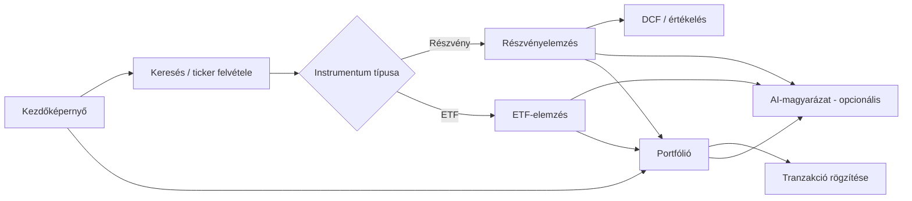

# Követelmények – Stock & ETF Analyzer

> Készült: PHASE 01, 2026-11-21. Tervezési dokumentum, még nincs mögötte kód.
> Jelölések: `[FELTÉTELEZÉS]` = dokumentált alapértelmezés, amelyet később felül kell vizsgálni. A döntési pontokat `DP-xx` jelöli (lásd [KNOWN_ISSUES.md](KNOWN_ISSUES.md#döntési-pontok)).

## 1. Termékcél

**Egy mondatban:** mobilalkalmazás (Android és iOS), amely magánbefektetőnek átlátható, reprodukálható és forrásolt elemzést ad részvényekről, ETF-ekről és a saját portfóliójáról. Minden szám mögött látszik a forrás, a lekérés ideje és az adatminőségi státusz, az AI pedig csak magyaráz, nem számol és nem dönt.

**Célfelhasználó**
- A projekt tulajdonosa, magyar magánbefektető. Az app **kizárólag saját használatra** készül (DP-02 válasz, D-008). Nyilvános kiadás nem cél.
- **Célpiacok:** US részvények és ETF-ek, európai UCITS ETF-ek és részvények, globális ETF-ek és részvények (DP-01 válasz, D-023). A lefedettség mélysége képességenként és adatcsomagonként eltér (DATA_SOURCES 6.).
- **Költségelv:** ingyenes-először, de a fizetős adat- és AI-bővítés nyitva marad (D-026, D-027).

**Mit NEM csinál az app (out of scope)**
- Nem köt üzletet, és nincs brókerintegráció.
- Nem ad valós idejű kereskedési jelzést, és nem streamel árfolyamot.
- Nem ad személyre szabott befektetési tanácsot. A BUY/HOLD/SELL jellegű címkék elemzési kategóriák.
- Nem készít adóbevallást és nem számol adót.
- Nem kezel kriptót, opciót vagy határidős terméket.

**MVP sikerkritériumok** (célértékek, nem mért adatok)
1. A megjelenített pénzügyi számok 100%-ánál lekérhető a forrás, az időpont és a státusz.
2. A számítási motor sorlefedettsége legalább 90%, minden képletnél normál és hibás bemenettel is.
3. Az app AI nélkül is teljes értékűen működik.
4. Egy cache-elt részvényelemzés 1 másodpercen belül megnyílik; hideg indításnál átlagos mobilneten 10 másodpercen belül, vagy egyértelmű részleges/hiba állapotot mutat.
5. Offline módban a korábban letöltött adat elérhető, „elavult lehet” jelöléssel.

## 2. Fő felhasználói folyamatok

### UF-01 – Ticker felvétele
1. A felhasználó beírja a tickert, a nevet vagy az ISIN-t.
2. Az app a proxyn keresztül keres. A találati lista megmutatja a típust (részvény/ETF), a tőzsdét, a pénznemet és a forrást.
3. Kiválasztás után az instrumentum bekerül a „legutóbbiak” közé, és megnyílik az elemzés.
- **Edge case-ek:** nincs találat; ugyanaz a ticker vagy ISIN több tőzsdén és devizában létezik (listing-választás kell, D-025; tipikus UCITS ETF-eknél); nem támogatott tőzsde (kiírás: „ehhez a piachoz nincs támogatott adatforrás”); rate limit; offline állapot.

### UF-02 – Részvényelemzés
1. Az app először a cache-ből tölt, majd szükség esetén frissít: profil, árfolyam, éves pénzügyi kimutatások.
2. A számítási motor kiszámolja a mutatókat. Minden mutatóhoz státusz tartozik (OK / N/A / N/M / hiányzó / kevés adat / elavult).
3. Szekciók: ár és alapadatok, értékelés, növekedés, jövedelmezőség, mérleg, cash flow, DCF, kockázat, score, AI-magyarázat.
4. Egy mutatóra koppintva látszik a képlet, a bemenetek, a forrás, az időszak és a pénznem.
5. A frissítés kézzel indítható, és látszik az utolsó frissítés ideje.

### UF-03 – ETF-elemzés
1. Az app betölti az ETF metaadatait (amennyit a forrás ad) és az ártörténetet.
2. Megjeleníti a hozamokat, a volatilitást, a max drawdownt és a költséget (TER).
3. Holdings, ország- és szektorkitettség csak akkor jelenik meg, ha van igazolt forrás. Ha nincs, az app ezt kiírja.
4. ETF-re nem számol vállalati P/E-t, DCF-et vagy részvény-score-t.
5. A TER-t és a benchmarkot a felhasználó kézzel is megadhatja. Ilyenkor a provenance `user_input`.

### UF-04 – DCF
1. Az app előtölti a bemeneteket az adatokból: aktuális FCF, részvényszám, adósság, készpénz.
2. A felhasználó szerkeszti a feltevéseket (növekedés, diszkontráta, terminális növekedés, időtáv).
3. Bear, Base és Bull forgatókönyvet futtat.
4. Kimenet: belső érték/részvény, Margin of Safety és érzékenységi tábla.
5. Érvénytelen bemenetnél (pl. diszkontráta ≤ terminális növekedés) nincs szám, csak emberi nyelvű magyarázat.

### UF-05 – Portfólió
1. A felhasználó tranzakciót rögzít: vétel, eladás, osztalék vagy díj; instrumentum, dátum, mennyiség, ár, pénznem, költség.
2. A pozíciókat az app a tranzakciókból **származtatja** (lásd D-012).
3. A kijelzés a választott pénznemben történik (HUF/EUR/USD/GBP/CHF/JPY), az FX-árfolyam dátumával.
4. Megjelenik a P/L, a súlyok, valamint az eszköztípus és pénznem szerinti allokáció.
5. Hiányzó ár- vagy FX-adatnál a pozíció „nem értékelhető” állapotba kerül, nem nulla értékbe.

### UF-06 – AI-magyarázat
> **Alapértelmezés (D-026):** ingyenes, a kliensen futó **szabályalapú összefoglaló** („Szabályalapú összefoglaló” címkével, nem AI). Az alábbi LLM-folyamat csak akkor fut, ha a felhasználó bekapcsolja.

1. A felhasználó megnyomja a „Magyarázat” gombot. Az LLM explicit felhasználói művelet, sosem fut automatikusan.
2. Az app a validált, kiszámolt eredményekből szigorú bemeneti DTO-t állít össze, és elküldi a proxynak.
3. A proxy meghívja az LLM-et strukturált (JSON séma) kimenettel, majd validálja a választ.
4. A megjelenítésen „AI-értelmezés” címke, időbélyeg és `basedOn` hivatkozások szerepelnek.
5. Ha az AI hibázik, az app egyértelmű üzenetet mutat, és minden más funkció működik tovább.
6. **Portfólió-magyarázatnál** a portfólió összetétele elhagyja az eszközt. Ehhez egyszeri, explicit beleegyezés kell (NFR-04).

## 3. Követelmények bontása

Kategóriák:
- **MVP**: a PHASE 02–13 végére kész.
- **MVP-F** (feltételes MVP): a fázis megpróbálja, de csak akkor kerül be, ha az adatforrás igazoltan támogatja.
- **v1.0**: a PHASE 14–16 végére kész.
- **Később**: a 16 fázison túl.
- **Opcionális**: csak külön döntés alapján.

| ID | Funkció | Kategória | Fázis | Megjegyzés / függőség |
|---|---|---|---|---|
| M-01 | Ticker/ISIN keresés és felvétel, listing-választással | MVP | 04, 12 | US, európai és globális instrumentumok (D-023, D-025) |
| M-02 | Profil és legutóbbi ár (késleltetett/EOD, időbélyeggel) | MVP | 04, 06 | Valós idejű ár nem cél |
| M-03 | Éves pénzügyi kimutatások (US SEC-filerek) | MVP | 04, 06 | SEC EDGAR XBRL |
| M-04 | Alap pénzügyi mutatók (margin, növekedés, FCF, adósság, ROE/ROIC stb.) | MVP | 05, 06 | Definíciók: DATA_DICTIONARY |
| M-05 | Értékelési szorzók, DCF forgatókönyvekkel és érzékenységi táblával | MVP | 05, 07 | |
| M-06 | ETF alapelemzés: ár alapú hozam, volatilitás, max DD, TER (forrásból vagy kézi bevitelből) | MVP | 08 | |
| M-07 | Portfólió: kézi tranzakciók, átlagár, P/L, súlyok, allokáció típus és pénznem szerint | MVP | 09 | Átlagár-módszer (D-012) |
| M-08 | FX: ECB referencia-árfolyamok, 6 kijelzési pénznem | MVP | 04 | Csak tájékoztató célú kijelzésre |
| M-09 | Determinisztikus score és döntés (külön részvény és ETF) | MVP | 10 | |
| M-10 | Magyarázat: ingyenes szabályalapú összefoglaló (alap) + opcionális LLM a proxyn át, strukturált kimenettel | MVP | 11 | D-026; LLM-kapcsoló a beállításokban |
| M-11 | Lokális tárolás, cache, offline olvasás | MVP | 13 | |
| M-12 | Provenance és státusz minden mutatón; jogi nyilatkozat | MVP | 03–12 | |
| M-13 | Beállítások: kijelzési pénznem, frissítés, AI be/ki | MVP | 12, 13 | |
| M-14 | Nem US instrumentumok (UCITS ETF, európai és globális részvény) **ár alapú** elemzése és portfólió-értékelése | MVP | 04B, 08, 09 | EODHD; free módban 20 hívás/nap és 1 év történet (R-22) |
| M-15 | Adatcsomag-tudatosság: a nem elérhető képesség `UNAVAILABLE (PLAN_LIMIT)` jelölése, magyarázattal | MVP | 04B, 12 | D-027 |
| F-01 | Negyedéves adatok és TTM | MVP-F | 06 | SEC-nél a Q4 származtatott (DATA_DICTIONARY 4.3) |
| F-02 | ETF holdings, ország- és szektorsúly, koncentráció | MVP-F | 08 | Nincs igazolt ingyenes forrás (R-03) |
| F-03 | Portfólió kockázat: volatilitás, korreláció, Sharpe/Sortino | MVP-F | 09 | Elég hosszú ártörténet kell |
| F-04 | Osztalékok és splitek (corporate actions) | MVP-F | 04, 06 | Szolgáltatófüggő |
| F-05 | Tracking difference / tracking error | MVP-F | 08 | Indexadat kell, valószínűleg nem elérhető |
| V-01 | Watchlist | v1.0 | 13, 14 | |
| V-02 | Összehasonlítás (részvény–részvény, ETF–ETF) | v1.0 | 14 | |
| V-03 | Szabályalapú screener (csak elérhető mezőkön) | v1.0 | 14 | Kis univerzum: watchlist és portfólió |
| V-04 | Ár- és mutatóriasztás alap (lokális) | v1.0 | 14 | Push = opcionális (O-03) |
| V-05 | Release build (Android APK/AAB, iOS ha van fiók) | v1.0 | 16 | |
| L-01 | Nem US részvény-fundamentumok és bővebb ETF-metaadat | Később (konfigurációval bekapcsolható) | 04B, 08 | Fizetős EODHD csomag kell (DP-05 nyitott, D-027) |
| L-02 | ETF look-through kitettség és overlap teljes körűen | Később | – | Holdings forrástól függ |
| L-03 | CSV import/export (tranzakciók) | Később | – | |
| L-04 | Osztaléknaptár | Később | – | |
| L-05 | Időarányos hozam (TWR) / pénzsúlyozott hozam (MWR) | Később | – | |
| O-01 | Lokális LLM | Opcionális | 11 (vizsgálat) | Hardverigény, eszközméret |
| O-02 | Felhasználói fiók, felhős szinkron, több eszköz | Opcionális | – | Backend és adatkezelési terv kell |
| O-03 | Push értesítés szerveroldali riasztással | Opcionális | – | Dev build, backend, ütemező |
| O-04 | Brókerimport | Opcionális | – | |
| O-05 | App-szintű adatbázis-titkosítás (SQLCipher) | Opcionális | 13 | Expo Go-ban nem elérhető (DATA_SOURCES 9) |
| O-06 | Webes verzió | Opcionális | – | |

## 4. Nem funkcionális követelmények

| ID | Terület | Követelmény |
|---|---|---|
| NFR-01 | Helyesség | A pénzügyi képletek UI-tól független, tiszta függvények, unit tesztekkel. Ugyanaz a bemenet mindig ugyanazt a kimenetet adja. |
| NFR-02 | Átláthatóság | Minden megjelenített értékhez tartozik provenance (forrás, időpont, időszak, pénznem, egység, típus, frissesség). |
| NFR-03 | Biztonság | Az alkalmazás titkos kulcsa nem kerül a mobilkliensbe és nem kerül verziókezelésbe. Külső adat csak futásidejű validáció után használható. |
| NFR-04 | Adatvédelem | A portfólió az MVP-ben csak az eszközön tárolódik. Szerverre csak felhasználói kérésre, AI-magyarázathoz kerül, és csak explicit beleegyezés után. A naplóban nincs portfólióadat. |
| NFR-05 | Teljesítmény | Lásd a sikerkritériumokat. Nincs adatlekérés render közben; párhuzamos, deduplikált lekérések. |
| NFR-06 | Offline | Cache-ből olvasható, elavult-jelöléssel. Offline is rögzíthető tranzakció. |
| NFR-07 | Akadálymentesség | Accessibility label, elegendő kontraszt, dinamikus betűméret, legalább 44×44 pt érintési felület. A státuszt nem csak szín jelzi. |
| NFR-08 | Lokalizáció | A UI nyelve magyar (D-019). A számformázás `Intl` alapú (hu-HU alapértelmezés). A szövegek központilag vannak kezelve. |
| NFR-09 | Karbantarthatóság | TypeScript strict, nincs `any`, rétegszabályokat ellenőrző lint, kis komponensek, nincs duplikált üzleti logika. |
| NFR-10 | Költség | A cél 0 Ft fix havi költség (ingyenes adatcsomagok, szabályalapú magyarázat, ingyenes hosting-keret). A fizetős adat és az LLM opcionális, konfigurációval bekapcsolható (D-026, D-027). |
| NFR-11 | Megfelelés | Jól látható jogi nyilatkozat („nem befektetési tanács”). A becslés és az AI-értelmezés mindig jelölve van. |
