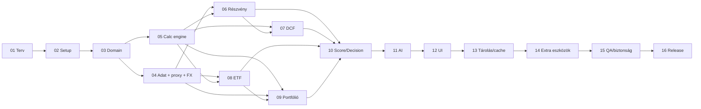

# Roadmap – Stock & ETF Analyzer

> Frissítve: 2026-11-22 (PHASE 10 vége). Minden fázis külön chatben fut, a `stock_etf_analyzer_prompts` csomag `NN_*.md` promptja alapján.
> **Fázisszabály:** a következő fázis csak akkor indul, ha az előző befejezési feltételei teljesültek, vagy a hiányok a KNOWN_ISSUES-ban dokumentálva vannak.
> **Verzió:** a promptok egy része SDK 57-et említ. Mindenhol **SDK 58** értendő (D-020).

## Állapot

| # | Fázis | Állapot | Mérföldkő |
|---|---|---|---|
| 01 | Követelmények és architektúra | **KÉSZ** (2026-11-21) | – |
| 02 | Projekt setup | **KÉSZ** (2026-11-21) | **M1 Futó váz ✅** |
| 03 | Architektúra és domain modell | **KÉSZ** (2026-11-21) | |
| 04 | Adatforrások, proxy és deviza – **két chatben: 04A + 04B** (D-028) | **KÉSZ** (04A és 04B, 2026-11-21) | **M2 Adat a csövön ✅** |
| 05 | Pénzügyi calculation engine | **KÉSZ** (2026-11-22) | |
| 06 | Részvény fundamentális elemzés | **KÉSZ** (2026-11-22) | |
| 07 | Értékelés és DCF | **KÉSZ** (2026-11-22) | |
| 08 | ETF-elemzés | **KÉSZ** (2026-11-22) | |
| 09 | Portfólió és kockázat | **KÉSZ** (2026-11-22) | |
| 10 | Score és döntési engine | **KÉSZ** (2026-11-22) | **M3 Elemzőmotor kész ✅** |
| 11 | AI-magyarázó engine | **KÖVETKEZIK** | |
| 12 | UI/UX és navigáció | NEM KEZDŐDÖTT | |
| 13 | Tárolás, cache, offline | NEM KEZDŐDÖTT | **M4 MVP** |
| 14 | Compare, watchlist, screener, alerts | NEM KEZDŐDÖTT | |
| 15 | Integráció, QA, biztonság | NEM KEZDŐDÖTT | |
| 16 | Release és dokumentáció | NEM KEZDŐDÖTT | **M5 v1.0 (személyes)** |

## Függőségi gráf

A promptcsomag szigorúan sorban halad (01 → 16). A gráf azt mutatja, mi mire épül valójában. Ebből látszik például, hogy a 05 elvben a 04-gyel párhuzamosan is mehetne. A sorrendet ettől függetlenül tartjuk.

## Fázisonkénti terv

Minden fázis közös lezárása (CLAUDE.md):
- lint, typecheck és tesztek futtatása, a valós eredmény rögzítése;
- a `PROJECT_STATE`, `ROADMAP`, `KNOWN_ISSUES` (és szükség esetén a `DECISIONS`) frissítése;
- `docs/handoffs/phase-XX-handoff.md` és `docs/phases/phase-XX-*.md` elkészítése.

---

### PHASE 02 – Projekt setup
- **Cél:** induló, ellenőrzött Expo SDK 58 + TS strict + Expo Router váz, git, minőségi eszközök, Android emulátoros futtatás.
- **Benne:**
  - Az SDK 58 sablon **explicit** kiválasztása (a `create-expo-app` alapból SDK 57-et adhat, D-002).
  - Node v26.10.0 ellenőrzése.
  - `git init` és első commit; `.gitignore` (`.env*`, kivéve `.env.example`).
  - ESLint (Expo konfiguráció) és Prettier.
  - `typecheck`, `lint`, `test` npm scriptek.
  - Jest 30 + `jest-expo` + RNTL ≥14 és egy smoke teszt.
  - Alap theme és egy kezdőképernyő.
  - `.env.example` titok nélkül.
  - `ANDROID_HOME` és PATH (`platform-tools`) beállítási útmutató Windowsra.
  - README.
  - Az ARCHITECTURE 5. mappaszerkezet üres vázának igazítása a sablonhoz.
- **Nincs benne:** domainmodellek, proxy-végpontok, szolgáltatók, tárolás, pénzügyi képernyők.
- **Függ:** PHASE 01.
- **Befejezési feltétel:**
  - Az app elindul az Android emulátoron, vagy a környezeti akadály pontosan dokumentált.
  - A `npm run typecheck`, `npm run lint` és `npm test` lefut, a kimenet rögzítve.
  - A `npx expo install --check` és a `npx expo-doctor@latest` lefutott, vagy indokolt, miért nem.
  - Az első commit létezik.
  - A tényleges React/RN verziók a DECISIONS D-001-ben.
- **Eredmény (2026-11-21): KÉSZ.** Minden feltétel teljesült:
  - Emulátoron fut: Expo Go 58.0.5, `Medium_Phone_API_37.0`, világos és sötét mód.
  - typecheck ✅, lint ✅, format ✅, teszt 15/15 ✅.
  - `expo install --check` ✅; `expo-doctor` 20/20 ✅.
  - Első commit ✅; D-001 frissítve.
  - Új döntések: D-029…D-034. Részletek: `docs/handoffs/phase-02-handoff.md`.
  - Tabos főnavigáció helyett egyszerű Stack készült (D-034, a tabok a PHASE 12-ben).
  - A sablon nem használt függőségei megmaradtak (KI-06).

### PHASE 03 – Architektúra és domain modell
- **Cél:** szigorúan típusos domain, hibakezelés és rétegszabályok működő példával.
- **Benne:**
  - `Instrument` (diszkriminált unió: `stock` | `etf`), `Quote`, `PriceSeries`, `FinancialStatement`, `FinancialMetric`, `FxRate`, `Portfolio`, `Position`, `Transaction`, `AnalysisResult`, `DataProvenance`, `Metric<T>`, `Result`/`AppError`.
  - Zod bevezetése (D-014) és a `src/contracts` váza.
  - Portok (`MarketDataGateway`, `FxGateway`, `AiGateway`, `*Repository`, `Clock`, `Logger`).
  - Composition root.
  - ESLint rétegszabályok, demonstrált tiltással.
  - Egy példa use case in-memory repository-val, teszttel.
  - **A PHASE 02-ből örökölt kapcsolódási pontok:**
    - a rétegszabályok az `eslint.config.js`-be kerülnek (a `no-floating-promises` és a típusinformációs lint már működik);
    - az `src/config/env.ts` kézi validációja zodra cserélhető;
    - az `about.tsx` most közvetlenül importálja a `publicEnvResult`-ot; a composition root után ez is Contexten át érkezhet.
- **Nincs benne:** valós API, képletek, proxy-végpontok, képernyők.
- **Függ:** 02.
- **Befejezési feltétel:**
  - A typecheck és a tesztek zöldek (valós kimenettel).
  - Képernyőben nincs hálózati hívás.
  - Az ARCHITECTURE és a DATA_DICTIONARY a tényleges kódhoz igazítva.
- **Eredmény (2026-11-21): KÉSZ.**
  - Domain: minden kért modell (+ `PriceSeries`, `Listing`, `Metric<T>`), validált konstruktorokkal.
  - `Result`/`AppError` (10 hibafajta).
  - zod 4.6.7 + `src/contracts` váz.
  - 4 port, 2 use case, composition root, `AppServicesProvider`.
  - ESLint rétegszabályok, 8 szándékos hibával igazolva.
  - `npm run check` exit 0; tesztek **98/98**; `expo export` (Android) OK.
  - Új döntések: D-035…D-041.
  - **Eltérés a tervtől:** `FxGateway`, `AiGateway`, `Logger` port nem készült (nincs még használója, D-040); az `env.ts` nem került át zodra (D-039).
  - **Lelet:** a PHASE 02 route-tesztjei kisbetűs `c:\` munkakönyvtárból pirosak voltak (KI-11, javítva: D-041).
  - Részletek: `docs/handoffs/phase-03-handoff.md`.
- **A PHASE 04A kapcsolódási pontjai (PHASE 03-ból):**
  - `MarketDataGateway` port (`src/application/ports`). A kliensoldali `ProxyMarketDataGateway` ezt valósítja meg, és a `src/config/container.ts`-ben váltja a `notImplementedMarketDataGateway`-t.
  - `parseApiResponse(json, schema)` + `quoteDtoSchema` + `quoteFromDto` (`src/contracts`) a proxyválasz validálásához; a proxy ugyanezt a sémát használja kimenetként.
  - Hibák: a hálózati, timeout és 429 hibák az `AppErrors.network/timeout/rateLimited` konstruktorokkal képezhetők le.
  - ESLint: a `src/app/api/**` és a `src/server` számára új zóna kell (D-038 következmények). A `no-restricted-globals` már kihagyja a `src/app/api/**`-t.
  - Az `FxGateway` portot a 04A vezeti be, az első használójával együtt.

### PHASE 04 – Adatforrások, proxy és deviza (két chatben, D-028)
- **Cél:** valós, validált, normalizált adat a proxyn keresztül, a három célpiacra (US, Európa, globális – D-023), FX-szel, élő API-tól független tesztekkel.
- **Előfeltétel:**
  - DP-01…DP-03 megválaszolva (2026-11-21).
  - A tulajdonos az FMP és EODHD kulcsát **a PHASE 04B elején, a `.env.local` fájlba** írja, nem a chatbe.
  - A SEC User-Agent kapcsolattartó címet is ő adja meg.
- **Közös (mindkét részre):** szolgáltatói DTO sémák, normalizálók, contract DTO-k; hibatérképezés (timeout, 429, 402, hibás ticker, hibás JSON, offline); „hiányzó ≠ 0” tesztek.
- **Nincs benne:** a végleges cache policy (13), pénzügyi mutatók (05), képernyők (12), magyarázat (11).
- **Függ:** 03.

#### 04A – Proxy váz és ingyenes alapforrások
- **Benne:**
  - Proxy váz (API routes, `web.output`, `/api/v1/health`).
  - D-004 spike: lokális futás, opcionális EAS Hosting próbatelepítés, a rate-limit/KV képesség felmérése (U-03).
  - `MarketDataProvider` port.
  - `sec-edgar` adapter (companyfacts, ticker → CIK), legalább 10 US cég fixture-jével.
  - `ecb-fx` adapter (Frankfurter v2 ECB provider).
  - `openfigi` adapter (ISIN → listingek).
  - `mock` adapter.
  - `FxService` (natív vs kijelzési pénznem).
  - Kliensoldali `ProxyMarketDataGateway` és mock gateway.
  - `/securities/{isin}/listings`.
- **Befejezési feltétel:**
  - Az ingyenes adapterek validáltak és teszteltek.
  - A proxy lokálisan fut.
  - A spike eredménye a D-004-ben.
  - Átadás: `docs/handoffs/phase-04a-handoff.md`.
- **Eredmény (2026-11-21): KÉSZ.**
  - Proxy váz: 5 API route (`health`, `fx`, `securities/{isin}/listings`, `stocks/{id}/financials`, `instruments/{id}/quote`), hosztfüggetlen handlerek, kimenet-önellenőrzés a közös contract-sémával (D-044).
  - `MarketDataProvider` szerződés (képességenként külön metódus, `capabilitiesOf`), `ProviderRegistry` live XOR mock (D-045).
  - Adapterek: `sec-edgar` (12 valós cég fixture-je, D-043), `ecb-fx`, `openfigi` (igazolt exchCode → MIC, D-042), `mock`.
  - Kliens: `ProxyMarketDataGateway`, `ProxyFxGateway`, proxy HTTP-kliens; `FxGateway` port; use case-ek: `convertMoney` (FxService, D-046), `getSecurityListings`, `getFinancialStatements`.
  - Spike: lokálisan igazolva, EAS-próbatelepítés nem készült; U-03 megválaszolva (D-004 frissítve).
  - Ellenőrzés: `npm run check` exit 0, **228/228 teszt** (19 suite); `expo export` web (szerver-bundle) és Android OK; a kliens-bundle-ben nincs szerverkód és titok.
  - Új döntések: D-042…D-048. Új ismert problémák: KI-17…KI-29.
  - **Eltérés a tervtől:** a `/search` végpont a 04B-be került (FMP/EODHD kereső kell hozzá).
- **A PHASE 04B kapcsolódási pontjai (PHASE 04A-ból):**
  - Új adapterek: `src/server/providers/fmp/`, `src/server/providers/eodhd/` – a `MarketDataProvider` metódusait valósítják meg (`getQuote`, `getPriceHistory`, …); profil/osztalék/ETF-metódus a saját domain-típusával együtt kerül be.
  - A `findProvider` (első találat) helyére a `ProviderRouter` jön (`src/server/routing/`), a regiszter `providers` listájára építve.
  - Env: `FMP_API_KEY`, `EODHD_API_KEY`, `FMP_PLAN`, `EODHD_PLAN` → `src/server/env.ts` bővítése (érték soha nem kerül naplóba vagy health-válaszba).
  - A `ListingCandidate.tradingCurrency` kitöltése és az ISIN → US listing (KI-21, KI-22).
  - Hibák: a 402 már `RATE_LIMITED`-re képződik; a `QUOTA_EXHAUSTED`/`PLAN_LIMIT` megkülönböztetéséhez a `CAPABILITY_UNAVAILABLE` mellé új kód vagy `unavailableReason` mező kellhet (contract-bővítés, visszafelé kompatibilisen).
  - Tesztminta: `fakeFetch` + `loadFixture` (`src/server/testing/test-helpers.ts`), és a végponttól végpontig minta (`src/__tests__/proxy-integration.test.ts`).

#### 04B – FMP, EODHD, routing és kvóta
- **Benne:**
  - `fmp` és `eodhd` adapter.
  - A csomagszint felderítése (U-13: EODHD `/api/user` 0 hívás; FMP dashboard és próbahívás).
  - Képességmátrix `FMP_PLAN`/`EODHD_PLAN`-ből.
  - `ProviderRouter` a DATA_SOURCES 5.2–5.3 szerint.
  - Kvóta-költségvetés (EODHD hívásköltség-tábla) és `/providers/status`.
  - `UNAVAILABLE (PLAN_LIMIT | NOT_COVERED | QUOTA_EXHAUSTED)` státuszok.
  - Fixture: legalább 3 UCITS ETF (többlistinges, GBX) és 3 nem US részvény.
  - A DATA_SOURCES véglegesítése (ToS, attribúció, igazolt keretek).
- **Befejezési feltétel:**
  - Minden külső válasz validált; teszt nem hív élő API-t.
  - Kulcs csak szerver env-ben (a repóban `grep`-pel ellenőrizve).
  - A routing és a fallback tesztelt (beleértve a 402/429 esetet).
  - Fizetős csomagra váltás csak env-módosítást igényel (teszttel demonstrálva).
  - Átadás: `docs/handoffs/phase-04-handoff.md`.
- **Eredmény (2026-11-21): KÉSZ.**
  - Csomagszint (U-13): mindkét kulcs **free**. Az FMP free csak US (annak is egy része); az EODHD free 20 hívás/nap, 1 év történet, fundamentum nélkül. Élő próbák: DATA_SOURCES 11.
  - Adapterek: `fmp` (quote, ártörténet 3 korrekcióval, profil, osztalék, keresés), `eodhd` (quote, ártörténet, osztalék, keresés ISIN-nel is, ISIN → jegyzések pénznemmel).
  - `ProviderRouter` (D-049), csomagmátrix `FMP_PLAN`/`EODHD_PLAN`-ből (D-051), napi kvóta-őr prioritással, `UNAVAILABLE` hibafajta + `unavailableReason` (D-053).
  - Új végpontok: `prices`, `profile`, `dividends`, `search`, `providers/status` (összesen 10). Kliens: 4 új use case frissesség-számítással.
  - Fixture: 3 UCITS ETF (VWCE, IWDA, ISF – GBX) és 4 nem US részvény (SAP, ASML, NESN – CHF, OTP – HUF), valamint FMP: AAPL (quote, profil, osztalék), SPY (ETF, NYSE Arca), NVDA (split, 3 korrekció), keresés (ISF, SAP).
  - Ellenőrzés: `npm run check` exit 0, **337/337 teszt** (25 suite); élő füstpróba a 8083-as porton; Android- és web-export szkennelve (nincs titok, a kliens-bundle-ben nincs szolgáltatói kód); repó-szkenner: 0 találat.
  - Új döntések: D-049…D-054. Új ismert problémák: KI-30…KI-41.
  - **Eltérés a tervtől:** `prices?adjusted` helyett `adjustment=none|split|split_dividend`; `corporate-actions` helyett `dividends` (split nincs bekötve); EAS-próbatelepítés továbbra sincs (tulajdonosi döntés, KI-29).
- **A PHASE 05 kapcsolódási pontjai (PHASE 04-ből):**
  - A képletek bemenete domain-típus: `FinancialStatementSet` (SEC, `Metric` `MISSING`/`OK`), `PriceSeries` (`adjustment`!), `DividendHistory` (eseményenkénti pénznem!), `Quote`, `FxConversion`.
  - Hozamhoz: `SPLIT_DIVIDEND` sorozat = total return; `SPLIT` = árhozam. Különböző korrekciójú sorozatot nem szabad keverni.
  - Osztalékhozamhoz az osztalék és az ár pénznemét egyeztetni kell (ISF: GBP osztalék vs. GBX ár → `toMajor`).
  - A `src/calculations/` mappa még nem létezik (az ESLint-szabályokban a `./calculations` réteg már szerepel).

### PHASE 05 – Pénzügyi calculation engine
- **Cél:** tiszta, dokumentált, tesztelt képletkönyvtár.
- **Benne:** a 05-ös prompt teljes képletlistája a DATA_DICTIONARY 5. definíciói szerint. Edge case-ek: 0-val osztás, nullás bázis, negatív EPS/FCF/equity, `NaN`/`Infinity`, százalék vs tört. N/M státuszok. A közös DCF-konvenciók előkészítése.
- **Nincs benne:** a teljes DCF (07), score (10), UI-formázás.
- **Függ:** 03 (domain típusok).
- **Befejezési feltétel:**
  - Minden képletre van normál és hibás bemenetes teszt.
  - A modul nem importál RN-t, UI-t vagy hálózatot.
  - A DATA_DICTIONARY definíciói véglegesek.
  - Lefedettség ≥ 90% (mért érték rögzítve).
- **Eredmény (2026-11-22): KÉSZ.**
  - `src/calculations/` (D-055): szám-szintű, tiszta képletek `CalcResult` kimenettel + `Metric`-adapter (`calculateMetric`, `preferReported`, `toFinancialMetric`, `METRIC_DEFINITIONS`).
  - A 05-ös prompt teljes képletlistája: jövedelmezőség, EPS-választás, növekedés, CAGR, ROE/ROA/ROIC, NOPAT, DOL; nettó adósság, D/E, FCF-család, EBITDA; piaci érték, EV, P/E, P/FCF, P/S, P/B, EV/EBITDA, PEG, osztalék- és FCF-hozam (TTM osztalék pénznem-egyeztetéssel), MOS; reálhozam, EPS × P/E felbontás, elvárthozam-modell; drawdown/recovery, TER, tracking difference/error, total return, rendszeres befizetés FV; portfóliósúly, súlyozott hozam. DCF-konvenciók: `discountFactor`, `presentValue`, `gordonTerminalValue` (D-057).
  - DATA_DICTIONARY 5. fejezet **végleges** (D-056, D-058), új 12. fejezet (motor-konvenciók).
  - Ellenőrzés: `npm run check` exit 0; **553/553 teszt** (38 suite); lefedettség `src/calculations`: **99,56% sor, 97,91% ág, 100% függvény**.
  - Rétegszabály: ESLint-zóna + `src/__tests__/calculations-purity.test.ts`.
  - Új döntések: D-055…D-058. Új ismert problémák: KI-42…KI-49.
- **A PHASE 06 kapcsolódási pontjai (PHASE 05-ből):**
  - Kimutatás-tétel (`Metric<number>`) → `calculateMetric({ … }, { … }, képlet, { unit, calculatedAt, period })` → `toFinancialMetric(id, …, period)`.
  - Jelentett elsőbbség: `preferReported(lineItems.grossProfit, () => calculateMetric(…))`; EPS: `selectEps` (a `basis` a címkéhez).
  - N éves trend/CAGR: `cagrOverYears([{ fiscalYear, value | null }], N)`.
  - **Teendő:** a `totalDebt` összerakása (KI-42), Q4/TTM és YTD-különbség (D-021, KI-18/19) – ezek nélkül a mérleg-alapú mutatók `MISSING`-ek maradnak.

### PHASE 06 – Részvény fundamentális elemzés
- **Cél:** `analyzeStock` use case: alapadatok, kimutatások, mutatók, trendek, provenance.
- **Benne:**
  - Éves (és ha igazolt, negyedéves/TTM) normalizált kimutatásmodell.
  - 1/3/5/10 éves trend és CAGR csak összehasonlítható adattal.
  - Időszak-, split- és restatement-szabályok (D-021).
  - Kvalitatív témák adatmodellje `Insufficient Data` állapottal, score nélkül.
- **Nincs benne:** pontozás (10), teljes UI (12).
- **Függ:** 04, 05.
- **Befejezési feltétel:**
  - Tesztek: hiányos történet, negatív EPS, hiányzó mező, eltérő pénzügyi év.
  - Nincs fiktív pótlás.
  - Az elavultság és a hiány tesztelt.
- **Eredmény (2026-11-22): KÉSZ.**
  - Use case: `analyzeStockFundamentals` (`AppServices`), a meglévő use case-ekre építve, részleges hibatűréssel (D-063/5).
  - `totalDebt` összerakva a SEC-adapterben (D-059, KI-42 megoldva); a fixture-ök csak új tagekkel bővítve (`--add-new-tags`).
  - Kimutatás-nézetek (éves/negyedéves), Q4-származtatás, TTM (D-060); időszaki mutatók; 1/3/5/10 éves CAGR összehasonlíthatósági ellenőrzéssel, split-gyanúval (D-061); értékelés aktuális ár + legutóbbi FY alapon, szolgáltatói béta, 52 hetes tartomány (D-062); minőségi modell pontszám nélkül, MOAT/MANAGEMENT csak forrásolt lelettel (D-063); `MetricOrigin` eredet-címke.
  - Ellenőrzés: `npm run check` exit 0; **661/661 teszt** (48 suite; +108); az új modulok lefedettsége ~97% sor.
  - **Nem készült el:** Q2/Q3 YTD cash flow különbségképzés (KI-18, a normalizáló bővítését igényli); FX-átváltás a szorzókhoz (KI-50).
  - Új döntések: D-059…D-063. Új ismert problémák: KI-50…KI-57.
- **A PHASE 07 kapcsolódási pontjai (PHASE 06-ból):**
  - DCF-bemenetek: `analysis.periodMetrics.annual` (FCF, `totalDebt`, `cashAndEquivalents`, `sharesOutstanding`, növekedés), `analysis.overview.price`, `analysis.trends` (FCF/árbevétel CAGR – csak `OK` esetén). A becsült (`estimated`) adósság eredete öröklődjön a DCF-be.
  - Szorzók: a `valuation` FY-alapú (D-062); TTM-alapú szorzó és FX-átváltás (KI-50, KI-52) a PHASE 07 döntése.
  - Minden feltevés `user_input`/`estimated` eredettel, a `createFundamentalMetric` mintájára.

### PHASE 07 – Értékelés és DCF
- **Cél:** külön valuation/DCF modul forgatókönyvekkel és érzékenységi táblával.
- **Benne:**
  - Szorzók (Forward P/E csak igazolt forrással).
  - DCF a D-022 szerint, `r > g` validációval.
  - Bear/Base/Bull.
  - Érzékenységi tábla ugyanazzal az engine-nel.
  - MOS-definíció.
  - Konfigurálható értékelési küszöbök.
  - Magyarázható output.
- **Nincs benne:** UI, score.
- **Függ:** 05, 06.
- **Befejezési feltétel:**
  - Normál, boundary és invalid tesztek.
  - Nincs DCF-számítás UI-komponensben.
  - Minden feltevés az outputban látszik.
- **Eredmény (2026-11-22): KÉSZ.**
  - Motor (`src/calculations/valuation/`): `runDcf` (explicit évek PV-je, Gordon TV, PV_TV, EV, equity, IV/részvény, MOS), `runDcfScenarios` (Bear/Base/Bull), `dcfSensitivityTable` + `sensitivityAxis` (minden cella `runDcf`), `valuation-bands.ts` (konfigurálható MOS- és szorzó-küszöbök) – D-064, D-065.
  - Alkalmazás (`src/application/valuation/`): DCF-bemeneti modell forrással/eredettel/időszakkal és felülírással; kiinduló feltevések (alapeset 5 év, 3 éves támogatott); magyarázható kimenet (képletek, konvenciók, történeti kontextus, időbélyegek, figyelmeztetések, nyilatkozat); megjelenítési javaslat hamis pontosság nélkül.
  - Use case-ek: `analyzeStockValuation`, `recalculateStockValuation` (`AppServices`). Forward P/E új mutató, csak forrásolt előrejelzésből (ma `MISSING`).
  - Őrteszt: `src/app` és `src/presentation` nem hív DCF-függvényt.
  - Ellenőrzés: `npm run check` exit 0; **783/783 teszt** (52 suite; +122); új motor 100% sor, új alkalmazási modulok ~97% sor.
  - **Nem készült el (tudatosan):** FX-átváltás a szorzókhoz/MOS-hoz (KI-50 → 09), TTM-szorzók (KI-52, elvetve), WACC/CAPM (KI-59), EV-bővítés (KI-44), UI (12).
  - Új döntések: D-064, D-065 (D-022 véglegesítve). Új ismert problémák: KI-58…KI-64.
- **A későbbi fázisok kapcsolódási pontjai (PHASE 07-ből):**
  - PHASE 10 (score): `valuation.dcf.scenarios[].category` és `valuation.multiples.bands` – mindkettő küszöbbel és nyilatkozattal; a score súlyozása ne kezelje ezeket objektív igazságként.
  - PHASE 11 (AI): a `valuation.explanation` (képletek, konvenciók) és a `warnings` adható át magyarázatra; számot az AI nem állíthat elő.
  - PHASE 12 (UI): `recalculateStockValuation(fundamentals, options)` a feltevés-szerkesztőhöz; megjelenítéshez a `display` mezők; a feltevések mindig az eredmény mellett.

### PHASE 08 – ETF-elemzés
- **Cél:** ETF-specifikus modell és use case, a részvénylogikától elválasztva.
- **Benne:**
  - ETF-mezők (DATA_DICTIONARY 6.).
  - Hozam, total vs price return jelölés.
  - Volatilitás, max DD, (beta/Sharpe/Sortino megfelelő adattal).
  - TER költség; tracking csak indexadattal.
  - Hedged/unhedged és pénznem-kitettség.
  - Holdings-alapú mutatók csak igazolt forrással; a SEC N-PORT vizsgálata. Az EODHD/FMP ETF-adatai a képességmátrix szerint (free-ben részleges, fizetősben bővebb).
  - UCITS-sajátosságok: több listing (D-025), GBX, acc/dist, domicil. A free EODHD 1 éves története miatt a hosszabb mutatók `INSUFFICIENT_DATA`.
  - ETF-score feature-modell (súlyozás nélkül).
- **Nincs benne:** a végleges ETF-score (10), overlap UI (14).
- **Függ:** 04, 05.
- **Befejezési feltétel:**
  - Tesztek: részleges holdings, hiányzó TER, eltérő időszak, dist/acc, hedged.
  - A lefedettségi korlátok láthatók.
- **Eredmény (2026-11-22): KÉSZ.**
  - Domain (`src/domain/etf/`): `EtfProfile` (jegyzés-szintű, minden forrásfüggő mező `Metric`), `EtfClassification` (régió, eszközosztály, méret, stílus, osztalékfókusz, súlyozás), `EtfHoldingsSnapshot` (validált, részleges/teljes).
  - Motor: `risk.ts` (volatilitás, downside deviation, Sharpe, Sortino, béta, dátum-igazítás – D-066), `etf/holdings.ts` (top N, HHI, effektív N, kitettség-bontás), `etf/exposure.ts` (régió-levezetés, devizakockázat) – D-067, D-068.
  - Alkalmazás (`src/application/etf-analysis/`): validált kézi metaadat, hozam (price vs total return, acc/dist módszer, összehasonlítási alap), kockázat, tracking (csak TR indexszel, közös ablakon), költség, holdings, deviza (jegyzési vs. mögöttes, hedged), feature-modell súlyozás nélkül, mezőnkénti lefedettség, P/E/DCF `notApplicable` – D-069.
  - Use case: `analyzeEtf` (`AppServices`). Őrteszt: az ETF- és a részvénylogika külön.
  - SEC N-PORT: élő próbával igazolva (DATA_SOURCES 13.2); adapter nem készült (KI-66).
  - Ellenőrzés: `npm run check` exit 0; **927/927 teszt** (59 suite; +144, a D-070 címkével együtt); az új modulok ~99% sor.
  - **Nem készült el (tudatosan):** N-PORT adapter (KI-66), volumen/likviditás (KI-67), indexforrás (KI-69), ETF-metaadat forrás (KI-65), végleges ETF-score (10), overlap (14), UI (12).
  - Új döntések: D-066…D-069. Új ismert problémák: KI-65…KI-73.
- **A későbbi fázisok kapcsolódási pontjai (PHASE 08-ból):**
  - PHASE 09 (portfólió): a `risk.ts` függvényei (volatilitás, drawdown, béta, `alignByDate`) portfólió-idősorra is használhatók; az ETF look-through a `EtfHoldingsSnapshot`-ból (csak forrással).
  - PHASE 10 (score): `EtfAnalysis.features` (csoport, irány, érték vagy hiány oka, `groupCoverage`) – súlyozás és küszöb ott készül; a hiányzó feature ne számítson 0-nak.
  - PHASE 12 (UI): ETF-metaadat kézi beviteli űrlap (`EtfMetadataInput`, a validációs hibák mezőútvonallal jönnek); a `coverage.limitations` és a `returns.comparisonBasis` mindig látható legyen.
  - PHASE 13 (cache/adat): proxy-cache (KI-68), volumen a `PricePoint`-ba (KI-67), kibocsátói holdings-fájl import (KI-74, D-071 – a N-PORT adapter helyett).
  - Lezárás utáni döntések (2026-11-22, tulajdonosi jóváhagyás): D-070 kockázati megbízhatósági címke (a 126-os minimum marad, ≥ 240 standard) – **megvalósítva**; D-071 N-PORT helyett holdings-fájl import – tervezve (PHASE 13).

### PHASE 09 – Portfólió és kockázat
- **Cél:** tranzakcióalapú portfólió, többdevizás értékelés, kitettség és koncentráció.
- **Benne:**
  - D-012 (származtatott pozíció, átlagár).
  - P/L két nézetben (DATA_DICTIONARY 7.).
  - Allokáció típus, pénznem és (ha van metaadat) ország/szektor szerint.
  - Koncentrációs mutatók.
  - Historikus elemzés csak elég idősorral.
  - Tranzakció-validáció.
  - ETF overlap adatmodell.
  - **In-memory repository** (a tartós tárolás a 13-ban jön).
- **Nincs benne:** tartós tárolás, képernyő, overlap UI.
- **Függ:** 04 (FX), 05, 08.
- **Befejezési feltétel:**
  - Minden összesítés visszavezethető tranzakciókra.
  - Tesztek: vegyes deviza, súlyszámítás, hiányzó ár/FX.

- **Eredmény (2026-11-22): KÉSZ.**
  - Domain: `validateTransactionLedger` (túladás, duplikált/ellentmondó tranzakció, hiányzó pénznem, hibás FX-irány; időrend), `PortfolioAssetMetadata`; a `Position` számított kimenet lett (`PositionAnalysis`).
  - Motor: `averageCostLedger` (átlagár, D-012 → Elfogadva), `timeWeightedReturn` (TWR), `holdingsOverlap`; a kockázat a meglévő `risk.ts`/`drawdown.ts`/`holdings.ts` függvényekkel (nem másolva).
  - Alkalmazás (`src/application/portfolio/`): két P/L-nézet (natív / bázis, árhatás + FX-hatás), ráta-elsőbbség (rögzített → ECB ügyleti napi → hiány), súlyok, visszakövethető összesítések (`components`, `missing`, `availableSum`), kitettség közvetlen és look-through nézetben, koncentráció (top N, HHI, egyedi részvény ISIN szerint, szektor/ország), historikus TWR + kockázat (tényleges mennyiségekből, nem a mai súlyokból), korreláció, ETF-átfedés adatmodell.
  - Use case: `analyzePortfolio` (`AppServices`); a `recordTransaction` a meglévő naplóval együtt validál (túladás elutasítva).
  - Ellenőrzés: `npm run check` exit 0; **1011/1011 teszt** (66 suite; +84); az új modulok 97,3% sor, a motor 100%.
  - **Nem készült el (tudatosan):** tartós tárolás (13), képernyő (12), teljes ETF-összehasonlítás (14), napi FX-idősor végpont (KI-77), FIFO/adó (KI-79), készpénzszámla és IRR (KI-78).
  - Új döntés: D-072. Új ismert problémák: KI-76…KI-82.
- **A későbbi fázisok kapcsolódási pontjai (PHASE 09-ből):**
  - PHASE 10 (score): `PortfolioAnalysis.concentration` (top N, HHI, egyedi részvény, szektor/ország), `exposures` (`uncoveredWeight` = adathiány, nem 0), `history` mutatói a `reliability` címkével; a portfólió-szintű döntés (pl. túlkoncentráció-jelzés) küszöbei ott készülnek.
  - PHASE 12 (UI): két P/L-nézet jelölve (natív / bázis + FX-dátum), `accountingMethod.taxWarning`, `validation.issues` mezőnként, a `missing` pozíciók és `limitations` mindig láthatók; tranzakció-űrlap a `recordTransaction` VALIDATION hibáival.
  - PHASE 13 (tárolás/cache): SQLite `PortfolioRepository` (a port változatlan), proxy-cache (KI-76), FX-idősor végpont (KI-77), holdings-fájl import (KI-74 → look-through).
  - PHASE 14: ETF-összehasonlítás az `EtfOverlapModel` / `holdingsOverlap` alapján.

### PHASE 10 – Score és döntési engine
- **Cél:** konfigurálható, determinisztikus, visszakövethető pontozás és döntés.
- **Benne:**
  - Külön részvény- és ETF-score.
  - Súlyok konfigurációban, automatikus összegellenőrzéssel.
  - Kategóriánkénti indoklás.
  - Hiányzó adat kezelése dokumentált stratégiával (nem 0).
  - Többdimenziós döntés.
  - `AnalysisConfidence`.
  - Thesis risks és invalidálók.
  - Regressziós tesztek.
- **Nincs benne:** AI, UI.
- **Függ:** 06, 07, 08, 09.
- **Befejezési feltétel:**
  - Ugyanarra a bemenetre ugyanaz a kimenet (teszttel bizonyítva).
  - Hiányzó adat nem ad csendes pontot.
  - A DECISIONS frissítve a súlyokkal.
- **Eredmény (2026-11-22): KÉSZ.**
  - Új réteg: `src/scoring` (tiszta szabálymotor, csak `domain` + `calculations`; ESLint-zóna + őrteszt) – D-073.
  - Két elkülönített rendszer egy motorral: részvény-score (8 kategória; MOAT 0 súllyal, indokkal) és ETF-score (9 kategória); a keverés `VALIDATION` hibát ad.
  - Súlyok és horgonyok konfigurációban (`src/scoring/config/`), automatikus súlyösszeg- és szabályellenőrzéssel minden futáskor.
  - Kategóriánként: pont, súly, effektív súly, lefedettség, alkalmazott mutatók, szabály, indoklás, hiányok, adatminőség, frissesség.
  - Hiányzó adat: kimarad + újranormalizálás minimális lefedettséggel + confidence-csökkentés (D-074); soha nem 0 pont.
  - Determinisztikus, többdimenziós döntés: kapu → sorrendezett szabályok → plafonok, teljes szabálynyommal; konfigurálható címkék; DCF/MOS és portfólió-túlsúly jelzésként (D-075).
  - `AnalysisConfidence` (lefedettség × minőség; nem hozam-valószínűség); strukturált thesis risks és érvénytelenítő feltételek (DCF-árszinttel).
  - Use case-ek: `evaluateStock`, `evaluateEtf` (`AppServices`); tiszta változatok: `buildStockEvaluation`, `buildEtfEvaluation`.
  - Két új képlet: `netDebtToEbitda`, `priceAtMarginOfSafety`.
  - Ellenőrzés: `npm run check` exit 0; **1186/1186 teszt** (72 suite; +175). Lefedettség: `src/scoring` 98,9% sor / 91,1% ág, a konfiguráció 100%.
  - **Nem készült el (tudatosan):** UI (12), AI (11), iparági konfigurációk (KI-85), MOAT-pontozás (KI-84), look-through túlsúly (KI-83), részvény-szorzók FX-e (KI-50).
  - Új döntések: D-073…D-075. Új ismert problémák: KI-83…KI-88.
- **A későbbi fázisok kapcsolódási pontjai (PHASE 10-ből):**
  - PHASE 11 (AI): bemenet az `InstrumentEvaluation` (`score.categories[].rationale/missing`, `decision.drivers/ruleTrace/appliedCaps`, `confidence.reasons`, `thesis`); az AI nem módosíthatja a pontot, a címkét vagy a confidence-t, és nem tehet hozzá saját döntést. A `template` provider a `drivers` és a `rationale` mezőkből építhet.
  - PHASE 12 (UI): a pont mellett mindig a `missing`, a `coverage`, a confidence `reasons` és a `disclaimer`; súly-/küszöbszerkesztés `EvaluationOptions.scoreConfig/decisionConfig` felülírással (a validációs hibák mezőútvonallal jönnek); a `NOT_RATED` nem negatív ítélet.
  - PHASE 13 (tárolás): a felhasználói konfigurációk tárolása (azonosító + verzió már a kimenetben).
  - PHASE 14 (screener/compare): ugyanaz a motor listára futtatható; a determinisztikus kimenet cache-elhető (bemenet + konfiguráció-verzió).

### PHASE 11 – AI-magyarázó engine
- **Cél:** ingyenes, szabályalapú magyarázat alapértelmezésként (D-026), valamint validált, strukturált, opcionális LLM-magyarázat a proxyn keresztül. Az app LLM nélkül is teljes.
- **Benne:**
  - **`template` provider** (`src/explanation`): determinisztikus magyar összefoglaló, offline, `calculated` jelöléssel. Ez az alapértelmezés.
  - `AiProvider` (szerver) és `AiGateway` (kliens), mock provider.
  - Ingyenes LLM-lehetőségek vizsgálata (U-16).
  - Lokális LLM és felhős API összevetése.
  - `POST /api/v1/ai/explain`.
  - `AiInputDto` és kimeneti JSON séma, zod-validáció.
  - Részvény-, ETF- és portfólió-sablon.
  - `basedOn` hivatkozások.
  - Prompt injection elleni védelem.
  - Költségkorlát és kill switch; cache input-hash alapján.
  - Refusal-kezelés.
  - SDK-futás ellenőrzése a választott hoszton.
- **Nincs benne:** UI (12); az AI nem módosíthat score-t vagy döntést.
- **Függ:** 10, 04 (proxy).
- **Befejezési feltétel:**
  - Tesztek: hibás JSON, hiányzó mező, timeout, rate limit, refusal.
  - AI-hiba esetén az app használható.
  - Kulcs csak szerveren.

### PHASE 12 – UI/UX és navigáció
- **Cél:** a fő képernyők a meglévő use case-ekre építve.
- **Benne:**
  - Dashboard, Search, Stock, ETF, Portfolio, Watchlist (váz), Compare (váz), Settings.
  - Közös formatterek (pénz, %, nagy szám, N/A/N/M, dátum, `hu-HU`).
  - Loading/empty/stale/partial/error/retry állapotok.
  - Provenance-nézet.
  - Grafikonkönyvtár kiválasztása kompatibilitás-ellenőrzéssel.
  - Akadálymentesség.
  - Jogi nyilatkozat.
- **Nincs benne:** tartós tárolás (13), screener/alerts (14).
- **Függ:** 11 (és minden korábbi use case).
- **Befejezési feltétel:**
  - A ticker keresés → elemzés megnyitása folyamat működik.
  - A Stock, ETF és Portfolio képernyő külön logikát használ.
  - A navigációs smoke tesztek lefutnak.

### PHASE 13 – Tárolás, cache, offline → **MVP**
- **Cél:** tartós portfólió, watchlist és beállítások; adattípusonkénti cache; őszinte offline mód.
- **Benne:**
  - D-013 megvalósítása: SQLite repository-k, a kv-store a beállításokhoz.
  - Migrációs séma.
  - Cache TTL-ek (ARCHITECTURE 11.).
  - Offline viselkedés (ARCHITECTURE 12.).
  - Kézi frissítés vs invalidálás vs háttérfrissítés.
  - Kibocsátói ETF holdings-fájl import (iShares, Vanguard, Xtrackers CSV/XLSX → `EtfHoldingsSnapshot`; D-071, KI-74).
  - Adatmegőrzési, törlési és exportálási terv.
- **Nincs benne:** felhős szinkron (O-02), SQLCipher (O-05, csak ha dev build-döntés születik).
- **Függ:** 12.
- **Befejezési feltétel:**
  - Offline nem jelenik meg régi adat frissként.
  - A portfólió mentése és visszaolvasása tesztelt.
  - Nincs titok nem biztonságos helyen.
  - **Az MVP (REQUIREMENTS 3. M-01…M-15) végigkattintható.**

### PHASE 14 – Compare, watchlist, screener, alerts
- **Cél:** a v1.0 kiegészítő eszközei, csak elérhető adaton.
- **Benne:**
  - Összehasonlítás csak összehasonlítható mutatókkal.
  - Tartós watchlist.
  - Screener a lokális univerzumon (watchlist és portfólió).
  - Riasztási alap: lokális értesítés, a platformkorlátok dokumentálásával.
  - ETF overlap kompatibilis snapshotokkal.
- **Nincs benne:** szerveroldali push (O-03), kivéve külön döntés esetén.
- **Függ:** 13.
- **Befejezési feltétel:**
  - Nincs dokumentálatlan push-képesség.
  - A screener-találatok visszavezethetők.

### PHASE 15 – Integráció, QA, biztonság
- **Cél:** teljes ellenőrzés, valós eredményekkel.
- **Benne:**
  - Teljes lint/typecheck/teszt.
  - E2E smoke (Maestro, Android).
  - A hibaforgatókönyvek átnézése.
  - Biztonsági review: kulcsok, `.env`, függőségek (`npm audit`), naplózás, prompt injection, a proxy visszaélés elleni védelme.
  - Teljesítmény.
  - Képlet-dokumentáció vs implementáció ellenőrzőlista.
  - CI-terv vagy konfiguráció.
- **Kimenet:** `docs/QA_REPORT.md`, `docs/SECURITY.md`.
- **Függ:** 14.
- **Befejezési feltétel:** nincs hamis PASS; minden kihagyott teszt BLOCKED/NOT RUN indokkal.

### PHASE 16 – Release és dokumentáció → **v1.0 (személyes)**
- **Cél:** telepíthető build és teljes dokumentáció, őszinte státusszal.
- **Benne:**
  - README, USER_GUIDE, DEVELOPER_GUIDE, RELEASE_CHECKLIST.
  - EAS Build konfiguráció (Android `preview` APK).
  - A proxy telepítése (`eas deploy`, vagy a D-004 szerinti tartalék hoszt).
  - iOS-lépések külön (Apple fiók kell).
  - A known limitations véglegesítése.
- **Nincs benne:** store-kiadás (D-008: csak saját használat). A cél a saját telefonra telepíthető build.
- **Függ:** 15.
- **Befejezési feltétel:**
  - Egy kezdő a dokumentációból telepít és használ.
  - A release-státusz őszinte (kész / részleges / blokkolt / terv).

## A promptcsomaghoz képest rögzített kiegészítések

1. **A backend/proxy-nak nincs saját fázisa a promptcsomagban.** Hozzárendelés: 04 (adat-proxy váz és spike), 11 (AI-végpont), 13 (cache-összehangolás), 15 (biztonsági review), 16 (éles telepítés).
2. **Késői integrációs kockázat** (a UI csak a 12-ben jön, R-11). Mitigáció: a 04-től use case-szintű integrációs tesztek. Opcionálisan, a fázishatárokat nem sértve, a 06/07-ben egy csak fejlesztési módban látható „diagnosztika” képernyő, amely nyersen kiírja egy elemzés eredményét.
3. **SDK-verzió:** a 12/13/14/16 promptok SDK 57-es hivatkozásai SDK 58-ként értendők.
4. **A PHASE 04 két chatben fut** (04A, 04B – D-028). Mindkettő a `04_ADATFORRASOK_ES_DEVIZA.md` prompttal indul; a második chat elejére oda kell írni: „PHASE 04B rész, a 04A kész, lásd `docs/handoffs/phase-04a-handoff.md`”.
