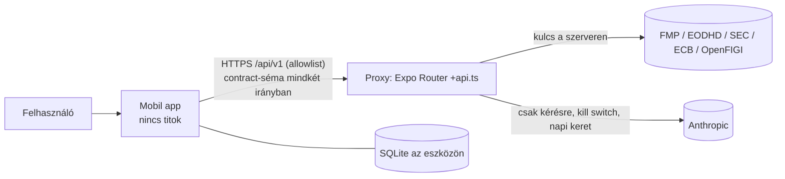

# Biztonsági modell és ismert kockázatok – Stock & ETF Analyzer

> Készült: 2026-11-24 (PHASE 15). Felülvizsgálandó: minden új adatforrásnál, csomagnál, végpontnál és a PHASE 16 éles proxy-telepítése előtt.
> Kapcsolódó: [QA_REPORT.md](QA_REPORT.md) (ténylegesen futtatott ellenőrzések), [ARCHITECTURE.md](ARCHITECTURE.md) 6., 9., 10. fejezet, [DECISIONS.md](DECISIONS.md) D-004, D-026, D-078, D-082/D-083, D-089…D-091.

## 1. Védett értékek

| Érték | Hol van | Miért érzékeny |
|---|---|---|
| Szolgáltatói API-kulcsok (FMP, EODHD, OpenFIGI) | csak a proxy környezeti változóiban (`.env.local` helyben, EAS env „sensitive” élesben) | kvótát/pénzt lehet vele fogyasztani, a ToS a kulcs titkosságát várja el |
| `ANTHROPIC_API_KEY` | csak a proxyban | tokenalapú költség |
| `SEC_USER_AGENT` (e-mail) | csak a proxyban | személyes adat |
| Portfólió, tranzakciók, figyelőlista, riasztások, beállítások | csak az eszközön (SQLite + kv-store; weben memóriában) | személyes pénzügyi adat |
| Piaci adat cache | eszközön, SQLite | nem titkos, de a felhasználó érdeklődését elárulja |

## 2. Bizalmi határok

1. **App → proxy:** az app csak a saját, verziózott `/api/v1` szerződést ismeri; minden választ zod-sémán validál (`parseApiResponse`). Nem-JSON / idegen hibaoldal a státusz szerint képeződik le (D-090).
2. **Proxy → szolgáltató:** allowlist-végpontok, nincs általános továbbító; minden bemenet (ticker, ISIN, dátum, deviza, időszak) validált, mielőtt szolgáltatóhoz érne; a szolgáltatói válasz séma + normalizáló után megy tovább; a kimenet a kliens sémáján is átfut (`okResponse` → 500, ha nem felel meg).
3. **Proxy → LLM:** csak a már kiszámolt, tisztított `AiInputDto` megy ki; a kimenet séma + tartalmi őr (`validateAiExplanation`) után jelenhet meg.

## 3. Kulcskezelés – felülvizsgálat (2026-11-24)

| Ellenőrzés | Eredmény | Bizonyíték |
|---|---|---|
| `.env*` a `.gitignore`-ban (kivétel `.env.example`) | ✅ | `.gitignore` |
| Követett env-fájl | csak `.env.example` (üres minta) | `git ls-files` |
| `.env.local` titkos értékei a git-történetben (összes branch) | **0 találat** (3 kitöltött titok, értékvak keresés: `git log --all -S`) | QA_REPORT 4. |
| Kulcsminták a fában (`sk-ant-…`, `AKIA…`, `apikey=`) | csak szándékosan hamis tesztértékek (`sk-ant-titok`, `sk-ant-xyz`) | QA_REPORT 4. |
| Titok az Android bundle-ben (`expo export -p android`) | **0 találat** 3 titkos értékre; `@anthropic-ai/sdk`, `api.anthropic.com`, kulcsváltozó-nevek, szolgáltatói hostok: nincsenek benne | QA_REPORT 4. |
| Kliens nem importálhat szervert | ESLint `import/no-restricted-paths` zónák (`src/config`, `src/app`, `src/presentation`, `src/infrastructure` → `src/server` tiltva) | `eslint.config.js`, lint exit 0 |
| `EXPO_PUBLIC_*` csak nem titkos érték | `EXPO_PUBLIC_API_BASE_URL`, `EXPO_PUBLIC_DATA_MODE` | `.env.example` |
| Env-hibaüzenet nem írja ki az értéket | ✅ (csak a változó neve) | `ai-proxy-integration.test.ts`, `server-context.ts` |
| CI nem használ titkot | ✅ (`permissions: contents: read`, nincs `secrets.*`) | `.github/workflows/ci.yml` |

**Szabály (marad):** valódi kulcs csak `.env.local`-ba vagy EAS env „sensitive” változóba kerül; chatbe, issue-ba, commitba soha. Kiszivárgás gyanújánál: a kulcs azonnali visszavonása a szolgáltatónál, új kulcs, majd a git-történet ellenőrzése.

## 4. Külső input validáció

- **Proxy bemenet:** `parseListingId`, `parseIsin`, `parseSearchQuery`, `parseIsoDate`, `parseCurrencyCode`, időszak-korlát (max. 40 év), FX max. 30 deviza, jövőbeli dátum tiltva (`api-handlers.ts`).
- **AI-kérés:** méretkorlát a beolvasás előtt (`Content-Length`, D-091) és után, JSON, szigorú séma (ismeretlen mező → 400), portfóliónál kötelező beleegyezés.
- **Szolgáltatói válasz:** adapterenkénti zod-séma + normalizáló; hibás válasz → `UPSTREAM_INVALID`, nem csendes 0.
- **Kliens:** contract-séma minden válaszra; tárolt rekordok domain-validációval visszaolvasva (sérült rekord → STORAGE hiba vagy kihagyás + törlés, nem hamis P/L).
- **Felhasználói űrlapok:** domain-validáció (pl. `parseDecimalInput`, tranzakció-szabályok, screener-validáció).

## 5. Prompt injection

Többrétegű (ARCHITECTURE 9., `src/server/ai/prompts.ts`):
1. A szolgáltatói/felhasználói szöveg csak a user üzenet `<analysis_data>` blokkjában, JSON-ként, „adat, nem utasítás” szabállyal.
2. `sanitizeAiText`: vezérlőkarakterek ki, `<`/`>` lecserélve, hosszkorlát; a DTO-séma ezeket el is utasítja; a JSON-ban `<`/`>` escape-elve (kettős védelem).
3. A modell nem kap eszközt, hálózatot, titkot.
4. A kimenet: séma + tartalmi őr (számok csak a bemenetből, `basedOn` létező ref, a címke/score nem módosítható, nincs URL/kulcs/garantált hozam). Elbukás → a szabályalapú magyarázat jelenik meg.
5. LLM csak kifejezett kérésre (`mode: 'llm'`), kill switch (`AI_ENABLED`), napi keret (`AI_DAILY_LIMIT`, alap 50).

**Maradék kockázat:** egy szolgáltatói cégnév/leírás megpróbálhatja befolyásolni a modellt; a hatás a magyarázat szövegére korlátozódik, a számokat és a döntést az őr védi.

## 6. Személyes adat, naplózás, adatmegőrzés

- **Napló (proxy):** egy JSON-sor kérésenként: útvonal (lekérdezés nélkül), státusz, késleltetés, provider, hibafajta. Nincs benne kulcs, User-Agent, teljes URL, portfólió- vagy AI-tartalom (`logging.ts`; tesztek: `ai-proxy-integration`, `e2e-business-flows`).
- **Kliens:** nincs `console.*` a kliensoldali kódban (ellenőrizve: csak `src/server/logging.ts` és az env-figyelmeztetés).
- **Portfólió → AI:** pénzösszeg nem kerül a bemenetbe; LLM-hez kérésenkénti beleegyezés kell.
- **Megőrzés:** a felhasználói adat csak az eszközön van, felhő/szinkron nincs. Cache megőrzés adattípusonként 30–400 nap (`cache-policy.ts`), utána takarítás. Export (Beállítások, JSON v2) és teljes törlés van.
- **Titkosítás:** az SQLite-fájl app-szinten nem titkosított; az OS eszköztitkosítása védi (KI-112).

## 7. Hibaüzenetek

- A proxy a szolgáltatói hibaüzenetet nem adja tovább nyersen (az URL kulcsot tartalmazhat – `request-json.ts`); `STORAGE`/`CALCULATION_INVALID` → „Belső hiba.”.
- A kliens magyar, felhasználónak szóló üzeneteket mutat; a validációs részletek max. 1000 karakter.

## 8. Függőségek (`npm audit`, 2026-11-24)

| Kör | Eredmény |
|---|---|
| Teljes fa | 22 moderate, 0 high, 0 critical |
| Csak futásidejű (`--omit=dev`) | 20 moderate, 0 high, 0 critical |

Mind a `minimatch` / `glob` csomagokra vezet vissza: a teszt-eszközláncban (jest → `@jest/*`, `babel-plugin-istanbul`, `test-exclude`) és az `expo` → `@expo/fingerprint` build-időbeli eszközben (projekt-ujjlenyomat; nem az app futásidejében fut, felhasználói inputot nem kap). Az `npm audit fix --force` visszaminősítést javasol (expo 52, jest 29) → **nem alkalmazható** (SDK 58 projekt). Teendő: Expo/Jest javító kiadások követése; a CI `high` szintnél megáll (D-089).

## 9. Ismert kockázatok

| ID | Kockázat | V | H | Mitigáció / állapot |
|---|---|---|---|---|
| R-S1 | **A proxy nyilvános, hitelesítés nélkül** (a cím a bundle-ben): bárki fogyaszthatja a szolgáltatói kvótát és az AI-keretet. | K | K | Szolgáltatónkénti napi kvótaőr, AI napi keret + kill switch, allowlist, inputvalidáció, méretkorlát. **Nincs** IP-/kliensalapú limit és nincs megosztott kvótaállapot példányok közt (KI-23, KI-114). Teendő a PHASE 16 telepítés előtt: EAS Hosting szintű rate limit / WAF lehetőségének ellenőrzése; az app-be ágyazott „token” NEM titok, ezért nem védelem. |
| R-S2 | Portfólió titkosítatlan SQLite-ban (rootolt/elveszett eszköz). | A | K | OS-titkosítás; SQLCipher csak dev builddel (KI-112). |
| R-S3 | Moderate audit-leletek a build-eszközláncban. | A | A | Futásidőben nem érintett; frissítés követése (8.). |
| R-S4 | Prompt injection szolgáltatói szövegen át. | A | A | 5. fejezet; a számokat és döntést az őr védi. |
| R-S5 | Kulcs kiszivárgása fejlesztői hibából (chat, commit). | A | M | `.gitignore`, értékvak szkennelés fázisonként, `.env.example` figyelmeztetések; ajánlott: GitHub secret scanning bekapcsolása a repón. |
| R-S6 | A web-előnézet memóriában tárol (nincs tartós adat) – nem biztonsági, de félreérthető. | A | A | Beállításokban jelölve (KI-111). |
| R-S7 | HTTP (nem HTTPS) proxy fejlesztéskor a LAN-on. | K | A | Csak fejlesztés; élesben az EAS Hosting HTTPS (PHASE 16). |

## 10. Ellenőrzési rutin (minden fázis végén)

1. `npm run check` (exit 0).
2. `git ls-files | grep -i env` → csak `.env.example`.
3. Értékvak titokszkennelés a git-történetre és az `expo export` bundle-re (QA_REPORT 4. – a parancsok ott).
4. `npm audit --omit=dev --audit-level=high` (exit 0).
5. Új végpontnál: allowlist, inputvalidáció, napló adatmentessége teszttel.
