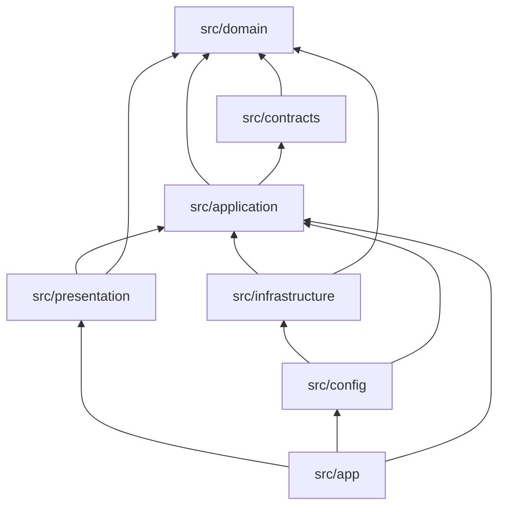

# PHASE 03 – Architektúra, domain modellek és alkalmazási rétegek (kezdőbarát útmutató)

> Dátum: 2026-11-21 · Állapot: **KÉSZ** · Előző: [phase-02-project-setup.md](phase-02-project-setup.md) · Átadás: [../handoffs/phase-03-handoff.md](../handoffs/phase-03-handoff.md)

Ez az útmutató lépésenként leírja, mi készült a PHASE 03-ban, miért, és hogyan ellenőrizheted. A **teljes, aktuális kód a repóban van**, a megadott útvonalakon; itt a lényeges részleteket és a kis konfigurációs fájlokat mutatjuk teljes terjedelmükben.

## Tartalom
0. [Szakszavak röviden](#0-szakszavak-röviden)
1. [Indulóállapot ellenőrzése](#1-indulóállapot-ellenőrzése)
2. [Tesztkörnyezet javítása Windowson (jest.config.js)](#2-tesztkörnyezet-javítása-windowson)
3. [A zod telepítése](#3-a-zod-telepítése)
4. [Domain alapelemek (src/domain/shared)](#4-domain-alapelemek)
5. [Domain modellek (entitások)](#5-domain-modellek)
6. [Contracts – a hálózati szerződés (zod)](#6-contracts)
7. [Rétegszabályok ESLinttel + bizonyítás](#7-rétegszabályok-eslinttel)
8. [Alkalmazási réteg: portok és use case-ek](#8-alkalmazási-réteg)
9. [Infrastruktúra, composition root, Provider](#9-infrastruktúra-composition-root-provider)
10. [Tesztek futtatása](#10-tesztek)
11. [Bundle-ellenőrzés](#11-bundle-ellenőrzés)
12. [Gyakori hibák és javításuk](#12-gyakori-hibák)
13. [A fázis befejezésének feltételei](#13-befejezési-feltételek)

---

## 0. Szakszavak röviden

| Szó | Jelentés ebben a projektben |
|---|---|
| **Domain** | Az üzleti fogalmak és szabályok kódja (pl. „mi az érvényes tranzakció?”). Nem tud semmit a képernyőről vagy az internetről. Mappa: `src/domain`. |
| **Réteg** | Egy mappa meghatározott felelősséggel. A rétegek csak meghatározott irányban importálhatnak egymásból. |
| **Port** | Egy interfész (szerződés), amely leírja, mire van szüksége egy műveletnek, pl. „adj árfolyamot egy listinghez”. Mappa: `src/application/ports`. |
| **Adapter** | Egy port konkrét megvalósítása, pl. demóadat vagy később a proxy-kliens. Mappa: `src/infrastructure`. |
| **Use case** | Egy felhasználói művelet lépései, pl. „tranzakció rögzítése”. Mappa: `src/application/use-cases`. |
| **Composition root** | Az az egy hely, ahol eldől, melyik adapter kerül melyik port mögé: `src/config/container.ts`. |
| **`Result`** | Visszatérési érték: `{ ok: true, value }` (siker) vagy `{ ok: false, error }` (hiba). Kivétel (`throw`) helyett használjuk, hogy a hibát ne lehessen elfelejteni kezelni. |
| **Diszkriminált unió** | Több változatú típus, ahol egy mező (pl. `kind`) mondja meg, melyik változatról van szó. Pl. `Instrument` = `Stock` (ha `kind: 'stock'`) vagy `Etf` (ha `kind: 'etf'`). A TypeScript a `kind` vizsgálata után tudja, milyen mezők léteznek. |
| **Branded típus** | Futás közben sima `string`, de a TypeScript külön típusként kezeli (pl. `Isin`). Ilyen értéket csak a validáló `parseIsin()` függvény adhat, így ellenőrizetlen szöveg nem csúszhat át. |
| **Smart constructor** | `create…` függvény, amely ellenőrzi a bemenetet, és `Result`-ot ad. Pl. `createTransaction()`. |
| **zod** | Futásidejű validációs könyvtár: ismeretlen JSON-ból típusos adatot csinál, vagy hibát ad. |
| **Provenance** | Egy adat származása: forrás, lekérés ideje, típus (jelentett / számított / becslés / AI / felhasználói / demó). |
| **`Metric<T>`** | Érték + státusz. Ha nincs érték (pl. hiányzik), nincs `value` mező, de van indok (`reason`). **A hiányzó adat nem 0.** |

---

## 1. Indulóállapot ellenőrzése

**Cél:** tudni, hogy honnan indulunk; a meglévő, működő setupot nem írjuk újra.
**Előfeltétel:** a PHASE 02 kész (lásd a handoffot).
**Hol futtasd:** VS Code → Terminal → New Terminal (a projekt mappájában: `c:\Users\lujzi\Documents\stock-etf-analyzer`).

```bash
git status          # elvárt: "nothing to commit, working tree clean"
npm run check       # typecheck + lint + format + test
```

**Lelet (2026-11-21):** a VS Code terminálból (`c:\…`, kisbetűs meghajtó) futtatott `npm run check` **5 piros route-tesztet** adott („Invalid hook call”). PowerShellből (`C:\…`) ugyanez zöld volt. Ennek okát és javítását a 2. lépés írja le (KI-11).

---

## 2. Tesztkörnyezet javítása Windowson

**Cél:** a tesztek bármelyik terminálból zöldek legyenek.
**Ok:** Windowson a meghajtóbetű kis- és nagybetűs alakja (`c:` vs `C:`) ugyanazt a mappát jelenti. A Jest viszont a modulokat útvonal-szöveg alapján tartja nyilván, ezért ugyanazt a React-csomagot kétszer töltötte be. Két React-példány mellett a hookok nem működnek.
**Fájl:** `jest.config.js` (új). A `package.json`-ból a `"jest": { "preset": "jest-expo" }` blokk törlődött, mert a beállítás ide költözött.

Teljes tartalom:

```js
// Jest-konfiguráció (D-032, D-041). Preset: jest-expo.
const fs = require('node:fs');

// Windows: ha a munkakönyvtár kisbetűs meghajtóval érkezik (pl. `c:\…` a VS Code-ból),
// a Jest ugyanazt a modult két útvonal-kulccsal (c:\ és C:\) kétszer töltheti be
// → két React-példány → "Invalid hook call". A kanonikus (valódi) útvonal ezt megszünteti.
const canonicalRoot = fs.realpathSync.native(__dirname);
if (
  process.cwd() !== canonicalRoot &&
  process.cwd().toLowerCase() === canonicalRoot.toLowerCase()
) {
  process.chdir(canonicalRoot);
}

module.exports = {
  preset: 'jest-expo',
  rootDir: canonicalRoot,
};
```

**Ellenőrzés:** `npm test` a VS Code terminálból. **Elvárt:** minden suite `PASS`.

---

## 3. A zod telepítése

**Cél:** futásidejű validáció a hálózati határon (D-014 → D-039).
**Parancs** (a projekt mappájában):

```bash
npx expo install zod
```

**Ellenőrzés:**
1. Nyisd meg a `package.json`-t. A `"dependencies"` alatt ennek kell szerepelnie: `"zod": "^4.6.7"`. (Ha a `devDependencies` közé került volna, helyezd át – KI-03.)
2. `npx expo install --check` → elvárt: `Dependencies are up to date`.

**Megjegyzés:** a zodot csak az `src/contracts` használja. A domain szándékosan **nem** függ tőle (7. lépés).

---

## 4. Domain alapelemek

**Cél:** közös, szigorúan típusos építőkövek, amelyekre minden modell épül.
**Mappa:** `src/domain/shared/`. Minden fájl tiszta TypeScript, külső csomag nélkül.

| Fájl | Mit ad |
|---|---|
| `result.ts` | `Result<T, E>`, `ok()`, `err()`, `mapResult()`, `andThen()` |
| `errors.ts` | `AppError` (10 hibafajta), `AppErrors.*` konstruktorok, `isRetryable()` |
| `validation.ts` | `validateFields()` – több mező ellenőrzése, az **összes** hibával egyszerre; `requirePositive()`, `requireNonEmpty()`, `parseNullable()`… |
| `brand.ts` | a branded típusok segédtípusa |
| `currency.ts`, `money.ts` | `CurrencyCode`, `Money`, `addMoney()` (eltérő pénznemnél hibát ad) |
| `dates.ts` | `IsoDate`, `IsoTimestamp`, `toLocalIsoDate()` (a felhasználó helyi „ma” napja) |
| `ids.ts` | `Isin` (ellenőrző számjeggyel), `ListingId` (`AAPL@XNAS`), `SecurityId`, `Cik`, `PortfolioId`… |
| `period.ts` | `FiscalPeriod` (FY/Q1–Q4, hosszellenőrzéssel; D-037) |
| `provenance.ts` | `DataProvenance`, `ProvenanceKind`, `Freshness`, `assessFreshness()` |
| `metric.ts` | `Metric<T>` + konstruktorok (`metricOk`, `metricMissing`, …) |

**A két legfontosabb minta:**

```ts
// 1) Result + összegyűjtött validáció (src/domain/shared/validation.ts használata)
const fields = validateFields({
  quantity: requirePositive(input.quantity),
  price: requirePositive(input.price),
});
if (!fields.ok) return fields; // pl. issues: [{ path: 'quantity', … }, { path: 'price', … }]
const { quantity, price } = fields.value; // ellenőrzött számok
```

```ts
// 2) Metric<T>: érték CSAK OK státusznál létezik (src/domain/shared/metric.ts)
type Metric<T> =
  | { status: 'OK'; value: T; provenance: DataProvenance }
  | { status: 'UNAVAILABLE'; unavailableReason: 'PLAN_LIMIT' | 'NOT_COVERED' | 'QUOTA_EXHAUSTED'; reason: string; provenance?: DataProvenance }
  | { status: 'MISSING' | 'NOT_APPLICABLE' | 'NOT_MEANINGFUL' | 'INSUFFICIENT_DATA' | 'INVALID_INPUT' | 'ERROR'; reason: string; provenance?: DataProvenance };

metricOk(Number.NaN, prov); // → { status: 'INVALID_INPUT', … }  (NaN soha nem lehet OK)
```

**Ellenőrzés:** `npx jest src/domain/shared` → elvárt: `PASS src/domain/shared/shared.test.ts`.

---

## 5. Domain modellek

**Cél:** minden kért modell szigorú típussal és validált létrehozással.

| Modell | Fájl | Unió vagy közös típus? | Konstruktor |
|---|---|---|---|
| `Instrument` = `Stock` \| `Etf` | `src/domain/instrument/instrument.ts` | **unió** (`kind`) – eltérő mezők (CIK vs TER) | `createStock`, `createEtf` |
| `Listing` | ugyanott | közös | `createListing` (a `listingId` = `SYMBOL@MIC`) |
| `Quote`, `PriceSeries` | `src/domain/market/quote.ts` | közös | `createQuote`, `createPriceSeries` |
| `FinancialStatement` = Income \| Balance \| CashFlow | `src/domain/fundamentals/financial-statement.ts` | **unió** (`statementType`) – eltérő tételek | `createFinancialStatement` |
| `FinancialMetric` | `src/domain/fundamentals/financial-metric.ts` | közös | `createFinancialMetric` |
| `FxRate` | `src/domain/fx/fx-rate.ts` | közös | `createFxRate` |
| `Portfolio` | `src/domain/portfolio/portfolio.ts` | közös | `createPortfolio` |
| `Transaction` = BUY/SELL \| DIVIDEND/FEE \| SPLIT | ugyanott | **unió** (`type`) – eltérő mezők | `createTransaction` |
| `Position` | ugyanott | közös, **csak típus** (a PHASE 09 számolja a tranzakciókból) | – |
| `AnalysisResult` | `src/domain/analysis/analysis-result.ts` | közös; a `subject` unió | `createAnalysisResult` |
| `DataProvenance` | `src/domain/shared/provenance.ts` | közös | – |

**Miért nem egy „mindenre jó” `Instrument` objektum opcionális mezőkkel?** Mert akkor egy ETF-nek is lehetne CIK-je, egy részvénynek TER-je, és a fordító ezt nem venné észre. Az unióval a `kind` ellenőrzése után pontosan a releváns mezők érhetők el.

**Kulcsviselkedés – a hiányzó tétel nem 0:**

```ts
const result = createFinancialStatement({
  statementType: 'cashflow',
  securityId, period, currency: USD, provenance,
  lineItems: {
    operatingCashFlow: metricOk(1000, prov),
    dividendsPaid: metricOk(0, prov), // a forrás KIFEJEZETTEN 0-t jelentett
  },
});
// result.value.lineItems.dividendsPaid      → { status: 'OK', value: 0 }
// result.value.lineItems.capitalExpenditure → { status: 'MISSING', reason: 'A forrás (…) nem adta meg.' }
```

Más fontos szabályok:
- ha van ISIN, a `securityId`-nak azzal egyeznie kell (D-025);
- a tranzakció dátuma nem lehet jövőbeli;
- az AI-értelmezés nem lehet számszerű mutató forrása;
- az ETF TER-je 0 és 0,10 közötti tört kell legyen (a „7” a „0.07” helyett hibát ad).

**Ellenőrzés:** `npx jest src/domain` → elvárt: 2 suite `PASS`.

---

## 6. Contracts

**Cél:** a proxytól (PHASE 04A) érkező JSON ellenőrzése, mielőtt az app bármit kezdene vele.
**Mappa:** `src/contracts/`

| Fájl | Mit ad |
|---|---|
| `shared.ts` | `fromDomainParser()` – domain parserből zod sémát készít; `dataProvenanceSchema`; `metricSchema(valueSchema)` |
| `quote.ts` | `quoteDtoSchema`, `QuoteDto`, `quoteFromDto()` (→ `createQuote`) |
| `api-envelope.ts` | `parseApiResponse(json, schema)`, hibakódok, `apiErrorToAppError()` |

**Duplikáció nélkül:** a zod csak a szerkezetet nézi („szám-e a `price`?”). Az üzleti szabályt („pozitív-e az ár?”) a domain ellenőrzi, és a séma/mapper azt hívja:

```ts
export function fromDomainParser<T>(parse: (input: string) => Result<T>) {
  return z.string().transform((value, ctx): T => {
    const parsed = parse(value);
    if (parsed.ok) return parsed.value;
    ctx.addIssue({ code: 'custom', message: parsed.error.message });
    return z.NEVER;
  });
}
export const currencyCodeSchema = fromDomainParser(parseCurrencyCode);
```

`parseApiResponse` viselkedése:

| Bemenet | Eredmény |
|---|---|
| `{ apiVersion: '1', data: {…érvényes…} }` | `ok(data)` |
| `{ apiVersion: '1', error: { code: 'RATE_LIMITED', retryAfterSec: 60, … } }` | `err({ kind: 'RATE_LIMITED', retryAfterSec: 60 })` |
| bármi más (pl. HTML hibaoldal, `apiVersion: '2'`) | `err({ kind: 'UPSTREAM', failure: 'CONTRACT_MISMATCH' })`, a hibás mező útvonalával |

**Ellenőrzés:** `npx jest src/contracts` → `PASS`.

---

## 7. Rétegszabályok ESLinttel

**Cél:** a függőségi irány ne csak dokumentáció legyen, hanem a gép kényszerítse ki (D-038).
**Fájl:** `eslint.config.js`. A szabályok magyarázata a fájlban, kommentként szerepel.

**Ki mit importálhat:**



(A nyíl iránya: „importálhat ebből”. Ami nincs a képen, az tilos, pl. `presentation → infrastructure`.)

**Négy szabály:**
1. `import/no-restricted-paths`: tiltott rétegirányok (zónák).
2. `no-restricted-imports` a `src/domain`-ben: **semmilyen** külső csomag (React, Expo, zod…).
3. `no-restricted-imports` a `src/contracts`-ban és az `src/application`-ben: React/React Native/Expo tiltott.
4. `no-restricted-globals`: `fetch`, `XMLHttpRequest`, `WebSocket`, `EventSource` tiltott a domain, contracts, application, presentation és `src/app` rétegben. **Képernyőből nem lehet közvetlenül hálózatot hívni.**

**Bizonyítás (szándékosan hibás importok, 2026-11-21):** négy ideiglenes fájl készült, például `src/domain/__lint_demo__.ts`:

```ts
import { useState } from 'react';
import { z } from 'zod';
import { systemClock } from '@/infrastructure/system/system-clock';
```

Parancs: `npx eslint <a négy fájl>`. **Tényleges kimenet (rövidítve):**

```
src\app\__lint-demo.tsx
  1:45  error  … imported in restricted zone. A route-ok (képernyők) nem érhetik el közvetlenül az adaptereket …  import/no-restricted-paths
  4:8   error  Unexpected use of 'fetch'. Közvetlen hálózati hívás (fetch) itt tilos. …                          no-restricted-globals
src\application\__lint_demo__.ts
  1:45  error  … Az application nem függhet konkrét adaptertől, UI-tól vagy szervertől – portot használj      import/no-restricted-paths
src\domain\__lint_demo__.ts
  1:1   error  'react' import is restricted … A domain nem importálhat külső csomagot …                          no-restricted-imports
  2:1   error  'zod' import is restricted …                                                                      no-restricted-imports
  4:1   error  '@/infrastructure/system/system-clock' import is restricted …                                     no-restricted-imports
  4:29  error  … A domain csak önmagát importálhatja (tiszta TypeScript)                                         import/no-restricted-paths
src\presentation\__lint_demo__\demo.ts
  1:35  error  … A presentation csak use case-eken át (useAppServices) ér el adatot                              import/no-restricted-paths
✖ 8 problems (8 errors, 0 warnings)
```

A próbafájlokat utána töröltük. **Magad is kipróbálhatod:** hozz létre egy `src/domain/proba.ts` fájlt ezzel a sorral: `import { useState } from 'react';`, futtasd az `npm run lint` parancsot, és nézd meg a hibát. Utána **töröld a fájlt**.

---

## 8. Alkalmazási réteg

**Cél:** minimális, tesztelhető példa arra, hogyan kapcsolódik a use case a repository-hoz és a gateway-hez. Valós API még nincs.

**Portok** (`src/application/ports/index.ts`): `Clock`, `IdGenerator`, `MarketDataGateway` (`getQuote`), `PortfolioRepository` (`getPortfolio`, `savePortfolio`, `listTransactions`, `addTransaction`). Csak az a port készült el, amelyet ténylegesen használ valami (D-040).

**Use case-ek** (`src/application/use-cases/`):

```ts
// record-transaction.ts – egyszerűsítve
export function createRecordTransaction(deps: RecordTransactionDeps): RecordTransaction {
  return async (command) => {
    const parsed = validateFields({ portfolioId: parsePortfolioId(command.portfolioId) });
    if (!parsed.ok) return parsed;                                    // VALIDATION
    const portfolio = await deps.portfolioRepository.getPortfolio(parsed.value.portfolioId);
    if (!portfolio.ok) return portfolio;                              // STORAGE
    if (portfolio.value === null) return err(AppErrors.notFound('portfólió', …)); // NOT_FOUND
    const transaction = createTransaction({ ...command, id: deps.ids.next('tx') },
                                          { today: toLocalIsoDate(deps.clock.now()) });
    if (!transaction.ok) return transaction;                          // VALIDATION
    const saved = await deps.portfolioRepository.addTransaction(transaction.value);
    if (!saved.ok) return saved;                                      // STORAGE
    return ok(transaction.value);
  };
}
```

A `get-listing-quote.ts` ellenőrzi a listing-azonosítót, meghívja a gateway-t, majd a **saját óránk** szerint számolja a frissességet (`FRESH`/`STALE`/`EXPIRED`), nem a forrás állítására hagyatkozva.

---

## 9. Infrastruktúra, composition root, Provider

| Fájl | Szerep |
|---|---|
| `src/infrastructure/system/system-clock.ts` | `systemClock`, `createLocalIdGenerator()` |
| `src/infrastructure/mock/mock-market-data-gateway.ts` | demó árfolyam **kitalált** `DEMO@XNAS`, `DEMOETF@XETR`, `DEMOOLD@XNAS` tickerekre, `kind: 'mock'` jelöléssel |
| `src/infrastructure/mock/in-memory-portfolio-repository.ts` | memóriabeli tároló (újraindításkor törlődik – KI-13) |
| `src/infrastructure/api-client/not-implemented-market-data-gateway.ts` | `live` módban őszinte hibát ad (PHASE 04A cseréli) |
| `src/config/container.ts` | `createAppServices(env, overrides)` – itt dől el, melyik adapter kerül a portok mögé |
| `src/presentation/di/app-services-context.tsx` | `AppServicesProvider`, `useAppServices()` |

**Patch – `src/app/_layout.tsx`** (a Provider a komponensfa tetejére került):

```tsx
import { useState } from 'react';

import { createAppServices } from '@/config/container';
import { publicEnvResult } from '@/config/env';
import { AppServicesProvider } from '@/presentation/di/app-services-context';
// …
export default function RootLayout() {
  const theme = useTheme();
  // Egyszer jön létre az app élettartama alatt.
  const [services] = useState(() => createAppServices(publicEnvResult.env));

  return (
    <AppServicesProvider services={services}>
      <ThemeProvider value={buildNavigationTheme(theme)}>
        {/* … változatlan StatusBar + Stack … */}
      </ThemeProvider>
    </AppServicesProvider>
  );
}
```

**Így fog egy képernyő adatot kérni (minta a PHASE 12-höz, most még nincs ilyen képernyő):**

```tsx
const { getListingQuote } = useAppServices();
useEffect(() => {
  void getListingQuote('DEMO@XNAS').then((result) => {
    if (result.ok) setQuote(result.value);
    else setError(result.error); // pl. RATE_LIMITED → „Próbáld újra 60 mp múlva”
  });
}, [getListingQuote]);
```

A képernyő nem tudja, hogy mock vagy valós adat van-e mögötte, és nem hív `fetch`-et.

---

## 10. Tesztek

**Parancsok** (a projekt mappájában):

```bash
npm run typecheck   # elvárt: nincs kimenet, exit 0
npm run lint        # elvárt: nincs hiba, nincs figyelmeztetés
npm test            # elvárt: Test Suites: 9 passed; Tests: 98 passed
npm run check       # mind a négy együtt; elvárt: exit 0
```

**Tényleges eredmény (2026-11-21, VS Code/Git Bash terminál, `c:\…`):** `npm run check` exit 0; `Test Suites: 9 passed, 9 total`; `Tests: 98 passed, 98 total`.

| Tesztfájl | Mit ellenőriz |
|---|---|
| `src/domain/shared/shared.test.ts` | Result, AppError, validáció, ISIN, dátumok, Money, időszak, frissesség, Metric |
| `src/domain/entities.test.ts` | Instrument/Listing, Quote, kimutatás (hiányzó ≠ 0), mutató, elemzés, FX, tranzakció |
| `src/contracts/contracts.test.ts` | séma ↔ domain típus illeszkedése (fordításkor), hibakód-leképezés, contract-eltérés |
| `src/application/use-cases/use-cases.test.ts` | use case-ek fake portokkal: siker, VALIDATION, NOT_FOUND, STORAGE, hálózati/rate limit hibák |
| `src/config/container.test.ts` | valódi bekötés: mock árfolyam, live helyőrző, tranzakció a memóriabeli tárolóba |
| `src/presentation/di/app-services-context.test.tsx` | a hook a Providerből olvas; Provider nélkül érthető hiba |
| `src/config/env.test.ts`, `src/presentation/theme/theme.test.ts`, `src/__tests__/routes.test.tsx` | PHASE 02 (változatlan) |

**Két valódi hibát a tesztek fogtak meg fejlesztés közben** (javítva):
1. A `createStock` nem egyszerre adta vissza az alap- és a részvénymezők hibáit.
2. A composition rootban a tesztben felülírt óra nem jutott el a mock gateway-hez.

---

## 11. Bundle-ellenőrzés

**Cél:** megbizonyosodni, hogy az app (az új kóddal és a zoddal) lefordul a telefonos futtatókörnyezetre.

```bash
npx expo export --platform android --output-dir <ideiglenes mappa>
```

**Tényleges eredmény:** `android bundles (1): _expo/static/js/android/entry-….hbc (2.9MB)` – sikeres. Az ideiglenes mappát ne tedd a projektbe; ha mégis oda került, töröld.
Emulátoron a PHASE 03-ban **nem** futtattuk az appot (KI-12). Ha meg akarod nézni: `npm run android` – a képernyők ugyanúgy néznek ki, mint a PHASE 02-ben.

---

## 12. Gyakori hibák

| Tünet | Ok | Javítás |
|---|---|---|
| `Invalid hook call` / `Cannot read properties of null (reading 'useMemo')` a route-tesztekben | két React-példány (Windows meghajtóbetű, KI-11) | legyen meg a `jest.config.js` (2. lépés); ne tegyél `jest` kulcsot a `package.json`-ba |
| `… imported in restricted zone` lint-hiba | rossz irányú import egy rétegből | használd a megfelelő réteget: UI-ból `useAppServices()`, use case-ből port |
| `'react' import is restricted …` a domainben | a domain nem függhet külső csomagtól | a logikát tedd tiszta függvénybe; UI-kód a `presentation`-be kerül |
| `Unexpected use of 'fetch'` | képernyőből/domainből hálózati hívás | adapter az `src/infrastructure`-ben + port + use case |
| `Type 'string' is not assignable to type 'Isin'` | branded típus | használd a `parseIsin(…)` függvényt, és kezeld a `Result`-ot |
| `Property 'value' does not exist on type 'Metric<number>'` | előbb a státuszt kell ellenőrizni | `if (metric.status === 'OK') { metric.value … }` |
| `Object is possibly 'undefined'` tömbindexelésnél | `noUncheckedIndexedAccess` (D-031) | `const x = arr[0]; if (x !== undefined) …` |
| a zod a `devDependencies` közé került | npm 12 viselkedés (KI-03) | helyezd át a `dependencies` közé, majd `npm install` |

---

## 13. Befejezési feltételek

- [x] Domain modellek szigorú típussal: `Instrument`, `Stock`, `Etf`, `Quote`, `FinancialStatement`, `FinancialMetric`, `FxRate`, `Portfolio`, `Position`, `Transaction`, `AnalysisResult`, `DataProvenance` (+ `Listing`, `PriceSeries`, `Metric<T>`).
- [x] Diszkriminált uniók ott, ahol a változatok eltérnek; nincs „mindenre jó” adatobjektum.
- [x] `Result`/`AppError`: validációs, hálózati, rate limit, hiányzó adat és számítási hiba külön.
- [x] Függőségi szabályok dokumentálva (ARCHITECTURE 3.) **és** kikényszerítve (ESLint, szándékos hibákkal igazolva).
- [x] Minimális application ↔ repository példa, tesztelve.
- [x] Nincs közvetlen hálózati hívás a képernyőkben (lint-szabály).
- [x] Typecheck, lint, format, tesztek zöldek (valós kimenettel, 10. lépés).
- [x] ARCHITECTURE, DATA_DICTIONARY, DECISIONS (D-035…D-041), PROJECT_STATE, ROADMAP, KNOWN_ISSUES frissítve; handoff elkészült.
- [ ] Valós API-integráció – **szándékosan nincs** (PHASE 04A).
