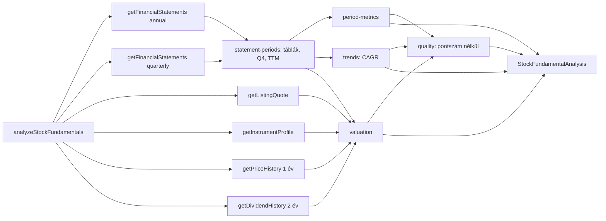

# PHASE 06 – Részvény fundamentális elemzés (kezdőbarát útmutató)

> Dátum: 2026-11-22 · Állapot: **KÉSZ** · Átadás: [../handoffs/phase-06-handoff.md](../handoffs/phase-06-handoff.md)
> Döntések: D-059…D-063 ([../DECISIONS.md](../DECISIONS.md)) · Adatmodell: [../DATA_DICTIONARY.md](../DATA_DICTIONARY.md) 4.4, 5.2 és **13.** fejezet

Ez az útmutató lépésenként leírja, mi készült a PHASE 06-ban, miért, és hogyan ellenőrizheted. A **teljes, aktuális kód a repóban van** a megadott útvonalakon (kb. 4 600 új sor, ennek több mint fele teszt). Itt a lényeges részeket, a kisebb módosításokat teljes patch-ként, és valós számpéldákat mutatunk.

## Tartalom
0. Szakszavak röviden
1. Indulóállapot ellenőrzése
2. Mit és miért építettünk (áttekintés)
3. 1. lépés – A teljes adósság (`totalDebt`) összerakása
4. 2. lépés – Béta a profilban
5. 3. lépés – Az eredmény-modell (domain)
6. 4. lépés – Időszakok: táblák, Q4, TTM
7. 5. lépés – Időszaki mutatók
8. 6. lépés – Trendek és CAGR
9. 7. lépés – Értékelés és áttekintés
10. 8. lépés – Minőségi modell (pontszám nélkül)
11. 9. lépés – A use case és a bekötés
12. Tesztek és ellenőrzés
13. Próbáld ki magad
14. Gyakori hibák és javításuk
15. Befejezési feltételek

---

## 0. Szakszavak röviden

| Szó | Jelentés |
|---|---|
| **Fundamentális elemzés** | A cég üzleti és pénzügyi adatainak (bevétel, nyereség, adósság, cash flow) vizsgálata – szemben az árfolyamgrafikon elemzésével. |
| **Use case** | Egy alkalmazás-funkció „receptje” az `application` rétegben: lekéri az adatot (portokon át), meghívja a számításokat, és egy kész eredményt ad a UI-nak. Itt: `analyzeStockFundamentals`. |
| **FY / Q1–Q4** | Pénzügyi év / negyedév. A pénzügyi év nem mindig naptári év (Apple: szeptember végén zárul). |
| **TTM** | „Trailing twelve months” – az utolsó 4 negyedév összege. |
| **CAGR** | Átlagos éves növekedési ütem: `(végérték / kezdőérték)^(1/évek) − 1`. |
| **Split (részvényfelosztás)** | Pl. 10:1 split után 10× annyi részvény van, és az EPS 1/10-ére esik – a régi és új EPS közvetlenül nem összevethető. |
| **Provenance / eredet** | Honnan jön egy szám: a szolgáltató jelentette (`reported`), mi számoltuk (`calculated`), becslés (`estimated`), elavult (`stale`), hiányzik (`missing`), vagy nem elérhető (`unavailable`). |
| **XBRL tag** | A SEC-jelentések gépi címkéje, pl. `LongTermDebtNoncurrent` = hosszú lejáratú adósság, rövid rész nélkül. |
| **Fixture** | Valódi, elmentett API-válasz, amelyet a tesztek használnak (így a teszt nem hív internetet). |

## 1. Indulóállapot ellenőrzése

**Cél:** meggyőződni, hogy a kiinduló kód zöld, mielőtt bármit változtatunk.
**Hol:** a projekt gyökérmappájában (`C:\Users\…\stock-etf-analyzer`), PowerShellben vagy a VS Code termináljában.

```powershell
git status
npm run check
```

**Elvárt eredmény (PHASE 06 elején):** `working tree clean`, a `check` exit 0, **553/553 teszt**.
**PHASE 06 végén:** exit 0, **661/661 teszt, 48 suite**.

## 2. Mit és miért építettünk (áttekintés)

A PHASE 05-ben elkészültek a képletek, de semmi nem hívta őket. A PHASE 06 összeköti a képleteket a valós adatokkal:



**Fontos elvek (CLAUDE.md):** hiányzó adat nem 0; nincs kitalált adat; minden mutató hordozza az eredetét; a kvalitatív és a numerikus rész külön; nincs rejtett pontszám.

## 3. 1. lépés – A teljes adósság (`totalDebt`) összerakása

**Cél és ok:** a PHASE 05 végén a `totalDebt` mindig `MISSING` volt (KI-42), ezért a nettó adósság, EV, D/E és ROIC sem volt számolható.
**Mit derített ki az élő SEC-próba (12 cég)?** A naiv összeadás hibás lenne:
- a `LongTermDebt` már **tartalmazza** a rövid lejáratú részt;
- a JNJ-nél a `ShortTermBorrowings` ≈ `DebtCurrent` (benne van a hosszú lejáratú adósság rövid része is) → `LongTermDebt + ShortTermBorrowings` **dupla számolás** (49,93 Mrd a helyes 47,94 Mrd helyett).

**Megoldás (D-059):** `totalDebt = nem rövid rész + rövid rész`.

| Rész | Tagek (sorrendben) |
|---|---|
| Nem rövid (kötelező) | `LongTermDebtNoncurrent` → `LongTermDebtAndCapitalLeaseObligations` |
| Rövid | `DebtCurrent`; ha nincs: `LongTermDebtCurrent` (vagy `…CapitalLeaseObligationsCurrent`) + `ShortTermBorrowings` (vagy `CommercialPaper` + `OtherShortTermBorrowings`) |

Ha egy rövid komponensnek nincs ténye → 0-nak vesszük, de az eredmény **`estimated`** (becslés), és a provenance megnevezi. Bankoknál (JPM), biztosítóknál (BRK-B) és IFRS-filereknél (TSM) → `MISSING`.

**Fájlok:**
- `src/server/providers/sec-edgar/sec-tags.ts` – új `SEC_DEBT_COMPONENT_TAGS` tábla.
- `src/server/providers/sec-edgar/sec-debt.ts` – **új**, `composeTotalDebt(picks, context)`.
- `src/server/providers/sec-edgar/sec-normalizer.ts` – a mérlegnél meghívja.

A lényeg (`sec-debt.ts`, rövidítve):
```ts
const used = [noncurrent];
if (picks.currentTotal !== null) {
  used.push(picks.currentTotal);            // DebtCurrent: mellé semmit
} else {
  if (picks.currentMaturities !== null) used.push(picks.currentMaturities);
  else assumedZero.push('currentMaturities');
  if (picks.shortTermBorrowings !== null) used.push(picks.shortTermBorrowings);
  else { /* CommercialPaper + OtherShortTermBorrowings, vagy assumedZero */ }
}
kind: assumedZero.length > 0 ? 'estimated' : 'calculated'
```

**A fixture-ök bővítése** (csak az új tagekkel, a régi tények változatlanok):
```powershell
node scripts/record-sec-fixtures.mjs --add-new-tags
```
Előfeltétel: `.env.local`-ban `SEC_USER_AGENT="AppNév email@cím"`. 12 SEC-hívás, ingyenes.
> ⚠️ Kapcsoló nélkül (`node scripts/record-sec-fixtures.mjs`) a szkript **minden fixture-t felülír** friss adattal, és a régi golden tesztek eltörhetnek. Ha ez véletlenül megtörtént: `git checkout -- src/server/providers/sec-edgar/__fixtures__/`.

**Ellenőrzés:**
```powershell
npx jest src/server/providers/sec-edgar
```
Elvárt: minden zöld; a `sec-debt.test.ts` golden értékei: AAPL FY2026 = **80 111 000 000** (68,21 + 9,91 + 2,00 Mrd), JNJ FY2025 = **47 938 000 000**, MSFT FY2026 = 40 294 000 000 `estimated`.

## 4. 2. lépés – Béta a profilban

**Cél:** a feladat kéri a bétát, „ha az adatforrás biztosítja”. Az FMP profil adja (AAPL: 1,089).
**Patch (4 fájl):**
- `src/domain/instrument/instrument-profile.ts`: új mező `readonly beta: number | null;`, a bemenetben opcionális (`beta?: number | null`), nem véges szám → hiba.
- `src/contracts/market.ts`: `beta: z.number().nullable().optional(),` (régi proxy-válasz is érvényes).
- `src/server/providers/fmp/fmp-normalizer.ts`: a sémában `beta: z.number().nullish().catch(null)`, a profilban `beta: typeof row.beta === 'number' && Number.isFinite(row.beta) ? row.beta : null`.
- `src/server/providers/fmp/fmp.test.ts`: `beta: 1.089` elvárás.

A béta **tájékoztató** (`reported`): az FMP nem közli, milyen időtávon és melyik indexhez számolja. Saját béta: PHASE 08.

## 5. 3. lépés – Az eredmény-modell (domain)

**Fájl:** `src/domain/analysis/stock-fundamentals.ts` (új, csak típusok és kis konstruktorok).

| Típus | Mire való |
|---|---|
| `MetricOrigin` + `classifyMetricOrigin(metric)` | a feladat 9. pontja: reported / calculated / estimated / stale / missing / unavailable (+ mock, user_input) |
| `FundamentalMetric` | egy mutató: `id`, `unit`, `formula`, `period`, `value` (`Metric<number>`), `origin`, `notes` |
| `StockOverview` | ticker, név, tőzsde, szektor, iparág, ország, pénznemek, ár, piaci érték, részvényszám, béta, 52 hetes csúcs/mélypont |
| `StatementTable` | éves/negyedéves IS / BS / CF nézet |
| `PeriodMetricTable` + `PeriodColumn` | mutatótábla oszlopokkal (FY, Q1–Q4, TTM) |
| `TrendSeries` | idősor + 1/3/5/10 éves CAGR |
| `QualityAnalysis`, `QualitativeFinding` | minőségi témák, **pontszám nélkül** |
| `StockDataQuality` | teljesség, hiánylista, figyelmeztetések, források frissességgel |

Példa az eredet-címkére:
```ts
classifyMetricOrigin(metricOk(1, { ...prov, kind: 'reported', freshness: 'STALE' })) // 'stale'
classifyMetricOrigin(metricUnavailable('PLAN_LIMIT', 'free csomag'))                  // 'unavailable'
classifyMetricOrigin(metricNotMeaningful('negatív EPS'))                               // 'missing'
```

## 6. 4. lépés – Időszakok: táblák, Q4, TTM

**Fájl:** `src/application/stock-analysis/statement-periods.ts`.

- `groupByPeriod(set)` – a kimutatásokat időszakonként csoportosítja (legfrissebb elöl), és a készlet frissességét ráírja a tételekre (így egy elavult készletből számolt mutató is `stale`).
- `deriveQ4(annual, quarterly, calculatedAt)` – **Q4 = FY − (Q1 + Q2 + Q3)**, csak ha a negyedévek hézagmentesek és azonos pénzneműek. Az EPS a Q4-ben `MISSING`, mert nem additív (a részvényszám negyedévente változik).
- `buildTtm(quarterly, calculatedAt)` – az utolsó 4 egymást követő negyedév összege; 4 nélkül nincs TTM.
- `buildStatementTables(...)` – a három kimutatás-tábla.

**Számpélda (teszt):** FY árbevétel 1000, Q1 200, Q2 250, Q3 260 → Q4 = **290** (`calculated`). Ha Q3 900 lenne → Q4 = −350 → `INVALID_INPUT` (az árbevétel nem lehet negatív: az adatok ellentmondanak).

**Ami nem készült el:** a 10-Q a Q2/Q3 cash flow-t csak halmozva (6/9 hónap) adja; ezt a normalizáló eldobja, ezért a negyedéves FCF jellemzően hiányzik (KI-18).

## 7. 5. lépés – Időszaki mutatók

**Fájl:** `src/application/stock-analysis/period-metrics.ts` – `computePeriodMetrics({ current, comparable, previousBalance, basis, calculatedAt })`.

Minden képlet a PHASE 05 motorjából jön; itt csak a bemenetek kiválasztása történik. Sorok: árbevétel, bruttó eredmény/árrés, üzemi eredmény/árrés, nettó eredmény/árrés, EPS, növekedések, pénz, adósság, eszközök, kötelezettségek, saját tőke, nettó adósság/készpénz, D/E, OCF, CapEx, FCF, FCF-árrés/-konverzió, EBITDA, adókulcs, ROE, ROA, ROIC, részvényszám.

Konvenciók:
- **EPS:** jelentett hígított → jelentett alap (megjegyzéssel) → saját számítás.
- **Növekedés:** éves → előző FY; negyedéves → előző év **azonos** negyedéve (szezonalitás).
- **EPS-növekedés split-gyanúnál** (részvényszám > 1,5× változás) → `NOT_MEANINGFUL`.
- **ROE/ROA/ROIC** csak éves oszlopban (negyedévesen évesítés nélkül félrevezető → `NOT_APPLICABLE`).

**Valós példa (AAPL FY2026, fixture):** árbevétel 478,83 Mrd, bruttó árrés 48,8%, üzemi árrés 33,0%, EPS 8,98 (jelentett), FCF = 145,10 − 9,04 = 136,06 Mrd, nettó adósság 43,81 Mrd, D/E 0,71.

## 8. 6. lépés – Trendek és CAGR

**Fájl:** `src/application/stock-analysis/trends.ts` – `buildTrends(annual, calculatedAt)`.

CAGR (1/3/5/10 év) **csak akkor**, ha:
1. mindkét végpont-év megvan és `OK` (különben `INSUFFICIENT_DATA` – pl. a fixture-ökön a 10 év);
2. azonos beszámolási pénznem;
3. azonos pénzügyi év vége (±7 nap az 52/53 hetes év miatt);
4. EPS-nél és részvényszámnál nincs split-gyanú az ablakban.

**Valós példa:** NVDA EPS 5 éves CAGR → `NOT_MEANINGFUL` (az ablak átível a 2024-es 10:1 spliten, a régi év EPS-e még a split előtti bázison van). AAPL árbevétel 3 éves CAGR → 7,7%.

## 9. 7. lépés – Értékelés és áttekintés

**Fájlok:** `src/application/stock-analysis/valuation.ts`, `src/calculations/returns/price-range.ts` (új tiszta függvény).

- **Alap (D-062):** aktuális ár + legutóbbi teljes FY eredménye/cash flow-ja + a legfrissebb mérleg. A megjegyzés mindig megnevezi az FY-t.
- **Piaci érték** = ár × részvényszám. AAPL: 342,56 × 14,532 Mrd = **4 978 Mrd USD** – egyezik az FMP által külön közölt értékkel (független ellenőrzés).
- **P/E** = 342,56 / 8,98 = **38,1×**.
- **52 hetes csúcs/mélypont:** saját számítás a napi záróárakból; ha az ártörténet rövidebb egy évnél → `INSUFFICIENT_DATA`.
- **Osztalékhozam:** TTM osztalék / ár. Esemény nélkül `MISSING` (nem 0%), mert a free forrás lefedettségét nem ismerjük.
- **Eltérő pénznem** (pl. TWD kimutatás, USD ár) → az ár-alapú szorzók `MISSING` + figyelmeztetés (KI-50).

## 10. 8. lépés – Minőségi modell (pontszám nélkül)

**Fájl:** `src/application/stock-analysis/quality.ts`.

Témák: BUSINESS, GROWTH, PROFITABILITY, BALANCE_SHEET, CASH_FLOW, MOAT, MANAGEMENT, VALUATION. Mindegyiknél: a releváns mutatók (értékkel és eredettel), a hiányzó elemek listája és egy állapot: `EVIDENCE_AVAILABLE` / `PARTIAL_EVIDENCE` / `INSUFFICIENT_DATA`. **Nincs pontszám** (`scoring: 'NOT_SCORED'`) – az a PHASE 10 dolga.

**MOAT és MANAGEMENT:** csak **forrásolt lelet** alapján lehet `EVIDENCE_AVAILABLE`. Lelet nélkül – még kiváló árrés mellett is – `INSUFFICIENT_DATA`, mert a magas árrés önmagában nem bizonyít versenyelőnyt. Lelet megadása:
```ts
await services.analyzeStockFundamentals('AAPL@XNAS', {
  qualitativeFindings: [{
    theme: 'MOAT',
    statement: 'Szabadalmi portfólió: 1 200 aktív szabadalom.',
    sourceKind: 'filing',                       // filing | provider | user
    sourceReference: '10-K 2026 Item 1',        // KÖTELEZŐ
    verifiableBy: '10-K Item 1, „Intellectual Property”', // KÖTELEZŐ
    asOf: '2026-11-03',
  }],
});
```
Forrás vagy ellenőrizhetőség nélkül a use case `VALIDATION` hibát ad.

## 11. 9. lépés – A use case és a bekötés

**Fájl:** `src/application/use-cases/analyze-stock-fundamentals.ts` – `createAnalyzeStockFundamentals(deps)`.

- A **meglévő** use case-eket hívja (nem közvetlenül a gateway-t), így a frissességet ugyanaz a logika számolja.
- **Részleges hibatűrés:** ha pl. az ár nem érhető el (kvóta), a fundamentumok ettől még elkészülnek, az ár-alapú mutatók `UNAVAILABLE`-ek, és a `dataQuality.sources` megmutatja a hibát. Csak érvénytelen bemenet ad hibát.

**Bekötés (patch):**
- `src/application/index.ts`: `export * from './use-cases/analyze-stock-fundamentals';` és az `AppServices`-ben `readonly analyzeStockFundamentals: AnalyzeStockFundamentals;`.
- `src/config/container.ts`: a meglévő use case-eket változóba tesszük, és átadjuk:
```ts
analyzeStockFundamentals: createAnalyzeStockFundamentals({
  getFinancialStatements, getListingQuote, getInstrumentProfile,
  getPriceHistory, getDividendHistory, clock: deps.clock,
}),
```
- `src/presentation/di/app-services-context.test.tsx`: a hamis szolgáltatás-objektumba `analyzeStockFundamentals: jest.fn(),`.

UI még nincs (PHASE 12). A UI később így éri el: `const { analyzeStockFundamentals } = useAppServices();`.

## 12. Tesztek és ellenőrzés

| Tesztfájl | Mit igazol |
|---|---|
| `src/server/providers/sec-edgar/sec-debt.test.ts` | adósság-szabályok + golden értékek 7 valós cégen |
| `src/application/stock-analysis/statement-periods.test.ts` | csoportosítás, Q4 (hézag, negatív, pénznem), TTM, táblák |
| `src/application/stock-analysis/period-metrics.test.ts` | pontos definíciók, **negatív EPS**, **hiányzó mezők**, **hiányos történet**, negatív saját tőke, split, elavultság |
| `src/application/stock-analysis/trends.test.ts` | CAGR-feltételek, **eltérő pénzügyi év vége**, 52/53 hetes év, pénznem, split |
| `src/application/stock-analysis/valuation.test.ts` | szorzók, osztalék, pénznem-őr, béta, 52 hetes tartomány, kiesések |
| `src/application/stock-analysis/quality.test.ts` | állapotok, MOAT/MANAGEMENT csak lelettel, nincs pontszám |
| `src/application/use-cases/analyze-stock-fundamentals.test.ts` | validáció, párhuzamos lekérés, teljes kiesés, elavultság, leletek |
| `src/domain/analysis/stock-fundamentals.test.ts` | eredet-címke, AI-tilalom, lelet-validáció |
| `src/calculations/returns/price-range.test.ts` | 52 hetes tartomány |
| `src/__tests__/stock-fundamentals-integration.test.ts` | **végponttól végpontig valós SEC + FMP fixture-ökön** (AAPL, BRK-B, MSFT, NVDA, TSM, XOM) |

**Parancsok (projekt gyökér):**
```powershell
npm run check
npx jest src/application/stock-analysis src/__tests__/stock-fundamentals-integration
```
**Elvárt:** `check` exit 0; 661/661 teszt.

## 13. Próbáld ki magad

Írj egy új tesztet a `src/application/stock-analysis/period-metrics.test.ts` végére, amely ellenőrzi, hogy nulla árbevételnél a bruttó árrés `NOT_MEANINGFUL` (nem végtelen, nem 0):
```ts
it('nulla árbevétel → bruttó árrés NOT_MEANINGFUL', () => {
  const zero: PeriodSpec = { ...fullYear(2025), income: { revenue: 0, costOfRevenue: 0 } };
  const [a] = columns(zero);
  expect(metrics(a!, null)('grossMargin').value.status).toBe('NOT_MEANINGFUL');
});
```
Futtatás: `npx jest src/application/stock-analysis/period-metrics`. Elvárt: zöld.

## 14. Gyakori hibák és javításuk

| Hiba | Ok | Javítás |
|---|---|---|
| A SEC golden tesztek egyszerre sok helyen elbuknak | a fixture-rögzítő kapcsoló nélkül futott és felülírta a fixture-öket | `git checkout -- src/server/providers/sec-edgar/__fixtures__/`, majd `--add-new-tags` |
| `HTTP 403` a fixture-rögzítőben | hiányzik vagy hibás a `SEC_USER_AGENT` | `.env.local`: `SEC_USER_AGENT="AppNév email@cím"` |
| `Property 'analyzeStockFundamentals' is missing in type …` | egy teszt saját `AppServices` objektumot épít | add hozzá: `analyzeStockFundamentals: jest.fn(),` |
| Minden ár-alapú mutató `stale` | a jegyzés 15 perc után már nem „friss” (`QUOTE_FRESHNESS_POLICY`) | várt viselkedés (KI-54); a PHASE 13 finomítja |
| A P/E `MISSING` „pénznem eltér” indokkal | ADR: a kimutatás és az ár pénzneme különbözik | várt viselkedés (KI-50); FX-átváltás: PHASE 07 |
| A 10 éves CAGR mindig `INSUFFICIENT_DATA` a tesztekben | a fixture-ök csak 2021 óta tartalmaznak filingeket | várt (KI-57); élő adattal számolható |
| Prettier-hiba a `npm run check`-ben | formázás | `npm run format`, majd újra `npm run check` |

## 15. Befejezési feltételek

| Feltétel (06-os prompt) | Állapot |
|---|---|
| Fundamental-analysis use case a meglévő domainre és provider rétegre | ✅ `analyzeStockFundamentals` |
| Alapadatok (ticker … 52 hetes csúcs/mélypont), ha a forrás adja | ✅ (nem US profil: `UNAVAILABLE`) |
| Éves/negyedéves IS/BS/CF normalizált nézet | ✅ `StatementTable` (+ Q4, TTM) |
| A kért mutatók pontos definícióval | ✅ DATA_DICTIONARY 13.4, 13.6 |
| 1/3/5/10 éves trend és CAGR csak összehasonlítható adattal | ✅ D-061 |
| Időszak, pénznem, egység nem keveredik; fiscal year end, split, diluted shares, restatement dokumentálva | ✅ D-060, D-061, DATA_DICTIONARY 4.3, 13. |
| Quality adatmodell 8 témával, rejtett score nélkül | ✅ `scoring: 'NOT_SCORED'` |
| Moat/Management csak forrásolt adatból, különben Insufficient Data | ✅ |
| Minden metrika forrás/státusz információval | ✅ `MetricOrigin` + `Metric.status` + provenance |
| Tesztek: hiányos történet, negatív EPS, missing fields, eltérő időszakok | ✅ |
| Nincs fiktív adatpótlás | ✅ (az egyetlen feltevés – becsült adósság – `estimated` címkével látszik) |
| Teljes UI nem készült | ✅ (PHASE 12) |
