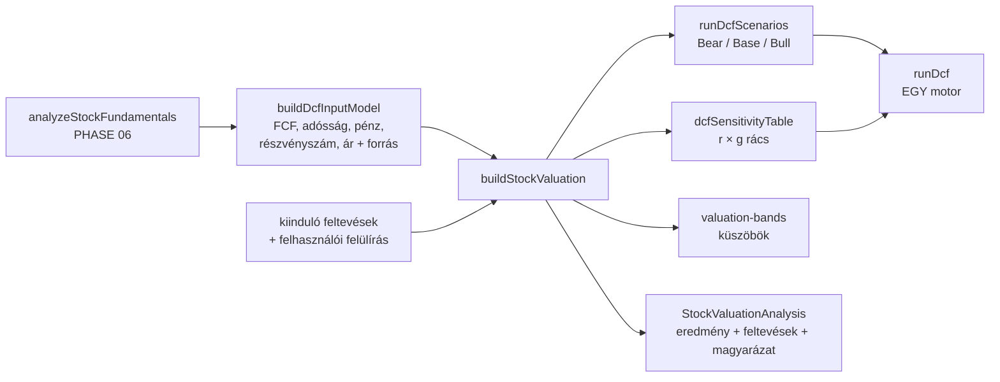

# PHASE 07 – Értékelés, DCF és szenzitivitási elemzés (kezdőbarát útmutató)

> Dátum: 2026-11-22 · Állapot: **KÉSZ** · Átadás: [../handoffs/phase-07-handoff.md](../handoffs/phase-07-handoff.md)
> Döntések: D-064, D-065 (a D-022 véglegesítve) ([../DECISIONS.md](../DECISIONS.md)) · Adatmodell: [../DATA_DICTIONARY.md](../DATA_DICTIONARY.md) **5.4** és **14.** fejezet

Ez az útmutató lépésenként leírja, mi készült a PHASE 07-ben, miért, és hogyan ellenőrizheted. A **teljes, aktuális kód a repóban van** a megadott útvonalakon (kb. 2 600 új sor, ennek közel fele teszt vagy tesztsegéd). Itt a lényeges részeket, a kisebb módosításokat teljes patch-ként, és valós számpéldát mutatunk.

## Tartalom
0. Szakszavak röviden
1. Indulóállapot ellenőrzése
2. Mit és miért építettünk (áttekintés)
3. 1. lépés – A DCF-motor (`runDcf`)
4. 2. lépés – Forgatókönyvek és szenzitivitási tábla
5. 3. lépés – Konfigurálható értékelési küszöbök
6. 4. lépés – Forward P/E (csak forrásból)
7. 5. lépés – A DCF-bemeneti modell
8. 6. lépés – Összerakás, kiinduló feltevések, magyarázat
9. 7. lépés – Use case-ek és bekötés
10. Tesztek és ellenőrzés
11. Valós példa: AAPL
12. Próbáld ki magad
13. Gyakori hibák és javításuk
14. Befejezési feltételek

---

## 0. Szakszavak röviden

| Szó | Jelentés |
|---|---|
| **DCF** (Discounted Cash Flow) | A cég értéke = a jövőbeli szabad pénzáramok mai értéke. |
| **FCF** (Free Cash Flow, szabad pénzáram) | Működési cash flow − beruházás (CapEx). Ennyi pénz „marad” a cégnél egy évben. |
| **Diszkontráta (r)** | Az elvárt éves hozam; ezzel váltjuk a jövőbeli pénzt mai pénzzé. 0.09 = 9%. |
| **Jelenérték (PV)** | `PV = jövőbeli összeg / (1 + r)^év`. Pl. 110 egy év múlva 10%-on = 100 ma. |
| **Terminális érték (TV)** | Az előrejelzési időszak utáni összes év értéke egy összegben (Gordon-modell). |
| **Gordon-modell** | `TV = FCF_utolsó × (1 + g) / (r − g)`. Csak akkor értelmes, ha **r > g**. |
| **Terminális növekedés (g)** | A végtelen távon feltételezett éves növekedés (tipikusan 2–3%). |
| **Enterprise Value (EV)** | A teljes vállalat értéke (tulajdonosok + hitelezők). |
| **Equity Value** | A részvényesek része: `EV − adósság + pénzeszközök`. |
| **Intrinsic value / share (IV)** | Belső érték egy részvényre: `Equity / részvényszám`. **Becslés.** |
| **Margin of Safety (MOS)** | Biztonsági sáv: `(IV − ár) / IV`. Pozitív = az ár a modellérték alatt. |
| **Forgatókönyv** | Egy feltevés-készlet (növekedés, r, g). Bear = óvatos, Base = kiinduló, Bull = kedvező. |
| **Szenzitivitási tábla** | Táblázat: hogyan változik az IV, ha r-t és g-t kicsit módosítjuk. |
| **`CalcResult`** | A motor eredménye: `OK` + érték, vagy indokolt hibastátusz (`MISSING`, `INVALID_INPUT`, `NOT_MEANINGFUL`…). |
| **Use case** | Az alkalmazás egy „funkciója” (pl. „értékeld ezt a részvényt”); a UI csak ezt hívja. |

---

## 1. Indulóállapot ellenőrzése

**Cél:** meggyőződni, hogy a PHASE 06 állapotáról indulunk, és minden zöld.
**Hol:** VS Code-ban nyiss terminált (*Terminal → New Terminal*); a parancsok a projekt gyökerében (`stock-etf-analyzer`) futnak.

```bash
git status          # elvárt: "nothing to commit, working tree clean"
git switch -c phase-07   # új munkaág (a main-t nem módosítjuk közvetlenül)
npm run check       # typecheck + lint + Prettier + tesztek
```

**Elvárt eredmény (a fázis elején mért):** `Tests: 661 passed, 661 total`, a parancs hibakód nélkül ér véget.

---

## 2. Mit és miért építettünk (áttekintés)



**Miért így?**
- **Egy motor (`runDcf`)**: a forgatókönyvek és a tábla minden cellája ugyanazt a függvényt hívja, így nem lehet két, egymásnak ellentmondó számítás (elfogadási feltétel).
- **Tiszta függvények** (`src/calculations`): nincs hálózat, óra, véletlen → ugyanarra a bemenetre mindig ugyanaz az eredmény, könnyen tesztelhető.
- **Külön alkalmazási réteg** (`src/application/valuation`): itt dől el, *melyik* adat megy a motorba, és itt készül a magyarázat.
- **A UI nem számol**: a képernyő (PHASE 12) a `recalculateStockValuation`-t hívja; egy őrteszt ezt ki is kényszeríti.

**Új fájlok:**

| Fájl | Szerep |
|---|---|
| `src/calculations/valuation/dcf.ts` | `runDcf` – a DCF-motor |
| `src/calculations/valuation/dcf-scenarios.ts` | forgatókönyvek, szenzitivitási tábla, tengely-generátor |
| `src/calculations/valuation/valuation-bands.ts` | konfigurálható MOS- és szorzó-küszöbök |
| `src/application/valuation/types.ts` | a kimenet típusai |
| `src/application/valuation/defaults.ts` | kiinduló feltevések, megjelenítési konvenciók, nyilatkozat |
| `src/application/valuation/dcf-inputs.ts` | DCF-bemenetek kiválasztása a PHASE 06 elemzésből |
| `src/application/valuation/stock-valuation.ts` | összerakás és magyarázat |
| `src/application/use-cases/analyze-stock-valuation.ts` | a két use case |
| `src/testing/stock-analysis-fixtures.ts` | CSAK tesztekhez: valós fixture → hamis gateway |
| + 4 tesztfájl | `dcf.test.ts`, `dcf-scenarios.test.ts`, `valuation-bands.test.ts`, `src/__tests__/stock-valuation-integration.test.ts` |

---

## 3. 1. lépés – A DCF-motor (`runDcf`)

**Cél:** egy feltevés-készletből kiszámolni minden év FCF-jét és jelenértékét, a terminális értéket, az EV-t, az equity-t, az IV/részvényt és a MOS-t.
**Fájl:** `src/calculations/valuation/dcf.ts`
**Előfeltétel:** a PHASE 05 `discountFactor`, `presentValue`, `gordonTerminalValue` függvényei (`dcf-conventions.ts`). A `checkDiscountRate` most exportált (egyetlen sor változott: `function` → `export function`).

**A képletek sorrendben:**
```
FCF_t   = FCF_{t−1} × (1 + g_t)               t = 1..n   (FCF_0 = kiinduló FCF)
PV_t    = FCF_t / (1 + r)^t                    év végi diszkontálás
TV      = FCF_n × (1 + g) / (r − g)            csak ha r > g
PV_TV   = TV / (1 + r)^n
EV      = Σ PV_t + PV_TV
Equity  = EV − teljes adósság + pénzeszközök
IV      = Equity / részvényszám
MOS     = (IV − ár) / IV                       csak ha IV > 0 és van azonos pénznemű ár
```

**Használat:**
```ts
import { runDcf } from '@/calculations';

const result = runDcf({
  baseFcf: 100,                  // kiinduló FCF
  growthRates: [0.1, 0.1, 0.1],  // 3 explicit év, évente 10%
  discountRate: 0.1,             // r = 10%
  terminalGrowth: 0.02,          // g = 2%
  totalDebt: 50,
  cash: 20,
  sharesOutstanding: 10,
  marketPrice: 80,
});
// result.status === 'OK'
// result.value.intrinsicValuePerShare ≈ 154.5   (kézzel: lásd a dcf.test.ts fejlécét)
```

**Az érvénytelen bemenetek kezelése** (minden esetben emberi nyelvű indok jön vissza):

| Helyzet | Eredmény |
|---|---|
| `r ≤ g` | `INVALID_INPUT`: „A diszkontráta … nem nagyobb a terminális növekedésnél … Csökkentsd a terminális növekedést vagy növeld a diszkontrátát.” |
| kiinduló FCF = 0 vagy negatív | `NOT_MEANINGFUL` (a „növekedés” a veszteséget növelné) – csak normalizált felülírással fut |
| részvényszám ≤ 0 | `INVALID_INPUT` |
| hiányzó adósság vagy pénz | `MISSING` – „a hiány nem 0; ha valóban 0, add meg explicit módon” |
| NaN / Infinity bárhol | `INVALID_INPUT` a bemenet nevével |
| r = 9 (9 helyett 0.09) | `INVALID_INPUT` + tipp: „tizedes törtként értendők” |
| időtáv 0 vagy 11 év | `INVALID_INPUT` (1–10 év; alapeset 5) |
| IV ≤ 0 (az adósság nagyobb, mint az EV) | a DCF `OK`, de a MOS `NOT_MEANINGFUL` + megjegyzés |
| nincs ár | a DCF `OK`, a MOS `MISSING` |

**Figyelmeztető megjegyzések** (nem hibák): ha a TV a vállalatérték > 75%-a; ha g > 4%; ha r − g < 2 százalékpont.

**Ellenőrzés:** `npx jest src/calculations/valuation/dcf.test.ts` → minden teszt zöld.

---

## 4. 2. lépés – Forgatókönyvek és szenzitivitási tábla

**Cél:** Bear/Base/Bull egymás mellett, és egy r × g táblázat – mindez ugyanazzal a `runDcf`-fel.
**Fájl:** `src/calculations/valuation/dcf-scenarios.ts`

```ts
import { runDcfScenarios, dcfSensitivityTable, sensitivityAxis } from '@/calculations';

const run = runDcfScenarios(
  { baseFcf: 100, totalDebt: 50, cash: 20, sharesOutstanding: 10, marketPrice: 80 },
  {
    bear: { growthRates: [0.02, 0.02, 0.02, 0.02, 0.02], discountRate: 0.1, terminalGrowth: 0.015 },
    base: { growthRates: [0.05, 0.05, 0.05, 0.05, 0.05], discountRate: 0.09, terminalGrowth: 0.025 },
    bull: { growthRates: [0.08, 0.08, 0.08, 0.08, 0.08], discountRate: 0.08, terminalGrowth: 0.03 },
  },
);
// run.scenarios[i] = { id, assumptions, result } – a feltevés MINDIG az eredmény mellett

sensitivityAxis(0.09, 0.01, 2); // → OK [0.07, 0.08, 0.09, 0.1, 0.11]
```

**Szabályok:**
- Minden cella = `runDcf({ ...base, discountRate: r, terminalGrowth: g })`. Ha egy cellában `r ≤ g`, **csak az a cella** lesz `INVALID_INPUT` (magyarázattal), a tábla többi része érvényes.
- Ha a belső értékek nem a Bear ≤ Base ≤ Bull sorrendben jönnek, megjegyzés figyelmeztet: a címkék csak elnevezések, a feltevések döntenek.
- Tengely: 1–11 véges, egyedi érték; különben a tábla `INVALID_INPUT`.

**Ellenőrzés:** `npx jest src/calculations/valuation/dcf-scenarios.test.ts` – a „minden cella = runDcf” teszt cellánként összeveti a táblát a közvetlen hívással.

---

## 5. 3. lépés – Konfigurálható értékelési küszöbök

**Cél:** a MOS-t és a szorzókat kategóriába sorolni – de úgy, hogy a küszöb **állítható** és **látható** legyen.
**Fájl:** `src/calculations/valuation/valuation-bands.ts`

| Kategória | Alapküszöb |
|---|---|
| `DISCOUNT_TO_MODEL` (az ár érdemben a modellérték alatt) | MOS ≥ 25% |
| `NEAR_MODEL` | −10% ≤ MOS < 25% |
| `PREMIUM_TO_MODEL` (az ár érdemben a modellérték felett) | MOS < −10% |
| Szorzó-sáv `LOW` / `MODERATE` / `HIGH` | pl. P/E < 15 / 15–25 / > 25 |

```ts
classifyMarginOfSafety(0.3);                                         // DISCOUNT_TO_MODEL
classifyMarginOfSafety(0.3, { discountAtLeast: 0.4, premiumBelow: 0 }); // NEAR_MODEL (saját küszöb)
```

**Fontos:** ezek **elemzési küszöbök, nem objektív igazságok** (iparágtól és kamatkörnyezettől függenek), és **nem** vételi/eladási jelzések. A kimenet mindig visszaadja a használt küszöböt és ezt a nyilatkozatot (`VALUATION_THRESHOLD_DISCLAIMER`).

---

## 6. 4. lépés – Forward P/E (csak forrásból)

**Cél:** a Forward P/E (ár / következő évi várható EPS) csak akkor jelenjen meg, ha az előrejelzés **valódi, forrásolt adat**. Saját becslést nem gyártunk.

**Patch 1 – `src/domain/fundamentals/financial-metric.ts`** (új azonosító):
```diff
   'pe',
+  // PHASE 07: csak ténylegesen elérhető elemzői EPS-előrejelzésből (D-065)
+  'forwardPe',
   'pfcf',
```

**Patch 2 – `src/calculations/definitions.ts`** (a fordító kikényszeríti, hogy minden azonosítónak legyen definíciója):
```diff
   pe: { formula: 'price / eps', unit: 'multiple' },
+  forwardPe: {
+    formula: 'price / forwardEps (forrásolt elemzői EPS-előrejelzés; nincs saját becslés)',
+    unit: 'multiple',
+  },
```

**Patch 3 – `src/application/stock-analysis/valuation.ts`:** a `ValuationInput` kapott egy opcionális `forwardEps?: Metric<number> | null` mezőt. Ha nincs megadva (ma mindig így van), a Forward P/E `MISSING` ezzel az indokkal: „Nincs bekötött, forrásolt elemzői EPS-előrejelzés … a Forward P/E-t saját feltevésből nem becsüljük.” Ha egyszer lesz forrás, ugyanaz a `priceToEarnings` képlet számolja.

---

## 7. 5. lépés – A DCF-bemeneti modell

**Cél:** a PHASE 06 elemzésből kiválasztani a DCF bemeneteit – **forrással, időszakkal, eredettel** –, és engedni a felhasználói felülírást.
**Fájl:** `src/application/valuation/dcf-inputs.ts` → `buildDcfInputModel(analysis, overrides)`

| Bemenet | Honnan jön | Mi történik, ha gond van |
|---|---|---|
| Kiinduló FCF | legutóbbi teljes pénzügyi év (FY) `fcf` sora | hiány → `MISSING`; negatív → a DCF `NOT_MEANINGFUL` |
| Teljes adósság, pénzeszközök | a legfrissebb mérlegnap (éves vagy negyedéves) | becsült adósság → figyelmeztetés; banknál `MISSING` |
| Részvényszám | legfrissebb mérleg | hiány → `MISSING` |
| Piaci ár | aktuális jegyzés | **eltérő pénznem** (pl. ADR) → `MISSING`, a MOS nem számolható (KI-50) |

Minden bemenetnél látszik: `value`, `status`, `origin` (pl. `calculated`, `estimated`, `stale`, `user_input`), `source` (forrás neve, `fetchedAt`, `asOf`), `basis` (pl. „FY2026 (záró: 2026-09-26)”), `reason` (ha nem használható).

**Felülírás példa** (negatív FCF helyett normalizált érték):
```ts
recalculateStockValuation(fundamentals, { inputOverrides: { baseFcf: 90_000_000_000 } });
// a mező: origin 'user_input', overridden: true, notes: ["Felhasználói felülírás (eredeti: …)."]
```

---

## 8. 6. lépés – Összerakás, kiinduló feltevések, magyarázat

**Fájlok:** `src/application/valuation/defaults.ts`, `stock-valuation.ts` → `buildStockValuation(analysis, options, calculatedAt)`

**Kiinduló feltevések** (`DEFAULT_DCF_SCENARIOS`) – **általánosak, nem a cégre kalibráltak**, mind felülírható:

| | Éves FCF-növekedés (5 év) | r | g |
|---|---|---|---|
| Bear (óvatos) | 2% | 10% | 1,5% |
| Base (kiinduló) | 5% | 9% | 2,5% |
| Bull (kedvező) | 8% | 8% | 3% |

**Beállítások (`StockValuationOptions`):**
```ts
{
  explicitYears: 3,                                        // 3 éves explicit időszak (alap: 5)
  scenarios: { base: { discountRate: 0.1 } },              // bármely mező külön állítható
  inputOverrides: { totalDebt: 120e9 },                    // bemenet-felülírás
  sensitivity: { discountRates: [0.08, 0.09, 0.1] },       // saját tengely
  marginOfSafetyThresholds: { discountAtLeast: 0.3, premiumBelow: -0.1 },
  multipleBands: { pe: { lowBelow: 12, highAbove: 22, higherIsCheaper: false, allowNonPositive: false } },
}
```

**A kimenet (`StockValuationAnalysis`) részei:**
- `dcf.inputs` – a bemenetek forrással; `dcf.scenarios` – feltevés + eredmény + kategória + `display`; `dcf.sensitivity` – a tábla; `dcf.provenanceKind: 'estimated'`.
- `multiples` – a PHASE 06 szorzói + sávok.
- `explanation` – `formulas` (minden képlet szövegesen), `conventions` (pl. év végi diszkontálás, FCFF-közelítés, nincs WACC, EV-egyszerűsítés), `context` (FCF/árbevétel CAGR, FCF-árrés, béta – csak viszonyítás).
- `generatedAt` és `fundamentalsGeneratedAt` (időbélyegek), `warnings`, `disclaimer`.

**Hamis pontosság ellen:** a motor nem kerekít (minden visszakövethető), de a `display` mező javaslatot ad: IV 3 értékes jegyre (pl. 161), MOS egész százalékra (pl. −112).

---

## 9. 7. lépés – Use case-ek és bekötés

**Fájl:** `src/application/use-cases/analyze-stock-valuation.ts`
- `analyzeStockValuation(listingId, options)` – lekéri a fundamentális elemzést (PHASE 06), majd értékel. Visszaadja mindkettőt: `{ fundamentals, valuation }`.
- `recalculateStockValuation(fundamentals, options)` – **hálózat nélkül** számol újra; ezt hívja majd a UI, amikor a felhasználó a feltevéseket állítja.

**Patch – `src/application/index.ts`** (az `AppServices` interfész bővítése):
```diff
   readonly analyzeStockFundamentals: AnalyzeStockFundamentals;
+  /** PHASE 07: értékelés + DCF (lekéréssel). */
+  readonly analyzeStockValuation: AnalyzeStockValuation;
+  /** PHASE 07: értékelés újraszámolása meglévő elemzésből, új feltevésekkel (hálózat nélkül). */
+  readonly recalculateStockValuation: RecalculateStockValuation;
 }
```

**Patch – `src/config/container.ts`** (a fundamentális use case egyszer jön létre, és mindkét helyen ugyanaz a példány):
```diff
   const getDividendHistory = createGetDividendHistory(market);
+  const analyzeStockFundamentals = createAnalyzeStockFundamentals({
+    getFinancialStatements, getListingQuote, getInstrumentProfile,
+    getPriceHistory, getDividendHistory, clock: deps.clock,
+  });
   return {
     …
-    analyzeStockFundamentals: createAnalyzeStockFundamentals({ … }),
+    analyzeStockFundamentals,
+    analyzeStockValuation: createAnalyzeStockValuation({ analyzeStockFundamentals, clock: deps.clock }),
+    recalculateStockValuation: createRecalculateStockValuation({ clock: deps.clock }),
   };
```

A `src/presentation/di/app-services-context.test.tsx` hamis szolgáltatás-objektuma két új `jest.fn()` mezőt kapott (különben a TypeScript hibát jelez).

---

## 10. Tesztek és ellenőrzés

```bash
npm run check
```

**Tényleges eredmény (2026-11-22):** exit 0 – typecheck ✅, lint ✅, Prettier ✅, **783/783 teszt, 52 suite** ✅ (a fázis elején 661).

| Tesztfájl | Mit igazol |
|---|---|
| `dcf.test.ts` | kézzel számolt golden eset (IV = 154,5), örökjáradék-azonosság (EV = FCF/r), `r ≤ g`, FCF ≤ 0, részvényszám ≤ 0, hiányzó adósság/pénz, NaN/Infinity, százalék-hiba, időtáv-határok, MOS minden ága |
| `dcf-scenarios.test.ts` | Bear/Base/Bull, nem monoton megjegyzés, cellánkénti egyezés a `runDcf`-fel, invalid cella, tengely-hibák, monotonitás |
| `valuation-bands.test.ts` | küszöbhatárok (≥ / <), saját küszöb, érvénytelen küszöb |
| `stock-valuation-integration.test.ts` | valós AAPL: zárt alakú képlettel ellenőrzött Base IV; 3 éves eset; BRK-B (hiányzó adósság/pénz/részvényszám); MSFT (becsült adósság, ár nélkül); XOM (nincs FY); eltérő pénznem; negatív FCF + felülírás |
| `calculations-purity.test.ts` | **őrteszt:** az `src/app` és `src/presentation` fájljai nem hívnak DCF-függvényt |

Lefedettség (csak az új modulokra): `src/calculations/valuation/*` 100% sor; `src/application/valuation/*` ~97% sor; a use case 100%.

---

## 11. Valós példa: AAPL (fixture, 2026-11-21, alapfeltevésekkel)

| Bemenet | Érték | Forrás |
|---|---|---|
| Kiinduló FCF | 136 056 M USD | FY2026 (záró: 2026-09-26), OCF − CapEx |
| Teljes adósság | 80 111 M USD | FY2026 mérleg (D-059) |
| Pénzeszközök | 36 305 M USD | FY2026 mérleg |
| Részvényszám | 14 532 M db | legfrissebb mérleg |
| Ár | 342,56 USD | FMP jegyzés (`stale`) |

| Forgatókönyv | IV/részvény (megjelenítve) | MOS | TV-arány | Kategória |
|---|---|---|---|---|
| Bear | 111 USD | −208% | 67% | PREMIUM_TO_MODEL |
| Base | 161 USD | −112% | 75% | PREMIUM_TO_MODEL |
| Bull | 237 USD | −45% | 80% (megjegyzés) | PREMIUM_TO_MODEL |

Szenzitivitás (Base, IV USD, sor = r, oszlop = g):

| r \ g | 1,5% | 2% | 2,5% | 3% | 3,5% |
|---|---|---|---|---|---|
| 7% | 198 | 215 | 235 | 261 | 293 |
| 8% | 167 | 178 | 192 | 208 | 227 |
| 9% | 144 | 152 | **161** | 172 | 185 |
| 10% | 126 | 132 | 139 | 147 | 156 |
| 11% | 112 | 117 | 122 | 128 | 135 |

**Hogyan olvasd?** Az általános (nem az Apple-re kalibrált) feltevésekkel mindhárom forgatókönyv a piaci ár alatt marad. Ez **nem** azt jelenti, hogy a részvény „drága”: azt mutatja, hogy a piaci ár ezeknél tartósan magasabb növekedést vagy alacsonyabb diszkontrátát áraz. Pont ezért látható és állítható minden feltevés (KI-58). A MOS definíciója miatt a negatív érték alulról nem korlátos (−208% = az ár kb. háromszorosa a modellértéknek).

---

## 12. Próbáld ki magad

**Cél:** saját feltevésekkel lefuttatni az AAPL-értékelést, élő hálózat nélkül.

1. Hozd létre ezt az **ideiglenes** fájlt: `src/__tests__/zz-probe.test.ts`
   ```ts
   import { createRecalculateStockValuation } from '@/application';
   import { analyze, clock } from '@/testing/stock-analysis-fixtures';

   it('próba', async () => {
     const fundamentals = await analyze('AAPL');
     const valuation = createRecalculateStockValuation({ clock })(fundamentals, {
       explicitYears: 3,
       scenarios: { base: { growthRates: [0.1, 0.08, 0.06], discountRate: 0.08 } },
     });
     for (const s of valuation.dcf.scenarios) {
       console.log(s.label, s.assumptions, s.result.status, s.display);
     }
   });
   ```
2. Futtasd a projekt gyökerében: `npx jest src/__tests__/zz-probe`
3. **Elvárt:** a konzolon a három forgatókönyv a feltevéseivel; a Base `source: 'user'`, a többi `default`; a `display` kerekített értéket mutat.
4. Próbáld ki: `discountRate: 0.02` a Base-ben → `INVALID_INPUT` és a magyarázat a `result.reason`-ben.
5. **Töröld a fájlt** a végén (`git status` ne mutassa).

---

## 13. Gyakori hibák és javításuk

| Hiba | Ok | Javítás |
|---|---|---|
| A DCF `INVALID_INPUT`, „tizedes törtként értendők” | százalékot adtál meg (9 a 0.09 helyett) | minden rátát törtként: 9% = `0.09` |
| `INVALID_INPUT`: „nem nagyobb a terminális növekedésnél” | `r ≤ g` | csökkentsd g-t vagy növeld r-t |
| Minden forgatókönyv `MISSING`, „Teljes adósság … felülírható” | a forrásban nincs adósság (pl. bank, biztosító) | `inputOverrides: { totalDebt: … }` – vagy fogadd el, hogy a modell erre a cégre nem alkalmazható |
| `NOT_MEANINGFUL`: „kiinduló szabad pénzáram nem pozitív” | negatív FY FCF | normalizált érték felülírással (`inputOverrides.baseFcf`), indoklással |
| A MOS `MISSING`, KI-50 | ADR / eltérő jegyzési pénznem | azonos pénznemű ár felülírással (`inputOverrides.marketPrice`) |
| TypeScript: „missing properties … analyzeStockValuation” | saját hamis `AppServices` objektum egy tesztben | add hozzá a két új mezőt (`jest.fn()`) |
| Lint: „Delete `␍`” | Windows-sorvég (CRLF) egy új fájlban | `npx prettier --write <fájl>` |
| Az őrteszt elbukik egy UI-fájlon | a komponens DCF-függvényt hív | a számítást a use case-be tedd; a UI csak a kimenetet jelenítse meg |

---

## 14. Befejezési feltételek

- [x] Külön DCF/valuation modul (`src/calculations/valuation/dcf*.ts`, `valuation-bands.ts`, `src/application/valuation/`).
- [x] Market Cap, EV, P/E, Forward P/E (csak forrásból), P/FCF, P/S, EV/EBITDA, PEG, P/B, FCF Yield.
- [x] DCF-bemeneti modell (FCF, időtáv, növekedés, r, g, adósság, pénz, részvényszám) forrással és felülírással; alapeset 5 év, 3 éves támogatott.
- [x] Évenkénti PV, Gordon TV, PV_TV, EV, Equity, IV/részvény, MOS.
- [x] `r > g` feltétel, különben invalid + emberi magyarázat.
- [x] Nem érvényes inputok kivédve (FCF ≤ 0, részvényszám ≤ 0, hiányzó adósság/pénz, nem véges szám).
- [x] Bear/Base/Bull, minden feltevés állítható és látható.
- [x] Szenzitivitási tábla: minden cella ugyanaz az engine (teszttel igazolva).
- [x] MOS = `(IV − ár) / IV`; IV ≤ 0 → nem számítható.
- [x] Konfigurálható küszöbök, dokumentálva, hogy elemzési konvenciók.
- [x] Magyarázható output: képletek, feltevések, forrásadatok, időbélyeg, eredmény.
- [x] Nincs DCF-számítás a UI-ban (őrteszt).
- [x] `npm run check` exit 0 (783/783).
