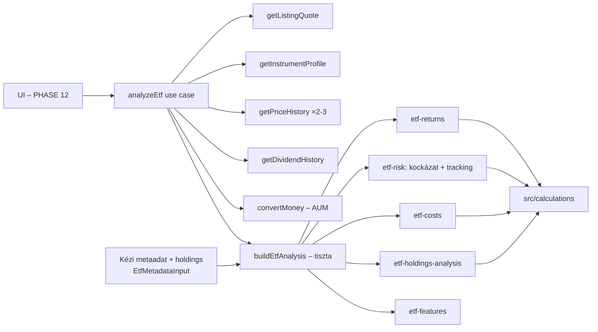

# PHASE 08 – ETF-elemző motor (kezdőbarát útmutató)

> Dátum: 2026-11-22 · Állapot: **KÉSZ** · Átadás: [../handoffs/phase-08-handoff.md](../handoffs/phase-08-handoff.md)
> Döntések: D-066…D-069 ([../DECISIONS.md](../DECISIONS.md)) · Adatmodell: [../DATA_DICTIONARY.md](../DATA_DICTIONARY.md) **5.5** és **15.** fejezet · Források: [../DATA_SOURCES.md](../DATA_SOURCES.md) **13.** fejezet

Ez az útmutató lépésenként leírja, mi készült a PHASE 08-ban, miért, és hogyan ellenőrizheted. A **teljes, aktuális kód a repóban van** a megadott útvonalakon (kb. 5 300 új sor, ennek kb. harmada teszt vagy tesztsegéd). Itt a lényeges részeket, a kisebb módosításokat pontos patch-ként és valós számpéldát mutatunk.

## Tartalom
0. Szakszavak röviden
1. Indulóállapot ellenőrzése
2. Mit és miért építettünk (áttekintés)
3. 1. lépés – ETF domain-modellek
4. 2. lépés – Kockázati képletek (`risk.ts`)
5. 3. lépés – Holdings- és kitettség-képletek
6. 4. lépés – A profil összerakása (kézi metaadat validálva)
7. 5. lépés – Hozam: price vs. total return, acc vs. dist
8. 6. lépés – Kockázat, tracking, költség
9. 7. lépés – Holdings, deviza, feature-modell
10. 8. lépés – Use case és bekötés
11. A SEC N-PORT vizsgálata
12. Tesztek és ellenőrzés
13. Valós példa: VWCE és ISF
14. Próbáld ki magad
15. Gyakori hibák és javításuk
16. Befejezési feltételek

---

## 0. Szakszavak röviden

| Szó | Jelentés |
|---|---|
| **ETF** | Tőzsdén kereskedett alap: egy indexet (pl. FTSE All-World) követő kosár. Nem vállalat – nincs saját eredménye, ezért P/E és DCF rá nem értelmezett. |
| **TER** | Teljes költséghányad: évente ennyit von le az alap a vagyonból. 0.0022 = 0,22%/év. |
| **AUM** | Kezelt vagyon (alapméret). |
| **Domicil** | Az alap bejegyzési országa (pl. `IE` = Írország). |
| **UCITS** | Európai alapszabályozás; csak európai domicilnél releváns. |
| **Replikáció** | Hogyan követi az indexet: teljes fizikai, mintavételes fizikai, szintetikus (swap). |
| **Akkumuláló (acc)** | Az osztalékot az alap újrabefekteti → az árfolyam már tartalmazza. |
| **Disztribúciós (dist)** | Az osztalékot kifizeti → az árfolyam esik az ex-napon; a hozamhoz a kifizetést is számolni kell. |
| **Price return** | Csak az árfolyam változása. |
| **Total return** | Árfolyam + osztalék. Két ETF csak így hasonlítható össze tisztességesen. |
| **Holdings** | Az alap összetétele (pozíciók és súlyuk). |
| **Top 10 súly** | A 10 legnagyobb pozíció együttes aránya – koncentráció-mérő. |
| **HHI** | Herfindahl-index: Σ súly². 1/HHI = „effektív pozíciószám”. |
| **Hedged (fedezett)** | Az alap devizaügyletekkel kiszűri a devizaárfolyam hatását egy célpénznemre. |
| **Jegyzési deviza ≠ devizakockázat** | Egy EUR-ban jegyzett világ-ETF mögött főleg USD-s részvények vannak: a kockázat a mögöttes devizákból jön. |
| **Tracking difference (TD)** | ETF-hozam − indexhozam ugyanarra az időszakra (tipikusan ≈ −TER). |
| **Tracking error (TE)** | A napi hozamkülönbségek szórása évesítve – mennyire „egyenletesen” követ. |
| **Volatilitás** | A napi hozamok szórása évesítve (× √252). |
| **Max drawdown** | A legnagyobb visszaesés egy csúcstól. |
| **Sharpe / Sortino** | Kockázatmentes hozam (rf) feletti hozam / kockázat. A Sortino csak a lefelé mozgást bünteti. |
| **Béta** | Mennyire mozog együtt egy indexszel (1 = ugyanannyit). |
| **Feature** | Egy jellemző (pl. TER, top 10 súly), amit a PHASE 10 score-motor majd súlyoz. |

---

## 1. Indulóállapot ellenőrzése

**Cél:** meggyőződni, hogy a PHASE 07 állapotáról indulunk, és minden zöld.
**Hol:** VS Code-ban nyiss terminált (*Terminal → New Terminal*); a parancsok a projekt gyökerében (`stock-etf-analyzer`) futnak.

```bash
git status               # elvárt: "On branch main ... nothing to commit, working tree clean"
git switch -c phase-08   # új munkaág (a main-t nem módosítjuk közvetlenül)
npm run check            # typecheck + lint + Prettier + tesztek
```

**Elvárt eredmény (a fázis elején mért):** `Tests: 783 passed, 783 total`, a parancs hibakód nélkül ér véget.

---

## 2. Mit és miért építettünk (áttekintés)



**A legfontosabb tény:** a free adatcsomagban **nincs ETF-metaadat** (TER, AUM, replikáció…) **és nincs holdings** (FMP `etf/info` 402, EODHD fundamentals 403). Ezért:
- a motor mindent tud számolni, **ha** megkapja az adatot;
- az adatot ma a felhasználó adja meg (a kibocsátó factsheetjéből) – ez `user_input` eredetű, és látszik;
- ha nincs megadva, a mező **`UNAVAILABLE / PLAN_LIMIT`** – a hiány nem nulla, és a lefedettségi lista (`coverage`) mezőnként kimutatja.

**Miért külön modul?** Az ETF nem részvény. Ha a részvény-elemzést futtatnánk rá, P/E-t és DCF-et kapnánk egy kosárra, aminek nincs saját eredménye. Az ETF-elemzés ezért külön mappában van (`src/application/etf-analysis/`), és egy **őrteszt** ellenőrzi, hogy nem importál részvénymodult (és fordítva).

---

## 3. 1. lépés – ETF domain-modellek

**Cél:** típusok, amelyek pontosan leírják, mit tudunk egy ETF-ről – és mit nem.
**Fájlok (új):**
- `src/domain/etf/etf-classification.ts` – kategóriák (régió, eszközosztály, méret, stílus, osztalékfókusz, súlyozás);
- `src/domain/etf/etf-holdings.ts` – holdings-pillanatkép + validáció (`createEtfHoldingsSnapshot`);
- `src/domain/etf/etf-profile.ts` – `EtfProfile`: egy jegyzés (ticker@tőzsde) elemzési bemenete.

**Kis módosítások (patch):**

`src/domain/instrument/instrument.ts` – futásidejű listák az enumokhoz (a kézi bevitel validálásához):
```ts
export const ETF_REPLICATIONS = ['physical_full', 'physical_sampling', 'synthetic'] as const;
export type EtfReplication = (typeof ETF_REPLICATIONS)[number];
export const ETF_DISTRIBUTIONS = ['accumulating', 'distributing'] as const;
export type EtfDistribution = (typeof ETF_DISTRIBUTIONS)[number];
```

`src/domain/index.ts` – a fájl végére:
```ts
export * from './etf/etf-classification';
export * from './etf/etf-holdings';
export * from './etf/etf-profile';
```

**A lényeg az `EtfProfile`-ban:** minden forrásfüggő mező `Metric<T>` (érték + forrás, vagy a hiány oka). Három deviza-fogalom külön mezőben (D-068): `tradingCurrency` (jegyzés), `fundBaseCurrency` (alap), és a holdings devizái (mögöttes kitettség).

**A holdings szabályai (D-067):** a súly tizedes tört (0.05 = 5%) és **nem normalizáljuk** – egy „top 10” kivonatnál így a top 10 súly a valós, alaphoz mért arány marad. Negatív súly (derivatíva) megengedett. Ha a súlyok összege 150% fölött van, szinte biztos, hogy valaki százalékot írt tört helyett → hiba.

**Ellenőrzés:** `npx jest src/domain/etf` → `Tests: 14 passed`.

---

## 4. 2. lépés – Kockázati képletek (`risk.ts`)

**Cél:** volatilitás, downside deviation, Sharpe, Sortino, béta – tiszta, tesztelt függvényekként.
**Fájl (új):** `src/calculations/returns/risk.ts` · **Export:** `src/calculations/index.ts` kapott egy sort: `export * from './returns/risk';`

**Konvenciók (D-066) – ezért ilyen a kód:**
- napi **egyszerű** hozam (`P_t / P_{t−1} − 1`);
- évesítés **√252**-vel (az EOD-sorban csak kereskedési napok vannak);
- **minta** szórás (n − 1);
- **rf nélkül nincs Sharpe/Sortino** (nem találunk ki kamatot);
- béta csak a két sor **közös dátumain** (`alignByDate`) – a londoni és a frankfurti ünnepnapok eltérnek;
- a hívó adja a minimum megfigyelésszámot; az alkalmazás alapja **126 napi hozam** (≈ fél év).

**Példa (kézzel ellenőrizhető, a tesztben is):** hozamok `[0.01, −0.01]` → minta szórás `0.014142…` → évesítve `× √252 ≈ 0.2245`.

**Ellenőrzés:** `npx jest src/calculations/returns/risk` → minden zöld.

---

## 5. 3. lépés – Holdings- és kitettség-képletek

**Fájlok (új):** `src/calculations/etf/holdings.ts`, `src/calculations/etf/exposure.ts` (exportálva a `src/calculations/index.ts`-ből).

| Függvény | Mit csinál | Mikor nem számol |
|---|---|---|
| `topNWeight` | a legnagyobb N pozitív súly összege | részleges listán, ha N-nél kevesebb tétel van |
| `holdingsConcentration` | HHI és effektív pozíciószám | részleges listán (alulbecsült volna) |
| `exposureBreakdown` | ország/szektor/deviza szerinti súly + „ismeretlen” + „le nem fedett” | üres lista |
| `deriveRegion` | régió az országsúlyokból (≥ 80% domináns; különben GLOBAL / OTHER) | ha az ismert súly < 50% |
| `currencyRisk` | a befektetői devizától eltérő, fedezés utáni kitettség | ha nincs ismert devizasúly |

**Egy valódi hiba, amit a teszt fogott meg:** `8 × 0.1` a gépben `0.7999999999999999`, ami kisebb, mint `0.8`, így egy pontosan 80%-ban amerikai alap nem lett „US”. Javítás: a küszöböt `1e-9` tűréssel vetjük össze (D-067/5).

---

## 6. 4. lépés – A profil összerakása (kézi metaadat validálva)

**Fájl (új):** `src/application/etf-analysis/etf-profile-builder.ts` (`buildEtfProfile`).

**Mit csinál:**
1. A szolgáltatói profilból (FMP, csak US) veszi a nevet, ISIN-t, domicilt – ezek `reported`.
2. A kézi metaadatból (`EtfMetadataInput`) a többit – ezek `user_input`.
3. **Mindent validál futásidőben** (a felhasználó bármit beírhat): TER 0…10%, ismert enum-értékek, ISO pénznem, dátum, holdings-szabályok. Hiba → `VALIDATION` a mező útvonalával (pl. `ter`, `classification.region`, `holdings`).
4. Ha a kézi név eltér a szolgáltatóétól → figyelmeztetés, a szolgáltatóét használja.
5. UCITS nem európai domicilnél → `NOT_APPLICABLE`.
6. Fedezetlen osztálynál a fedezési deviza `NOT_APPLICABLE`; fedezett, de deviza nélkül → `MISSING`.

**Kis refaktor (patch):** az `appErrorToMetric` segéd a részvénymodulból a közös `src/application/shared/app-error-metric.ts`-be került, a `src/application/stock-analysis/metric-helpers.ts` pedig továbbexportálja:
```ts
/** Közös segéd (PHASE 08-ban kiemelve, hogy az ETF-elemzés is használhassa). */
export { appErrorToMetric } from '../shared/app-error-metric';
```
Így az ETF-modul nem függ a részvénymodultól.

---

## 7. 5. lépés – Hozam: price vs. total return, acc vs. dist

**Fájl (új):** `src/application/etf-analysis/etf-returns.ts` (`analyzeReturns`).

**A probléma:** egy disztribúciós ETF árfolyama minden osztaléknál esik. Ha csak az árfolyamot nézzük, rosszabbnak tűnik egy ugyanolyan akkumuláló ETF-nél – pedig nem az.

**A megoldás – a total return forrásának sorrendje (D-069/4):**

| Sorrend | Feltétel | Módszer (`totalReturnMethod`) |
|---|---|---|
| 1 | van split- és osztalék-korrigált ártörténet | `adjusted_series` |
| 2 | akkumuláló ETF, csak árfolyam van | `accumulating_price` (az ár = total return) |
| 3 | disztribúciós ETF, árfolyam + osztalékok | `price_plus_distributions` (újrabefektetés nélkül) |
| – | egyik sem | `MISSING`, és `comparisonBasis: 'price_return_only'` + figyelmeztetés |

További szabályok: **1 évnél rövidebb időszakot nem évesítünk** (félrevezető); akkumulálónál az osztalékhozam `NOT_APPLICABLE`; GBX-árat és GBP-osztalékot a motor fő egységre (GBP) hozza.

---

## 8. 6. lépés – Kockázat, tracking, költség

**Fájlok (új):** `src/application/etf-analysis/etf-risk.ts` (`analyzeRisk`, `analyzeTracking`), `src/application/etf-analysis/etf-costs.ts` (`analyzeCosts`).

- **Kockázat:** a total return sorból; ha nincs, az árfolyamsorból (megjegyzéssel). 126 napi hozam alatt `INSUFFICIENT_DATA` az okkal (pl. a free csomag 1 éves korlátja).
- **Tracking (D-069/5):** csak **total return indexsorral**. Árindex → `NOT_MEANINGFUL` (az osztalék torzítaná). Eltérő pénznem → `INVALID_INPUT`. Eltérő időszak → a **közös** ablakra számol, és kiírja. Indexforrás ma nincs, ezért a hívó adja (`options.benchmark`).
- **Költség:** `10 000 × TER` (pl. 0,19% → 19 egység/év), és a TER 10 éves hatása 6% feltételezett hozammal – ez **becslés** (`estimated`), a feltevések a kimenetben.

---

## 9. 7. lépés – Holdings, deviza, feature-modell

**Fájlok (új):** `src/application/etf-analysis/etf-holdings-analysis.ts` (`analyzeHoldings`, `analyzeCurrency`), `src/application/etf-analysis/etf-features.ts` (`buildFeatureModel`), `src/application/etf-analysis/etf-analysis.ts` (`buildEtfAnalysis` – minden összerakása).

**Deviza:** a fedezetlen idegen kitettség a holdings devizáiból jön, **nem** a jegyzési devizából. Ha nincs holdings-deviza → `MISSING` (nem találjuk ki).

**Feature-modell (a PHASE 10-nek):** 21 feature kilenc csoportban (diverzifikáció, költség, tracking, likviditás, méret, struktúra, kockázat, koncentráció, deviza), mindegyik „kedvező iránnyal”. **Nincs súly és nincs pontszám** – azt a PHASE 10 dönti el. A `groupCoverage` csak azt mutatja, csoportonként hány feature-nek van értéke.

**Részvény-mutatók:** a kimenet `notApplicable` listája indokkal közli, miért nincs P/E, Forward P/E, DCF és vállalati minőségi modell.

---

## 10. 8. lépés – Use case és bekötés

**Fájl (új):** `src/application/use-cases/analyze-etf.ts` (`createAnalyzeEtf`).

**Bekötés (patch-ek):**

`src/application/index.ts`:
```ts
import type { AnalyzeEtf } from './use-cases/analyze-etf';
// …
export * from './use-cases/analyze-etf';
export * from './etf-analysis/types';
export { buildEtfAnalysis, ETF_ANALYSIS_DISCLAIMER, ETF_NOT_APPLICABLE } from './etf-analysis/etf-analysis';
export { DEFAULT_TER_IMPACT } from './etf-analysis/etf-costs';
export { DEFAULT_MIN_RISK_OBSERVATIONS } from './etf-analysis/etf-risk';
// az AppServices interfészben:
  /** PHASE 08: ETF-elemzés (a részvénylogikától különválasztva; UI a PHASE 12-ben). */
  readonly analyzeEtf: AnalyzeEtf;
```

`src/config/container.ts` – a `convertMoney` egy változóba került (két use case is használja), és:
```ts
    analyzeEtf: createAnalyzeEtf({
      getListingQuote,
      getPriceHistory,
      getDividendHistory,
      getInstrumentProfile,
      convertMoney,
      clock: deps.clock,
    }),
```

`src/presentation/di/app-services-context.test.tsx` – a hamis szolgáltatás-objektumba: `analyzeEtf: jest.fn(),`

**Mit csinál a use case:** párhuzamosan lekéri az árfolyamot, a profilt, 3 év ártörténetet (korrigált + split-korrigált; az EODHD-nél split-korrigált nincs, ott a nyers a tartalék), és az osztalékokat. Ha a szolgáltató szerint részvény → hibát ad („használd a részvényelemzést”). **Kvóta:** 4–5 hívás / elemzés (KI-68).

---

## 11. A SEC N-PORT vizsgálata

A roadmap kérte, hogy nézzük meg, ad-e a SEC ingyen ETF-összetételt. **Élő próbával igazoltuk** (3 kérés, a `.env.local` SEC User-Agentjével – a kulcs és az e-mail sehol nem került ki):
- **Igen:** US-regisztrált alapokra (iShares, SPDR) teljes lista súllyal (`pctVal`, százalékban), országgal, ISIN-nel, devizával.
- **De:** negyedévente, ~60 nap késéssel; **szektor nincs**; UCITS ETF-re (VWCE, IWDA) **nincs**.
- A részletek: DATA_SOURCES 13.2.

**Döntés (D-069/9):** adaptert most nem építettünk (XML-feldolgozó függőség kompatibilitás-ellenőrzése, sorozat-kiválasztás és valós fixture kell hozzá) – a holdings-modell viszont kész a fogadására (KI-66).

---

## 12. Tesztek és ellenőrzés

```bash
npm run check
```

**Elvárt (a fázis végén mért):** exit 0; `Test Suites: 59 passed`, `Tests: 927 passed, 927 total` (a 923 + 4 teszt a D-070 megbízhatósági címkéhez).

| Tesztfájl | Mit igazol |
|---|---|
| `src/calculations/returns/risk.test.ts` | kézzel számolt volatilitás, downside dev., Sharpe, Sortino, béta; hibás bemenetek |
| `src/calculations/etf/holdings.test.ts`, `exposure.test.ts` | top N, HHI, kitettség-bontás, régió (a 80%-os lebegőpontos esettel), devizakockázat |
| `src/domain/etf/etf-holdings.test.ts` | holdings-validáció (százalék-hiba, üres lista, részleges lista) |
| `src/application/etf-analysis/etf-analysis.test.ts` | **részleges holdings, hiányzó TER, eltérő időszak, acc/dist, hedged/unhedged**, metaadat nélküli free eset, validációs hibák |
| `src/__tests__/etf-analysis-integration.test.ts` | valós EODHD-fixture (VWCE, ISF) → use case; részvény elutasítása; AUM-átváltás |
| `src/__tests__/etf-stock-separation.test.ts` | az ETF- és a részvénylogika nem importálja egymást |

**Lefedettség (új modulok):** ~99% sor; a képletek (`risk.ts`, `holdings.ts`, `exposure.ts`) 100%.

---

## 13. Valós példa: VWCE és ISF (EODHD-fixture, 2026-10-20 … 2026-11-20)

| | VWCE@XETR (akkumuláló, EUR) | ISF@XLON (disztribúciós, GBX) |
|---|---|---|
| Árfolyamhozam (1 hónap) | −6,47% | −3,29% |
| Total return (1 hónap), módszer | −6,47%, `adjusted_series` | −3,29%, `adjusted_series` (az ablakban nem volt ex-nap) |
| Évesített total return | `INSUFFICIENT_DATA` – 0,08 év | `INSUFFICIENT_DATA` |
| Osztalékhozam (TTM) | `NOT_APPLICABLE` (akkumuláló) | **3,14%** = (0,0528 + 0,0492 + 0,1288 + 0,0865) GBP / 10,108 GBP |
| Volatilitás | `INSUFFICIENT_DATA` – 23 napi hozam < 126 | ua. |
| TER (kézzel megadva) → költség / 10 000 / év | 0,19% → 19 | 0,07% → 7 |
| TER 10 éves hatása (6% feltevés, becslés) | 1,78% | 0,66% |
| Holdings | `MISSING` (metaadat van, holdings nincs) | ua. |

Figyeld meg: az ISF ára pennyben (1010,8 GBX), az osztaléka fontban jön – a motor 10,108 GBP-vel oszt, nem 1010,8-cal (különben 100-szor kisebb hozam jönne ki).

---

## 14. Próbáld ki magad

**Cél:** saját metaadattal lefuttatni egy ETF-elemzést hálózat nélkül, szintetikus adatokon.

1. Hozd létre ezt az **ideiglenes** fájlt: `src/__tests__/zz-probe.test.ts`
   ```ts
   import { buildEtfAnalysis } from '@/application';
   import { holdingsList, inputs, metadata } from '@/application/etf-analysis/testing';

   it('próba', () => {
     const result = buildEtfAnalysis(
       inputs({
         options: {
           displayCurrency: 'HUF',
           riskFreeRate: 0.03,
           metadata: metadata({
             ter: 0.0019,
             distribution: 'accumulating',
             currencyHedged: false,
             holdings: {
               asOf: '2026-10-31',
               holdings: holdingsList(10, 0.05, { country: 'US', currency: 'USD' }),
               declaredComplete: false,
               reportedHoldingsCount: 3700,
             },
           }),
         },
       }),
     );
     if (!result.ok) throw new Error(result.error.message);
     const a = result.value;
     console.log('top10', a.holdings.top10Weight.value, 'top20', a.holdings.top20Weight.value.status);
     console.log('Sharpe', a.risk.sharpe.value.status, 'FX', a.currency.unhedgedForeignShare.value);
     console.log('lefedettség', a.coverage.available, '/', a.coverage.total, a.coverage.limitations);
   });
   ```
2. Futtasd a projekt gyökerében: `npx jest src/__tests__/zz-probe`
3. **Elvárt:** a top 10 súly ≈ `0.5` (`OK`; a konzolon `0.49999999999999994` – lebegőpontos ábrázolás, a megjelenítés kerekít), a top 20 `INSUFFICIENT_DATA` (részleges lista), a Sharpe `OK` (rf megadva), a fedezetlen idegen kitettség HUF-hoz képest `1`.
4. Próbáld ki: `ter: 0.19` → a hívás `VALIDATION` hibát ad (`ter` útvonallal), mert 19%-ot jelentene.
5. **Töröld a fájlt** a végén (`git status` ne mutassa).

---

## 15. Gyakori hibák és javításuk

| Hiba | Ok | Javítás |
|---|---|---|
| `VALIDATION`, útvonal: `ter` | százalékot adtál meg (0.19 a 0.0019 helyett) | 0,19% = `0.0019` |
| `VALIDATION`, útvonal: `holdings` | a súlyok összege > 150% (százalékok) vagy üres lista | súly törtként (5% = `0.05`); hiányzó holdings-t ne add meg |
| Minden ETF-mező `UNAVAILABLE / PLAN_LIMIT` | nincs `metadata` (a free csomag nem ad ETF-adatot) | add meg a factsheet adatait `options.metadata`-ban |
| A TD `NOT_MEANINGFUL` | árindexet adtál meg (`returnBasis: 'price'`) | total return index kell (`net_total_return`) |
| A TD `INVALID_INPUT` | az ETF és az index pénzneme eltér | azonos pénznemű indexsort adj |
| A volatilitás `INSUFFICIENT_DATA` | < 126 napi hozam (pl. free 1 év, fiatal ETF) | hosszabb sor, vagy tudatosan `minRiskObservations` (a megbízhatóság csökken) |
| `comparisonBasis: 'price_return_only'` | nincs korrigált sor, és az acc/dist nincs megadva | add meg a `distribution`-t, vagy kérj `SPLIT_DIVIDEND` sort |
| Az `analyzeEtf` hibát ad: „részvény, nem ETF” | a szolgáltató részvénynek jelöli | a részvényelemzést használd (`analyzeStockFundamentals`) |
| Lint: „Delete `␍`” | Windows-sorvég (CRLF) egy új fájlban | `npx prettier --write <fájl>` |
| ESLint: „imported in restricted zone” egy `application` alatti tesztben | az application réteg nem importálhat szerverkódot (fixture-normalizálót) | az ilyen integrációs tesztet a `src/__tests__/`-be tedd |

---

## 16. Befejezési feltételek

- [x] ETF domain-modellek: ticker, név, kibocsátó, ISIN, tőzsde, deviza, domicil, AUM, indulás, TER, replikáció, benchmark, acc/dist, UCITS, holdings + dátum (`EtfProfile`, `EtfHoldingsSnapshot`).
- [x] Külön ETF use case (`analyzeEtf`); P/E/DCF/minőség `notApplicable` indokkal; őrteszt a különválasztásra.
- [x] Kategóriák (régió, méret, stílus, osztalékfókusz, súlyozás); a régió holdingsból is levezethető.
- [x] HUF/EUR/USD/GBP/CHF/JPY kijelzés (AUM-átváltás), hedged/unhedged, jegyzési vs. mögöttes deviza.
- [x] Holdings-szám, top 5/10/20, ország-/szektorsúly, koncentráció – csak ha van holdings.
- [x] TER-költség, tracking difference, tracking error – csak megfelelő adattal; definíciók dokumentálva (DATA_DICTIONARY 15.8).
- [x] Price vs. total return, acc/dist összehasonlíthatóság, „csak árhozam” jelzés.
- [x] Volatilitás, max drawdown, béta, Sharpe/Sortino – csak megfelelő idősorral; évesítési konvenció dokumentálva (D-066).
- [x] Feature-modell súlyozás nélkül (a döntési engine a PHASE 10).
- [x] Tesztek: részleges holdings, hiányzó TER, eltérő időszak, dist/acc, hedged/unhedged.
- [x] Lefedettségi korlátok láthatók (`coverage`, `limitations`).
- [x] `npm run check` exit 0 (927/927).
