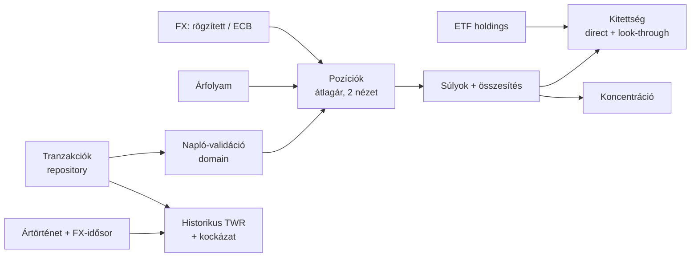

# PHASE 09 – Saját portfólió, allokáció és kockázat (kezdőbarát útmutató)

> Dátum: 2026-11-22 · Állapot: **KÉSZ** · Átadás: [../handoffs/phase-09-handoff.md](../handoffs/phase-09-handoff.md)
> Döntés: **D-072** ([../DECISIONS.md](../DECISIONS.md)) · Adatmodell: [../DATA_DICTIONARY.md](../DATA_DICTIONARY.md) **7.** fejezet (7.1–7.6) és **5.5**

Ez az útmutató lépésenként leírja, mi készült a PHASE 09-ben, miért, és hogyan ellenőrizheted. A **teljes, aktuális kód a repóban van** a megadott útvonalakon (kb. 5 450 új sor, ebből ~1 800 teszt). Itt a lényeges részeket, a kisebb módosításokat patch-ként és egy kézzel végigszámolt példát mutatunk.

## Tartalom
0. Szakszavak röviden
1. Indulóállapot ellenőrzése
2. Mit és miért építettünk (áttekintés)
3. 1. lépés – Tranzakciónapló-validáció (domain)
4. 2. lépés – Eszköz-metaadat (domain)
5. 3. lépés – Átlagáras könyvelés (motor)
6. 4. lépés – Időarányos hozam, TWR (motor)
7. 5. lépés – ETF-átfedés (motor)
8. 6. lépés – FX-ráták feloldása (alkalmazás)
9. 7. lépés – Pozíciók két P/L-nézetben (alkalmazás)
10. 8. lépés – Súlyok és összesítés
11. 9. lépés – Kitettség, koncentráció, átfedés
12. 10. lépés – Historikus elemzés
13. 11. lépés – Use case, bekötés, `recordTransaction`
14. Tesztek és ellenőrzés
15. Kézzel végigszámolt példa
16. Próbáld ki magad
17. Gyakori hibák és javításuk
18. Befejezési feltételek

---

## 0. Szakszavak röviden

| Szó | Jelentés |
|---|---|
| **Tranzakció** | Egy rögzített esemény: vétel (`BUY`), eladás (`SELL`), osztalék (`DIVIDEND`), külön díj (`FEE`), részvényfelosztás (`SPLIT`). Ez az egyetlen igazságforrás. |
| **Pozíció** | Amit egy jegyzésből (pl. `AAPL@XNAS`) most tartasz. Nem kézzel írjuk, hanem a tranzakciókból **számoljuk**. |
| **Átlagár-módszer** | A vételek költségét (díjjal együtt) átlagoljuk; eladáskor az átlagáron csökken a bekerülés. Egyszerű, de **nem adóbevallásra való**. |
| **Bekerülési érték (cost basis)** | Amennyiért a még meglévő darabokat „vetted” (díjjal). |
| **Realizált P/L** | Eladásnál ténylegesen elért nyereség/veszteség. **Nem realizált P/L**: a mai piaci érték − bekerülés (papíron). |
| **Natív nézet** | Az instrumentum saját pénznemében (pl. USD), devizahatás nélkül. |
| **Bázis nézet** | A portfólió pénznemében (pl. EUR). A bekerülést a vétel napi árfolyamán, a piaci értéket a mai árfolyamon váltjuk → benne van a **devizahatás (FX-hatás)**. |
| **GBX** | Londoni „penny” jegyzés: 100 GBX = 1 GBP. |
| **Súly** | Egy pozíció aránya a portfólió (árazott) értékében. 0.25 = 25%. |
| **Kitettség** | Mekkora rész esik egy országra, szektorra, devizára stb. |
| **Look-through** | „Átnézés” az ETF-en: az ETF súlyát szétosztjuk a benne lévő cégek között (holdings alapján). |
| **HHI / effektív pozíciószám** | Koncentrációs mutató: Σ súly²; az 1/HHI azt mondja meg, hány egyforma pozícióval lenne egyenértékű a portfólió. |
| **TWR (időarányos hozam)** | Olyan hozam, amelyet a be- és kifizetések nem torzítanak – a befektetések teljesítményét méri. |
| **Drawdown** | Visszaesés a korábbi csúcshoz képest. |
| **Korreláció** | Mennyire mozog együtt két eszköz (−1 … 1). |

---

## 1. Indulóállapot ellenőrzése

**Cél:** meggyőződni, hogy a PHASE 08 utáni állapotból indulunk, és minden zöld.

**Hol:** VS Code → *Terminal → New Terminal* (a projekt gyökerében: `C:\Users\lujzi\Documents\stock-etf-analyzer`).

```bash
git status
npm run check
```

**Elvárt (a fázis előtt):** `On branch main`, `nothing to commit`; `npm run check` végén `Tests: 927 passed`.
**A fázis után:** a munka a `phase-09` branchen van; `Tests: 1011 passed, 66 suites`.

```bash
git switch phase-09     # ha nem ezen állsz
npm run check
```

---

## 2. Mit és miért építettünk (áttekintés)



**Rétegek** (a projekt szabálya szerint, ESLint kikényszeríti):
- `src/domain/portfolio/` – szabályok (validáció, metaadat), külső függőség nélkül;
- `src/calculations/` – tiszta képletek számokkal (nincs hálózat, nincs óra);
- `src/application/portfolio/` – összerakás (`buildPortfolioAnalysis`, szintén tiszta);
- `src/application/use-cases/analyze-portfolio.ts` – az adatlekérés (árfolyam, FX, profil, ártörténet).

**Amit tudatosan NEM csináltunk:** tartós tárolás (PHASE 13), képernyő (PHASE 12), teljes ETF-összehasonlítás (PHASE 14), FIFO/adó (KI-79).

---

## 3. 1. lépés – Tranzakciónapló-validáció (domain)

**Cél és ok:** egy tranzakció önmagában lehet helyes, de a naplóval együtt ellentmondásos (pl. több darabot adsz el, mint amennyid van). Ezt pozíciószámítás előtt ki kell szűrni, és **a tárolóból érkező adatot is újra ellenőrizni** (a tároló megkerülheti a konstruktort).

**Fájl:** `src/domain/portfolio/ledger-validation.ts` (új). Fő függvény:

```ts
export function validateTransactionLedger(
  portfolio: Portfolio,
  transactions: readonly Transaction[],
  options: { listingCurrencies?: ReadonlyMap<ListingId, CurrencyCode> } = {},
): LedgerValidation; // { issues, blocking, invalidListings }
```

| Kód | Súly | Mikor |
|---|---|---|
| `DUPLICATE_ID`, `PORTFOLIO_MISMATCH` | hiba, **blokkoló** (az elemzés `VALIDATION` hibát ad) | ismétlődő azonosító / idegen portfólió |
| `INVALID_VALUE`, `MISSING_CURRENCY` | hiba | ≤ 0 mennyiség/ár, negatív díj, hiányzó/rossz pénznem |
| `CURRENCY_CONFLICT` | hiba | egy jegyzés két pénznemben (GBX/GBP nem ütközés) |
| `FX_RATE_MISMATCH` | hiba | a rögzített árfolyam rossz irányú |
| `OVERSELL` | hiba | eladás > birtokolt mennyiség (időrendben!) |
| `POSSIBLE_DUPLICATE`, `SPLIT_WITHOUT_POSITION`, `DIVIDEND_WITHOUT_POSITION` | figyelmeztetés | csak jelzés |

**Időrend:** dátum szerint, azonos napon a rögzítés sorrendjében (`orderTransactions`).

**Ellenőrzés:** `npx jest src/domain/portfolio` → `12 passed`.

---

## 4. 2. lépés – Eszköz-metaadat (domain)

**Cél:** a kitettség-bontáshoz tudni kell, hogy egy jegyzés részvény vagy ETF, milyen eszközosztály, ország, szektor.

**Fájl:** `src/domain/portfolio/portfolio-asset.ts` (új): `PortfolioAssetMetadata` + `createPortfolioAssetMetadata(input)` (validál: ISIN ellenőrző számjegy, országkód, ismert fajta és eszközosztály). Részvény eszközosztálya automatikusan `equity`.

**Fontos:** az ETF `country` mezője a **domicil** (pl. IE = Írország) – ez **nem** gazdasági kitettség, ezért ETF-nél a közvetlen országbontás nem használja.

**Patch – a régi, használatlan `Position` interfész törlése** (`src/domain/portfolio/portfolio.ts`): a fájl végén a `Position` interfész helyére megjegyzés került, mert a pozíció számított kimenet lett (`PositionAnalysis`, `src/application/portfolio/types.ts`).

---

## 5. 3. lépés – Átlagáras könyvelés (motor)

**Cél:** a pozíció darabszámát, bekerülését, átlagárát és a realizált P/L-t számolni – **egy pénznemben**, számokkal.

**Fájl:** `src/calculations/portfolio/average-cost.ts` (új), függvény: `averageCostLedger(events)`.

```text
VÉTEL:   bekerülés += darab × ár + díj
ELADÁS:  realizált += darab × eladási ár − díj − darab × átlagár
         bekerülés −= darab × átlagár      (az átlagár NEM változik)
SPLIT:   darab × (ratioTo / ratioFrom)      (bekerülés változatlan → átlagár csökken)
Túladás → INVALID_INPUT (short pozíció nincs)
```

A függvény **lépésenként** visszaadja az állapotot (`steps`), így minden szám visszakövethető.

**Ugyanez a motor fut kétszer:** egyszer natív pénznemben, egyszer a vétel napi árfolyamán bázisra váltott összegekkel (lásd 7. lépés).

**Ellenőrzés:** `npx jest src/calculations/portfolio/average-cost` → zöld; a teszt egy kézzel végigszámolt életutat ellenőriz (2 vétel, részeladás, split, teljes eladás: realizált 237).

---

## 6. 4. lépés – Időarányos hozam, TWR (motor)

**Cél és ok:** ha év közben veszel még, a portfólió értéke nő – de ez **nem hozam**. A TWR ezt kiszűri.

**Fájl:** `src/calculations/portfolio/time-weighted-return.ts` (új), függvény: `timeWeightedReturn(days)`.

```text
r_t = (V_t − F_t + I_t) / V_{t−1} − 1
  V_t: napvégi érték   F_t: aznapi vétel(+)/eladás(−) napvégi áron   I_t: osztalék
Index = Π(1 + r_t)    Kumulált hozam = Index − 1
```

Ha előtte nap üres volt a portfólió (`V_{t−1} = 0`), aznap nincs hozam-megfigyelés.

---

## 7. 5. lépés – ETF-átfedés (motor)

**Fájl:** `src/calculations/etf/overlap.ts` (új), `holdingsOverlap({ a, b, bothComplete })`.
**Képlet:** Σ min(súly_A, súly_B) a **közös ISIN-ekre**. 0 = nincs közös cég, 1 = azonos összetétel. ISIN nélküli tételt nem párosítunk (név alapján nem találgatunk). Részleges listán ez alsó becslés. A teljes összehasonlító funkció és a képernyő a PHASE 14-ben jön.

---

## 8. 6. lépés – FX-ráták feloldása (alkalmazás)

**Fájl:** `src/application/portfolio/fx-lookup.ts` (új).

**Elsőbbség egy tranzakció napjára** (pénznem → bázis):
1. azonos pénznem (pl. EUR → EUR): nincs váltás;
2. a tranzakcióhoz rögzített `fxRateToBase` (pl. a brókered tényleges árfolyama) – `source: 'transaction'`;
3. ECB-árfolyam **az ügylet napjára** – `source: 'market'`;
4. különben **hiány** okkal. **Soha nem a mai árfolyammal pótoljuk** (az hamis bekerülést adna).

A piaci érték a **mai** árfolyammal számol; a dátum a kimenetben látszik (`currentFx.asOf`, `fxRatesUsed`).

---

## 9. 7. lépés – Pozíciók két P/L-nézetben (alkalmazás)

**Fájl:** `src/application/portfolio/portfolio-positions.ts` (új), `buildPosition(input)`.

- **Natív nézet:** a jegyzés pénznemében. Más pénznemű díj (pl. GBP díj GBX-es ügyletnél) egységváltással (×100), eltérő devizánál az ügyleti napi FX-szel.
- **Bázis nézet:** minden esemény az ügyleti napi rátával bázisra váltva, majd ugyanaz az átlagáras motor.
- **FX-felbontás:** `nem realizált P/L (bázis) = árhatás + FX-hatás`
  - árhatás = natív nem realizált P/L × mai ráta
  - FX-hatás = natív bekerülés × mai ráta − bázis bekerülés
- **Összhozam** = nem realizált + realizált + osztalék − külön díjak; **%** = ÷ bruttó befektetés (egyszerű, nem idő- és nem pénzsúlyozott – ezt a kimenet kiírja).

Hibás naplójú jegyzés: `status: 'invalid'`, minden mutató `INVALID_INPUT` okkal – **a többi pozíció ettől még számolódik**.

---

## 10. 8. lépés – Súlyok és összesítés

**Fájl:** `src/application/portfolio/portfolio-totals.ts` (új).

- Súly: a meglévő `portfolioWeights` (PHASE 05) a bázisdevizás piaci értékekből; ár/FX nélküli pozíció **nem kap 0 súlyt**, hanem `MISSING` és az `unpriced` listába kerül.
- Minden összeg (`PortfolioTotal`): `value` (csak akkor `OK`, ha MINDEN pozíciónak van értéke), `components` (pozíciónként az összeg), `missing` (hiányzók), `availableSum` (részösszeg). Így az összeg mindig visszavezethető.

---

## 11. 9. lépés – Kitettség, koncentráció, átfedés

**Fájl:** `src/application/portfolio/portfolio-exposure.ts` (új).

| Nézet | Mit mutat |
|---|---|
| `direct` | instrumentumfajta, eszközosztály, jegyzési deviza, ország, szektor – pozíciónként egy tétel (ETF-nél ország/szektor nincs) |
| `look_through` | ország, szektor, mögöttes deviza – részvény + **ETF-súly × holdings-súly**, azonos kulcsnál összeadva; holdings nélküli ETF → „le nem fedett” (`uncoveredWeight`) |

**Koncentráció:** legnagyobb pozíció, Top 5/10, HHI, effektív pozíciószám, **egyedi részvénykitettség** ISIN szerint (pl. Apple közvetlenül + a VWCE-n keresztül), szektor- és országkoncentráció mindkét nézetben.

A meglévő `exposureBreakdown`, `topNWeight`, `holdingsConcentration` (PHASE 08) függvényeket használjuk újra.

---

## 12. 10. lépés – Historikus elemzés

**Fájl:** `src/application/portfolio/portfolio-history.ts` (új).

**Elv (a prompt 7. pontja):** a múltbeli értéket a **tényleges, tranzakciókból visszaépített mennyiségekből** számoljuk – soha nem a mai súlyokból visszafelé.

- napi érték = Σ (mennyiség × split-korrekció × záróár ÷ alegység × napi FX);
- hozam: TWR (4. lépés); kockázat: a meglévő `risk.ts` / `drawdown.ts` (√252, minta szórás, min. 126 napi hozam, megbízhatósági címke `standard` / `short_window`);
- évesített hozam csak ≥ 1 éves ablakon; Sharpe/Sortino csak megadott kockázatmentes hozammal (`riskFreeRate`);
- korreláció a nyitott pozíciók napi hozamaiból;
- ha az ártörténet később kezdődik (a free EODHD 1 évet ad), az ablak később indul, és a `limitations` ezt kimondja;
- **többdevizás portfólió napi FX-idősor nélkül → `MISSING`** (KI-77; nincs még FX-idősor végpont).

Csak kérésre fut (`history: { enabled: true }`), mert jegyzésenként egy ártörténet-hívás.

---

## 13. 11. lépés – Use case, bekötés, `recordTransaction`

**Új fájl:** `src/application/use-cases/analyze-portfolio.ts` – `createAnalyzePortfolio(deps)`.

Lépések: portfólió + tranzakciók → előzetes validáció (blokkoló hiba → `VALIDATION`) → opciók validálása → párhuzamos lekérés (árfolyam csak a nyitott pozíciókra; profil, ha `fetchProfiles !== false`; ártörténet csak kérésre; FX az ügyleti napokra és mára, duplikátum nélkül) → `buildPortfolioAnalysis`.

**Patch – bekötés** (`src/config/container.ts`, a `createAppServices` visszatérési objektumának végén):

```ts
    analyzePortfolio: createAnalyzePortfolio({
      portfolioRepository: deps.portfolioRepository,
      getListingQuote,
      getInstrumentProfile,
      getPriceHistory,
      convertMoney,
      clock: deps.clock,
    }),
```

és az `AppServices` interfészben (`src/application/index.ts`):

```ts
  /** PHASE 09: portfólióelemzés (pozíciók, P/L két nézetben, kitettség, koncentráció, historikus). */
  readonly analyzePortfolio: AnalyzePortfolio;
```

**Patch – `recordTransaction`** (`src/application/use-cases/record-transaction.ts`): mentés előtt a meglévő naplóval együtt validál, és ha az új tranzakció **új hibát** okoz (pl. túladás, akár visszadátumozott eladás miatt), `VALIDATION` hibát ad és nem ment. A figyelmeztetés (pl. lehetséges duplikátum) nem akadályoz.

**Tárolás:** nem változott – `InMemoryPortfolioRepository` (újraindításkor elvész; PHASE 13).

---

## 14. Tesztek és ellenőrzés

```bash
npx jest src/calculations/portfolio src/calculations/etf/overlap   # motor
npx jest src/domain/portfolio                                       # validáció
npx jest src/application/portfolio src/application/use-cases        # összerakás + use case
npm run check                                                        # minden
```

**Tényleges eredmény (2026-11-22):** `npm run check` exit 0 – typecheck ✅, lint ✅, Prettier ✅, **1011/1011 teszt, 66 suite** ✅.

| Tesztfájl | Mit bizonyít |
|---|---|
| `src/calculations/portfolio/average-cost.test.ts` | átlagár, split, tört darab, túladás |
| `src/calculations/portfolio/time-weighted-return.test.ts` | befizetés nem hozam, osztalék igen, üres napok |
| `src/calculations/etf/overlap.test.ts` | Σ min súly, ISIN nélküli tétel |
| `src/domain/portfolio/ledger-validation.test.ts` | minden hibakód, időrend, split utáni eladás |
| `src/application/portfolio/portfolio-analysis.test.ts` | **vegyes deviza**, két nézet, FX-felbontás, **súlyok**, összeg = Σ pozíció, **hiányzó ár / mai FX / ügyleti FX**, kitettség, koncentráció, átfedés |
| `src/application/portfolio/portfolio-history.test.ts` | TWR = eszközhozam, két eszköz, osztalék, split (korrigált és nyers sor), FX-idősor, hézag, kevés adat |
| `src/application/use-cases/analyze-portfolio.test.ts` | mit kér le és mit nem, opció-validáció mezőútvonallal, NOT_FOUND, sérült napló |
| `src/config/container.test.ts` | végponttól végpontig demó módban, a mock jelölés megmarad |

---

## 15. Kézzel végigszámolt példa

Portfólió bázisa: **EUR**. Apple (`AAPL@XNAS`, USD):

| Nap | Esemény | USD→EUR |
|---|---|---|
| 2026-01-02 | vétel 10 db @ 100 USD + 1 USD díj | 0,90 |
| 2026-03-02 | vétel 10 db @ 120 USD + 1 USD díj | 0,95 |
| 2026-05-15 | osztalék 5 USD | 0,93 |
| 2026-06-01 | eladás 5 db @ 130 USD − 1 USD díj | 0,92 |
| ma | árfolyam 150 USD | 0,85 |

**Natív (USD):** bekerülés 1001 + 1201 = 2202 (20 db, átlag 110,1). Eladás: 5 × 130 − 1 = 649; levonandó 5 × 110,1 = 550,5 → **realizált 98,5**. Marad 15 db, bekerülés 1651,5. Piaci érték 15 × 150 = 2250 → **nem realizált 598,5 USD**.

**Bázis (EUR):** vételek: 10 × 90 + 0,9 = 900,9 és 10 × 114 + 0,95 = 1140,95 → 2041,85 (átlag 102,0925). Eladás: 5 × 119,6 − 0,92 = 597,08; levonandó 5 × 102,0925 = 510,4625 → **realizált 86,6175 EUR**. Bekerülés 1531,3875. Piaci érték 2250 × 0,85 = **1912,5 EUR** → **nem realizált 381,1125 EUR**, ebből:
- árhatás = 598,5 × 0,85 = **508,725**
- FX-hatás = 1651,5 × 0,85 − 1531,3875 = **−127,6125** (a dollár gyengült)
- ellenőrzés: 508,725 − 127,6125 = 381,1125 ✅

Ugyanezek a számok szerepelnek a `portfolio-analysis.test.ts` első tesztjében.

---

## 16. Próbáld ki magad

Hozz létre egy ideiglenes tesztfájlt: `src/application/portfolio/sajat-proba.test.ts`

```ts
import { buildPortfolioAnalysis } from './portfolio-analysis';
import { baseInput, EUR, quote, tx, VWCE } from './testing';

it('saját próba', () => {
  const analysis = buildPortfolioAnalysis(
    baseInput({
      transactions: [tx.buy(VWCE, '2026-01-02', 10, 100, EUR, 2)],
      quotes: new Map([[VWCE, quote(VWCE, 110, EUR)]]),
    }),
  );
  const p = analysis.positions[0];
  console.log(p?.costBasisBase, p?.marketValueBase, p?.weight);
});
```

Futtatás (a projekt gyökerében): `npx jest src/application/portfolio/sajat-proba`
Elvárt: bekerülés 1002 EUR, piaci érték 1100 EUR, súly 1. Utána **töröld** a fájlt (ne kerüljön a repóba).

Próbáld ki azt is, hogy a `quote(...)` helyett üres `new Map()`-et adsz: a piaci érték `MISSING` lesz okkal – nem 0.

---

## 17. Gyakori hibák és javításuk

| Tünet | Ok | Javítás |
|---|---|---|
| A pozíció `invalid`, `CURRENCY_CONFLICT` | az ügylet pénzneme eltér az árfolyamétól (pl. USD-s árfolyam EUR-ban rögzített vételnél) | a tranzakciót a jegyzés pénznemében rögzítsd (GBX/GBP felcserélhető) |
| `OVERSELL` azonos napi vétel+eladásnál | azonos napon a rögzítés sorrendje számít (KI-81) | előbb a vételt rögzítsd |
| A bázis bekerülés `MISSING` | az ügylet napjára nincs árfolyam | add meg a tranzakcióhoz a bróker rátáját (`fxRateToBase`), vagy ellenőrizd az FX-forrást |
| A historikus elemzés `MISSING`, „KI-77” | többdevizás portfólió, nincs napi FX-idősor | `history.fxSeries`-ben add meg, vagy várd meg a PHASE 13-at |
| A historikus elemzés `NOT_APPLICABLE` | nem kérted | `analyzePortfolio(id, { history: { enabled: true } })` |
| Sharpe `MISSING` | nincs kockázatmentes hozam | `riskFreeRate: 0.03` (tizedes tört!) |
| `riskFreeRate` VALIDATION hiba | százalékot adtál meg (3) tört helyett | `0.03` = 3% |
| Az ETF országkitettsége „besorolatlan” | közvetlen nézetben ez szándékos (domicil ≠ kitettség) | nézd a `look_through` nézetet holdings-szal |
| Lint: „restricted zone” egy tesztben | application-teszt infrastruktúrát importált | hamis tárolót írj a tesztben (lásd `analyze-portfolio.test.ts`) |
| Windows: `heredoc` / sorvég-gondok szkriptnél | Git Bash sajátosság | fájlba írt szkript; a repó LF-et kényszerít (`.gitattributes`) |

---

## 18. Befejezési feltételek

- [x] Portfólió domain/application logika: validáció, metaadat, pozíciók, összesítés, kitettség, koncentráció, historikus, átfedés-modell.
- [x] Portfólió-képletek unit tesztekkel (motor 100% sor).
- [x] Minden összesítés visszavezethető (`components`, `ledger`).
- [x] Hiányzó ár / FX egyértelmű állapot (nem 0).
- [x] ETF mögöttes és közvetlen kitettség külön nézetben.
- [x] Tesztek: vegyes deviza, súlyszámítás, hiányzó adatok.
- [x] Könyvelési módszer dokumentálva (átlagár, adózásra nem alkalmas).
- [x] Nincs új, dokumentálatlan tároló (a PHASE 13-ig memóriában).
- [x] `npm run check` exit 0 (1011/1011).
- [x] Docs: DATA_DICTIONARY 7., DECISIONS D-072, KNOWN_ISSUES KI-76…82, ROADMAP, ARCHITECTURE, PROJECT_STATE, handoff.
- [x] Commit (`b9dc472`) és PR #5 – a merge a tulajdonos döntése.

**Következő:** PHASE 10 – Score és döntési engine. Állj meg itt; a 10-es prompt új chatben induljon.
