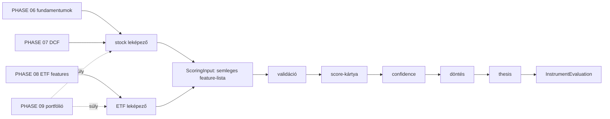

# PHASE 10 – Magyarázható score és determinisztikus döntési engine (kezdőbarát útmutató)

> Dátum: 2026-11-22 · Állapot: **KÉSZ** · Átadás: [../handoffs/phase-10-handoff.md](../handoffs/phase-10-handoff.md)
> Döntések: **D-073, D-074, D-075** ([../DECISIONS.md](../DECISIONS.md)) · Adatmodell: [../DATA_DICTIONARY.md](../DATA_DICTIONARY.md) **16.** fejezet

Ez az útmutató lépésenként leírja, mi készült a PHASE 10-ben, miért, és hogyan ellenőrizheted. A **teljes, aktuális kód a repóban van** a megadott útvonalakon (kb. 4 900 új sor, ebből ~1 500 teszt és tesztsegéd). Itt a lényeges részeket, a kisebb módosításokat patch-ként, és egy kézzel végigszámolt példát mutatunk.

> **Fontos:** a rendszer címkéi (Strong Buy … Strong Sell) **elemzési kategóriák** a megadott adatokból és a konfigurált küszöbökből. Nem garantált előrejelzések, nem hozamígéretek és nem személyre szabott befektetési tanácsok. Az `AnalysisConfidence` azt méri, mennyire teljes és jó minőségű az adat – **nem** a jövőbeli hozam valószínűségét.

## Tartalom
0. Szakszavak röviden
1. Indulóállapot ellenőrzése
2. Mit és miért építettünk (áttekintés)
3. 1. lépés – Új réteg: `src/scoring` és a rétegszabály
4. 2. lépés – Két új képlet a számítási motorban
5. 3. lépés – Típusok és konfiguráció
6. 4. lépés – Konfiguráció-validáció (a súlyok automatikus ellenőrzése)
7. 5. lépés – Score engine és a hiányzó adat kezelése
8. 6. lépés – AnalysisConfidence
9. 7. lépés – Döntési engine
10. 8. lépés – Thesis risks és érvénytelenítés
11. 9. lépés – Leképezők és use case-ek (alkalmazási réteg)
12. Tesztek és ellenőrzés
13. Kézzel végigszámolt példa
14. Próbáld ki magad
15. Gyakori hibák és javításuk
16. Befejezési feltételek

---

## 0. Szakszavak röviden

| Szó | Jelentés |
|---|---|
| **Score (pontszám)** | 0–100 közötti szám. Itt mindig egy tizedesre kerekítve. |
| **Kategória** | Egy témakör (pl. Jövedelmezőség), több mutató súlyozott átlaga. |
| **Súly** | Mennyit számít egy tétel az átlagban. A kategóriasúlyok összege 100, a kategórián belüli mutatósúlyoké 1. |
| **Horgony (anchor)** | A két érték, amelyhez 0 és 100 pont tartozik (pl. ROIC 5% → 0, 20% → 100). |
| **Újranormalizálás** | Ha egy tétel kimarad, a többi súlyát úgy osztjuk újra, hogy összegük megint 100% legyen. |
| **Lefedettség (coverage)** | A ténylegesen pontozott mutatók súlyaránya (0–1). |
| **Dimenzió** | A döntés egy szempontja (pl. Értékelés, Minőség), egy vagy több kategóriából. |
| **Plafon (cap)** | Szabály, amely a címkét legfeljebb egy szintig engedi (pl. „legfeljebb Hold”). |
| **Determinisztikus** | Ugyanarra a bemenetre mindig pontosan ugyanaz a kimenet (nincs véletlen, óra, külső állapot). |
| **Regressziós (golden) teszt** | Egy rögzített bemenet rögzített, várt kimenete. Ha a kód vagy a konfiguráció változik, szándékosan piros lesz. |
| **Thesis** | Az elemzés „állítása” (pl. „minőségi cég, drága áron”); a **thesis risk** az, ami ellene szól, az **invalidáló** az, aminek bekövetkezése érvénytelenítené. |

## 1. Indulóállapot ellenőrzése

**Cél:** tiszta kiindulópont. **Hol:** a projekt gyökerében (`c:\Users\lujzi\Documents\stock-etf-analyzer`), VS Code terminálban.

```bash
git status            # elvárt: main, clean (a PHASE 09 már merge-ölve: 296eeba, PR #5)
npm test              # elvárt: 1011/1011, 66 suite
git switch -c phase-10
```

**Elvárt:** `Switched to a new branch 'phase-10'`. Ha a `git status` módosított fájlokat mutat, előbb tisztázd őket (commit vagy `git stash`).

## 2. Mit és miért építettünk (áttekintés)



- **Miért külön réteg (`src/scoring`)?** Az ARCHITECTURE már a PHASE 01-ben kijelölte: a pontozás tiszta szabály, nem függhet UI-tól, hálózattól vagy órától. Így könnyen tesztelhető és garantáltan determinisztikus.
- **Miért semleges bemenet?** A motor nem tudja, mi a „részvény” vagy az „ETF”: mutatókat (`Metric` + provenance) és igen/nem jelzéseket kap. A részvény- és az ETF-score ugyanazt a motort használja, de **külön konfigurációval**. A kettő keverése hibát ad.
- **Miért nem 0 a hiányzó adat?** Mert a hiány nem rossz eredmény, hanem ismeretlen. A 0 pont csendben büntetne (például minden nem US céget a free csomag miatt).

## 3. 1. lépés – Új réteg: `src/scoring` és a rétegszabály

**Cél:** az új mappa csak a `domain`-t és a `calculations`-t importálhatja. **Fájl:** `eslint.config.js`.

Patch (a `layerZones` tömbbe, az `application` zóna elé):

```js
  {
    // PHASE 10 (D-073): a score-/döntési engine tiszta szabálymotor – domain + calculations.
    target: './src/scoring',
    from: './src',
    except: ['./scoring', './domain', './calculations'],
    message: 'A scoring csak a domaint és a calculations-t importálhatja (ARCHITECTURE 3.).',
  },
```

Ezen felül egy `no-restricted-imports` blokk tiltja a külső csomagokat (React, Expo, zod…) a `src/scoring/**` fájlokban, és a hálózati globálisok tiltása is kiterjed rá. Az őrteszt: `src/__tests__/scoring-purity.test.ts`. Ez ellenőrzi az importokat, és azt, hogy nincs `fetch`, `Date.now`, `new Date`, `Math.random`, AI-hivatkozás, illetve hogy a UI nem hív pontozó függvényt.

**Ellenőrzés:** `npx eslint src/scoring` → nincs hiba.

## 4. 2. lépés – Két új képlet a számítási motorban

**Cél:** a pontozás ne számoljon saját képletet (CLAUDE.md: nincs duplikált business logic).

| Függvény | Fájl | Képlet | Szélsőeset |
|---|---|---|---|
| `netDebtToEbitda` | `src/calculations/fundamentals/balance-cashflow.ts` | nettó adósság / EBITDA (negatív = nettó készpénz) | EBITDA ≤ 0 → `NOT_MEANINGFUL`; hiány → `MISSING` |
| `priceAtMarginOfSafety` | `src/calculations/valuation/multiples.ts` | ár = belső érték × (1 − MOS) – a MOS inverze | IV ≤ 0 vagy MOS ≥ 1 → `INVALID_INPUT` |

**Ellenőrzés:** `npx jest src/calculations/fundamentals/balance-cashflow.test.ts src/calculations/valuation/multiples.test.ts` → minden zöld.

## 5. 3. lépés – Típusok és konfiguráció

**Fájlok:** `src/scoring/types.ts` (minden típus), `src/scoring/config/shared-defaults.ts`, `stock-config.ts`, `etf-config.ts`.

Egy mutató-szabály így néz ki a konfigurációban:

```ts
{
  featureId: 'roic',
  weight: 0.6,                                   // súly a kategórián belül
  rule: { kind: 'linear', worst: 0.05, best: 0.2 },
  rationale: '5% körül a tőkeköltség közelében, 20% felett kiemelkedő tőkehatékonyság.',
}
```

Szabályfajták:
- `linear` – két horgony között arányos, kívül levágva (az irány a horgonyokból adódik: ha `best < worst`, akkor az alacsonyabb a jobb, pl. P/E);
- `linear_money` – pénzösszegnél pénznemenként külön horgony (más pénznemben nem pontoz, mert az csendes átváltás lenne);
- `categorical` – pl. replikáció: `physical_full` = 100, `physical_sampling` = 85, `synthetic` = 60.

**Kiinduló súlyok** (D-073/6–7):

| Részvény | Súly | ETF | Súly |
|---|---|---|---|
| Üzleti minőség | 10 | Diverzifikáció | 15 |
| Növekedés | 15 | Költség | 20 |
| Jövedelmezőség | 15 | Követés | 15 |
| Mérleg | 15 | Likviditás | 5 |
| Cash flow | 15 | Méret és kor | 10 |
| Moat | **0** (nem pontozott) | Szerkezet | 10 |
| Menedzsment | 5 | Kockázat | 10 |
| Értékelés | 25 | Koncentráció | 10 |
| | | Devizakockázat | 5 |
| **Összesen** | **100** | **Összesen** | **100** |

**Miért 0 a Moat?** A versenyelőny csak forrásolt szöveges lelettel bizonyítható (D-063), a szövegnek viszont nincs gépileg pontozható iránya. Szövegből nem pontozunk.

## 6. 4. lépés – Konfiguráció-validáció

**Fájl:** `src/scoring/config-validation.ts`. **Cél:** a prompt 3. pontja – a súlyoknak össze kell adódniuk, és ezt automatikusan ellenőrizni kell.

A motor **minden futáskor** validál (`validateConfigs`). Ellenőrzi:
- kategóriasúlyok összege = 100, kategórián belül a mutatósúlyok összege = 1 (lebegőpontos tűrés: 1e-9);
- a horgonyok véges és különböző számok, a kategória-pontok 0–100 között vannak;
- a 0 súlyú kategóriának nincs mutatója, és van indoka;
- az utolsó döntési szabály feltétel nélküli „fallback” (mindig legyen címke);
- a dimenziók, jelzések és kategóriák létező azonosítókra hivatkoznak;
- a score- és a döntési konfiguráció eszközfajtája egyezik a bemenetével (részvény ≠ ETF).

Hibás konfigurációnál **nincs pontozás**, hanem `VALIDATION` hiba jön, mezőútvonallal (pl. `scoreConfig.categories` – „A kategóriasúlyok összege 100 kell legyen (most: 99)”).

## 7. 5. lépés – Score engine és a hiányzó adat kezelése

**Fájlok:** `src/scoring/score-math.ts`, `src/scoring/score-engine.ts`. **Döntés:** D-074.

```
mutatópont  = szabály(érték)                                    ∈ [0, 100]
kategória   = Σ(mutatópont × súly) / Σ(a PONTOZOTT mutatók súlya)
összpont    = Σ(kategória × súly) / Σ(a PONTOZOTT kategóriák súlya)
minden szint egy tizedesre kerekítve; a felső szint a kerekített alsóból számol
```

**Hiányzó adat – hibrid stratégia:**
1. A nem pontozható mutató **kimarad** (nem 0), a maradék súlya újranormalizálódik.
2. Csak akkor, ha a lefedettség eléri a kategória minimumát (alapból 50%; egymutatós kategóriánál 100%). Alatta a kategória `INSUFFICIENT_DATA`, és nincs pontja.
3. Az összpontszám ugyanígy működik: a pontozott kategóriák súlyaránya legalább 60% legyen, különben nincs összpontszám.
4. A lefedettség csökkenti a confidence-t (6. lépés).

**Miért ez?** A „mindig elérhetetlen” majdnem mindent kinullázna. A „mindig újranormalizál” elrejtené a hiányt. A „csak confidence” mellett a hiány rejtve 0-nak számítana. A hibrid megőrzi a használható pontot, de láthatóvá teszi a hiányt.

Kategóriánként a kimenet: `score`, `weight`, `effectiveWeight`, `coverage`, `metrics` (minden mutató értéke, pontja, szabálya, eredete, frissessége), `rule`, `rationale` (olvasható sorok, formátum: `<mutató> = <érték> → <pont> pont (súly <w>; <szabály>)`, pl. a golden ETF-tesztben `Teljes költséghányad (TER) = 0.22% → 77.9 pont (súly 1; lineáris: 0.75% → 0 pont, 0.07% → 100 pont …)` – ezt a teszt szó szerint ellenőrzi), `missing`, `dataQuality`, `freshness`.

## 8. 6. lépés – AnalysisConfidence

**Fájl:** `src/scoring/confidence.ts`.

```
confidence = 100 × adatlefedettség × adatminőség
adatminőség (mutatónként) = forrásfajta × frissesség × ablakhossz
   forrásfajta: jelentett/számított 1 · felhasználói 0,8 · becsült 0,7 · demó 0,3 · AI 0
   frissesség:  FRESH 1 · UNKNOWN 0,9 · STALE 0,75 · EXPIRED 0,5
   ablak:       rövid kockázati ablak (D-070) 0,8
szint: HIGH ≥ 80 · MEDIUM ≥ 45 · LOW alatta · nincs összpontszám → INSUFFICIENT · demóadat → legfeljebb LOW
```

A HIGH küszöb azért 80, mert így egy legalább 20 súlyú kategória (pl. a 25 súlyú Értékelés) teljes hiánya mellett tökéletes adatminőséggel sem lehet HIGH (0,75 × 1,0 = 75).

## 9. 7. lépés – Döntési engine

**Fájl:** `src/scoring/decision-engine.ts`. **Döntés:** D-075.

1. **Dimenziók** kiszámítása: részvénynél Értékelés, Minőség (Üzleti minőség 0,4 + Jövedelmezőség 0,4 + Menedzsment 0,2), Növekedés, Mérleg, Cash flow, Kockázat (béta).
2. **Jelzések:** `mosDiscount` / `mosPremium` (a PHASE 07 Base DCF MOS-kategóriája), `bearMosNegative`, `portfolioOverweight` (> 10%).
3. **Kapu:** ha a confidence `INSUFFICIENT` → `NOT_RATED` („Nem értékelhető” – ez nem negatív ítélet).
4. **Szabályok sorrendben**, az első teljesülő nyer:

| Szabály | Feltételek (mind kell) |
|---|---|
| Strong Buy | össz ≥ 75, minőség ≥ 70, értékelés ≥ 65, mérleg ≥ 50, cash flow ≥ 50, DCF-diszkont |
| Buy | össz ≥ 65, minőség ≥ 60, értékelés ≥ 50, mérleg ≥ 40, cash flow ≥ 40 |
| Watch | minőség ≥ 60, értékelés < 50 |
| Hold | össz ≥ 45 |
| Strong Sell | össz < 25, mérleg < 30, cash flow < 30 |
| Sell | össz < 35 |
| Reduce | (fallback) |

5. **Plafonok** (csak lefelé visznek): LOW confidence → legfeljebb Watch; DCF-prémium → legfeljebb Hold; béta-pont < 25 → legfeljebb Watch; portfólió-túlsúly → legfeljebb Hold.

**Ismeretlen érték:** ha egy dimenzió vagy jelzés nem ismert, a feltétel `UNKNOWN`, és a szabály **nem** teljesül. Ezért értékelési adat nélkül nem lehet Buy.

**Visszakövethetőség:** `ruleTrace` (minden kiértékelt szabály, feltételenként PASS/FAIL/UNKNOWN és a tényleges érték), `appliedCaps`, `drivers` (olvasható indoklás).

## 10. 8. lépés – Thesis risks és érvénytelenítés

**Fájl:** `src/scoring/thesis.ts`. Csak adat és szabály által alátámasztott tételek kerülnek bele:
- **Kockázatok** (`risks`): konfigurált szabályok (pl. veszteség, negatív FCF, nettó adósság / EBITDA > 3, P/E > 35, DCF-prémium), valamint adat-kockázatok (pont nélküli nagy kategória, demóadat, elavult adat). Mindegyikhez bizonyíték tartozik: mutató, érték, összehasonlítás, küszöb.
- **Érvénytelenítők** (`invalidation`): az illeszkedő szabály feltételeinek megfordítása („ha a Minőség 60 alá esik…”), a plafon megszűnése, a kockázati szabályok, és részvénynél egy DCF-ből számolt **árszint** (pl. „Ha az ár X USD alá csökken, megszűnik a DCF-prémium plafon”).

## 11. 9. lépés – Leképezők és use case-ek (alkalmazási réteg)

**Fájlok:**
- `src/application/scoring/stock-evaluation.ts` – a PHASE 06 + 07 kimenetéből feature-ök (legutóbbi FY, CAGR, szorzók, béta, MOS) és jelzések; `buildStockEvaluation`.
- `src/application/scoring/etf-evaluation.ts` – a PHASE 08 `features` 1:1; `buildEtfEvaluation`.
- `src/application/scoring/portfolio-context.ts` – a PHASE 09 közvetlen pozíciósúlya.
- `src/application/use-cases/evaluate-instrument.ts` – `evaluateStock`, `evaluateEtf`.
- Bekötés: `src/application/index.ts` (`AppServices`), `src/config/container.ts`.

Használat (példa, később a UI-ból):

```ts
const services = useAppServices();
const result = await services.evaluateStock('AAPL@XNAS');
if (result.ok) {
  const { score, decision, confidence, thesis } = result.value.evaluation;
  // score.totalScore, decision.labelText, confidence.level, thesis.risks …
}
```

Saját súlyokkal (hálózat nélkül, meglévő elemzésből):

```ts
const custom = { ...DEFAULT_STOCK_SCORE_CONFIG, categories: /* módosított súlyok */ };
const evaluation = buildStockEvaluation(fundamentals, valuation, { scoreConfig: custom });
// rossz súlyösszegnél: evaluation.ok === false, error.kind === 'VALIDATION'
```

## 12. Tesztek és ellenőrzés

**Hol:** a projekt gyökerében.

```bash
npm run check
```

**Tényleges eredmény (2026-11-22):** exit 0 – typecheck ✅, lint ✅, Prettier ✅, **1186/1186 teszt, 72 suite** ✅.

Csak a PHASE 10 tesztjei:

```bash
npx jest src/scoring src/application/scoring src/__tests__/stock-evaluation-integration.test.ts src/__tests__/scoring-purity.test.ts
```

| Tesztfájl | Mit bizonyít |
|---|---|
| `src/scoring/score-engine.test.ts` | horgony-határok (worst → 0, best → 100, levágás, ±szélsőérték), kerekítés, hiány ≠ 0, újranormalizálás, minimális lefedettség (pontosan a határon is), pénznem- és kategória-ütközés, AI-forrás tiltása, NaN, visszaszámolhatóság |
| `src/scoring/decision-engine.test.ts` | minden címke és határérték (pl. 65,0 → Buy, 64,9 → Hold), „nem csak az összpontszám”, plafonok, NOT_RATED, thesis, konfigurálhatóság, **determinizmus** (100 ismétlés, fagyasztott bemenet, fordított sorrend, JSON oda-vissza, duplikált azonosító → hiba) |
| `src/scoring/config-validation.test.ts` | a súlyok automatikus ellenőrzése, minden hibaág mezőútvonallal, részvény/ETF szétválasztás |
| `src/application/scoring/etf-evaluation.test.ts` | ETF golden értékek, free csomag → NOT_RATED, szintetikus/drága ETF, portfólió-túlsúly |
| `src/__tests__/stock-evaluation-integration.test.ts` | **regresszió valós SEC/FMP fixture-ön**: AAPL, MSFT, NVDA, JPM; DCF-árszint; use case |
| `src/__tests__/scoring-purity.test.ts` | tisztaság, AI-mentesség, a UI nem pontoz |

## 13. Kézzel végigszámolt példa

Az ETF golden teszt bemenete (`src/application/scoring/etf-evaluation.test.ts`): TER 0,22%, AUM 30 milliárd EUR, fizikai mintavételes replikáció, 400 tételes teljes holdings, nincs indexsor, nincs forgalmi adat, nincs megadva a devizafedezés.

**1. Költség-kategória (egy mutató, TER):**
`(0,0022 − 0,0075) / (0,0007 − 0,0075) × 100 = (−0,0053) / (−0,0068) × 100 = 77,94` → **77,9 pont**.

**2. Pont nélküli kategóriák:** Követés (nincs indexsor), Likviditás (nincs forgalom), Devizakockázat (nincs fedezési adat) → `INSUFFICIENT_DATA`, **nem 0**.

**3. Összpontszám** a pontozott kategóriákból (súly × pont):

| Kategória | Súly | Pont | Súly × pont |
|---|---|---|---|
| Diverzifikáció | 15 | 91,7 | 1 375,5 |
| Költség | 20 | 77,9 | 1 558,0 |
| Méret és kor | 10 | 100 | 1 000,0 |
| Szerkezet | 10 | 85 | 850,0 |
| Kockázat | 10 | 100 | 1 000,0 |
| Koncentráció | 10 | 70 | 700,0 |
| **Összesen** | **75** | | **6 483,5** |

`6 483,5 / 75 = 86,45` → **86,4**. A pontozott súlyarány 75% ≥ 60%, tehát van összpontszám.

**4. Confidence:** lefedettség = 75 / 100 = 0,75; adatminőség = 0,9013 (a kézi metaadat 0,8-as szorzót kap, a jelentett/számított adat 1-et) → `100 × 0,75 × 0,9013 = 67,6` → **MEDIUM**.

**5. Döntés:** az ETF Buy-szabálya: össz ≥ 70 (86,4 ✓), költség ≥ 60 (77,9 ✓), diverzifikáció ≥ 50 (80,9 ✓), szerkezet ≥ 50 (90,6 ✓) → **Buy**. A MEDIUM confidence nem plafonoz (csak a LOW). Kockázat: `data-gap-TRACKING` (a 15 súlyú Követés pont nélkül maradt).

## 14. Próbáld ki magad

1. **Súlyhiba szándékosan:** a `src/scoring/config/stock-config.ts`-ben írd át a `GROWTH` súlyát 15-ről 14-re, majd futtasd: `npx jest src/scoring/config-validation.test.ts`. **Elvárt:** piros teszt, „A kategóriasúlyok összege 100 kell legyen (most: 99)”. Utána állítsd vissza.
2. **Golden teszt szerepe:** írd át a P/E horgonyát (`linear(35, 12)` → `linear(40, 12)`), és futtasd: `npx jest src/__tests__/stock-evaluation-integration.test.ts`. **Elvárt:** az AAPL Értékelés-pontja és összpontszáma megváltozik → piros. Ez a lényeg: konfigurációváltozás nem mehet át észrevétlenül. Állítsd vissza.
3. **Hiányzó adat:** a `decision-engine.test.ts` „hiányzó értékelés” tesztje mutatja, hogy értékelés nélkül 90-es összpontszámmal is csak Hold lehet a címke.

## 15. Gyakori hibák és javításuk

| Hiba | Ok | Javítás |
|---|---|---|
| `VALIDATION: Érvénytelen score-/döntési konfiguráció` | a súlyok nem adnak ki 100-at / 1-et, vagy hiányzik a fallback-szabály | nézd meg az `issues[].path` mezőt; javítsd az ott jelzett súlyt |
| `A(z) etf pontozása nem futhat stock-konfigurációval` | ETF-elemzéshez részvény-konfigurációt adtál | `DEFAULT_ETF_SCORE_CONFIG` / `DEFAULT_ETF_DECISION_CONFIG` |
| `Duplikált feature-azonosító` | a bemenetben kétszer szerepel ugyanaz a mutató | mutatónként egy feature – különben a sorrend döntene |
| Mindig `NOT_RATED` | túl kevés adat (pl. free csomagos ETF metaadat nélkül, bank, ADR) | ez szándékos (D-074); add meg a kézi metaadatot, vagy fogadd el az adathiányt |
| ESLint: „A scoring csak a domaint és a calculations-t importálhatja” | `src/scoring`-ból `@/application`-t importáltál | a leképezés az `src/application/scoring`-ba tartozik |
| `prettier/prettier Delete ␍` | Windows CRLF sorvég | `npx prettier --write <fájl>` |
| Heredoc hiba a Git Bashben magyar szövegnél | ismert eszközhiba | fájlt szerkesztővel írj, ne `cat <<EOF`-fel |

## 16. Befejezési feltételek

- [x] Két elkülönített értékelési rendszer (részvény, ETF), keverésük hibát ad.
- [x] Súlyok konfigurációban, dokumentálva (D-073), automatikus összegellenőrzéssel.
- [x] Kategóriánként: pont, súly, alkalmazott mutatók, szabály/indoklás, hiányzó adatok, adatminőség, frissesség.
- [x] Hiányzó adat dokumentált kezelése (D-074): nem 0, látható, csökkenti a confidence-t.
- [x] Determinisztikus, többdimenziós döntés (nem csak az összpontszám), DCF/MOS-szal (D-075).
- [x] Konfigurálható címkék, nyilatkozattal (elemzési kategória, nem előrejelzés).
- [x] `AnalysisConfidence` – adatteljesség, nem hozam-valószínűség.
- [x] Strukturált thesis risks és érvénytelenítő feltételek.
- [x] Határérték-, hiányzóadat-, szélsőérték-, regressziós és determinizmus-tesztek.
- [x] Az AI nem vesz részt (`aiInvolvement: 'none'`, őrteszt).
- [x] `npm run check` exit 0 (1186/1186).
