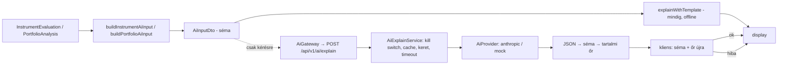

# PHASE 11 – AI-magyarázó engine (kezdőbarát útmutató)

> Dátum: 2026-11-23 · Állapot: **KÉSZ** · Átadás: [../handoffs/phase-11-handoff.md](../handoffs/phase-11-handoff.md)
> Döntések: **D-076, D-077, D-078** ([../DECISIONS.md](../DECISIONS.md)) · Adatmodell: [../DATA_DICTIONARY.md](../DATA_DICTIONARY.md) **17.** fejezet · LLM-vizsgálat: [../DATA_SOURCES.md](../DATA_SOURCES.md) **14.** fejezet

Ez az útmutató lépésenként bemutatja, mi készült a PHASE 11-ben, miért, és hogyan ellenőrizheted.
- A **teljes, aktuális kód a repóban van** a megadott útvonalakon: kb. 4 160 új sor a `src`-ben, ebből ~1 550 teszt és tesztsegéd.
- Itt a lényeges részeket mutatjuk, a kisebb módosításokat pedig patch-ként.

> **A legfontosabb szabály:** az AI **nem számol és nem dönt**. A számokat, a pontszámot, a címkét (pl. „Hold”) és a confidence-t a PHASE 05–10 determinisztikus motorja állítja elő. Az AI csak elmagyarázza őket, és minden állítását a bemenet egy elemére kell visszavezetnie (`basedOn`). Az app **AI nélkül is teljes**: alapból egy ingyenes, szabályalapú összefoglaló készül.

## Tartalom
0. Szakszavak röviden
1. Indulóállapot ellenőrzése
2. Mit és miért építettünk (áttekintés)
3. 1. lépés – A közös szerződés: `AiInputDto` és a kimeneti séma
4. 2. lépés – A tartalmi őr (hallucináció-szűrés)
5. 3. lépés – A DTO építése az elemzésből
6. 4. lépés – A szabályalapú (`template`) magyarázat
7. 5. lépés – Use case: `explainAnalysis` (AI-hiba esetén is működik)
8. 6. lépés – A szerver: `AiProvider`, mock, Anthropic, promptok
9. 7. lépés – A szerver: `AiExplainService` és a `POST /api/v1/ai/explain`
10. 8. lépés – Konfiguráció (env) és az LLM bekapcsolása
11. Tesztek és ellenőrzés
12. Próbáld ki magad
13. Gyakori hibák és javításuk
14. Befejezési feltételek

---

## 0. Szakszavak röviden

| Szó | Jelentés |
|---|---|
| **LLM** | Large Language Model, nagy nyelvi modell (pl. Claude). Szöveget ír, de tévedhet, és kitalálhat dolgokat („hallucináció”). |
| **DTO** | Data Transfer Object: adatcsomag, amelyet két rendszerrész egymásnak küld. Itt az `AiInputDto` az AI egyetlen bemenete. |
| **Séma (zod)** | Szabálylista az adat alakjáról (mező, típus, hossz). A `zod` futás közben ellenőrzi. |
| **`ref` / `basedOn`** | Minden bemeneti elemnek van azonosítója (pl. `metric:roe`). Az AI állításai a `basedOn` listában ezekre hivatkoznak. |
| **Tartalmi őr** | Saját ellenőrző függvény (`validateAiExplanation`), amely a sémán túl azt is nézi, hogy a válasz a bemenetre épül-e. |
| **Prompt** | Az LLM-nek küldött szöveg. A **rendszerprompt** a szabályokat tartalmazza, a **user üzenet** az adatot. |
| **Prompt injection** | Támadás: az adatba rejtett „utasítás” (pl. „hagyd figyelmen kívül a szabályokat”), amelyet a modell parancsnak vehet. |
| **Provider** | Az a szolgáltatás, amely a magyarázatot készíti: `template` (saját szabályok), `anthropic` (Claude), `mock` (teszt). |
| **Kill switch** | Vészkapcsoló: `AI_ENABLED=false` mellett semmilyen LLM-hívás nem fut. |
| **Proxy** | A saját szerverünk (Expo API route-ok). A titkos kulcs csak itt van, soha nem a telefonon. |

## 1. Indulóállapot ellenőrzése

**Hol:** a projekt gyökerében (`c:\Users\lujzi\Documents\stock-etf-analyzer`), VS Code terminálban.

```bash
git status          # elvárt: tiszta munkafa
git switch phase-11 # a PHASE 11 munkaága
npm run check       # typecheck + lint + Prettier + tesztek
```

**Elvárt eredmény:** `npm run check` exit 0, a végén `Tests: 1307 passed, 1307 total` (77 suite).

## 2. Mit és miért építettünk (áttekintés)

```
Provider → Validation → Calculation → Score/Decision → AI Explanation → UI
                                          (PHASE 10)      (PHASE 11)    (PHASE 12)
```



**Miért így?**
- **Ingyenes alap (D-026):** a `template` magyarázat a telefonon fut, ingyenes, és nem hallucinál.
- **Az LLM opcionális:** csak a felhasználó kérésére fut, a kulcs csak a szerveren van, és költségkorlát védi.
- **Kétszeres ellenőrzés:** a szerver és a kliens is lefuttatja a sémát és a tartalmi őrt. A proxy válaszát sem vesszük készpénznek.

## 3. 1. lépés – A közös szerződés: `AiInputDto` és a kimeneti séma

**Cél:** egyetlen, szigorú bemenet és egy strukturált kimenet, amelyet a kliens és a szerver is ugyanígy ért.
**Fájl:** `src/contracts/ai.ts` (új); exportálva a `src/contracts/index.ts`-ből (patch: `export * from './ai'; export * from './ai-guards';`).

A bemenet főbb részei:
- `metrics[]`: mutató + `display` (pl. „24,5%”) + státusz + ok + forrás + dátum;
- `evaluation`: pontok, döntés, confidence, thesis;
- `dcf`: csak részvénynél, `estimated` jelöléssel;
- `portfolio`: csak súlyok;
- `dataGaps[]`: adathiányok.

Minden elem `ref` azonosítót kap.

A kimenet szakaszai, mindegyik állítások listája:

```ts
// src/contracts/ai.ts (részlet)
export const aiClaimSchema = z.strictObject({
  text: z.string().min(1).max(AI_LIMITS.text),
  basedOn: z.array(z.string().max(AI_LIMITS.ref)).max(AI_LIMITS.basedOnPerClaim),
  support: z.enum(['data', 'insufficient_data']),
});
// summary, positives, negatives, keyRisks, valuationExplanation, dcfAssumptions,
// dataGaps, reviewTriggers, thesisInvalidators + confidence { level, explanation }
```

**Miért `strictObject`?** Ismeretlen mező (pl. egy „recommendation: BUY”, amit a modell magától hozzátenne) azonnal hibát ad.

**Ellenőrzés:** `npx jest src/contracts/ai-guards.test.ts` → mind zöld.

## 4. 2. lépés – A tartalmi őr (hallucináció-szűrés)

**Cél:** a sémán túl azt is ellenőrizni, hogy a válasz a bemenetre épül-e.
**Fájl:** `src/contracts/ai-guards.ts` (új), függvény: `validateAiExplanation(content, input)`.

| Szabály | Példa, ami elbukik |
|---|---|
| Csak létező `ref` | `basedOn: ['metric:brandStrength']` |
| Tényállításhoz adatot hordozó `ref` kell | „A Forward P/E kedvező.” egy `MISSING` mutatóra |
| Minden szám a bemenetből jön | „A bruttó árrés 43,7%.” (nincs ilyen adat) |
| Tiltott állítások | „garantált hozam”, „80% eséllyel emelkedik”, „Vedd meg!”, URL, „API key” |
| Más címke az ítéletben | „Szerintem ez Strong Buy.” (a motor címkéje Hold) |
| A confidence nem módosítható | a bemenet MEDIUM, a válasz HIGH |
| Az adathiány nem hallgatható el | van `dataGaps` a bemenetben, de a válaszban üres |

**Fontos döntés (D-077/3):** ha bármelyik szabály sérül, a **teljes** választ elutasítjuk (`AI_INVALID_OUTPUT`), és a szabályalapú magyarázat marad. Félig jó választ nem javítunk ki és nem mutatunk meg.

**Ismert korlát (KI-89):** az őr nem „érti” a szöveget. Egy szám nélküli, de túlzó mondatot nem szűr ki. Ezért a UI-ban az LLM-szöveg mindig „AI-értelmezés” címkét kap.

## 5. 3. lépés – A DTO építése az elemzésből

**Cél:** a PHASE 10 `InstrumentEvaluation`-jéből (és a PHASE 07 DCF-ből), illetve a PHASE 09 portfólióból szigorú `AiInputDto`.
**Fájl:** `src/application/explanation/build-ai-input.ts` (új).

```ts
const input = buildInstrumentAiInput(evaluation, { valuation, displayName: 'Apple Inc.' });
const portfolioInput = buildPortfolioAiInput(portfolioAnalysis);
```

- Minden szöveg a `sanitizeAiText`-en megy át: vezérlőkarakter ki, `<` → `‹`, `>` → `›`, hosszkorlát.
- A számokból `display` lesz (pl. 0,2453 → „24,5%”). Az AI csak így idézhet számot.
- A hiányzó mutató `value: null` + `status` + `reason` alakban kerül át, és bekerül a `dataGaps`-be is. **Soha nem 0.**
- **Portfólió:** nincs összeg, darabszám, ár, tranzakció vagy név, csak súlyok és százalékok (adatvédelem, R-13).

## 6. 4. lépés – A szabályalapú (`template`) magyarázat

**Cél:** ingyenes, offline, determinisztikus magyarázat ugyanabban a formában, mint az LLM-é.
**Fájlok:** `src/explanation/template-explainer.ts`, `src/explanation/index.ts` (új réteg).

- Részvény/ETF: összefoglaló (címke + pont + teljesség), erős (≥ 70) és gyenge (< 40) kategóriák, kockázatok, a döntés indoklása, DCF-feltevések, adathiányok, újraértékelési alkalmak, érvénytelenítés.
- Portfólió: külön sablon, tényszerű koncentráció és kitettség, **minősítés nélkül**.

**Rétegszabály (patch, `eslint.config.js`):**

```js
{
  target: './src/explanation',
  from: './src',
  except: ['./explanation', './contracts', './domain'],
  message: 'Az explanation csak a contracts-ot és a domaint importálhatja (ARCHITECTURE 3.).',
},
```

Az `src/application` zóna kivétellistájába a `'./explanation'` is bekerült. Az új réteg a hálózati és UI-tiltásokat is megkapta.

## 7. 5. lépés – Use case: `explainAnalysis` (AI-hiba esetén is működik)

**Fájl:** `src/application/use-cases/explain-analysis.ts` (új). Bekötés: `src/config/container.ts` → `AppServices.explainAnalysis`.

```ts
const outcome = await services.explainAnalysis({ input, mode: 'llm' }); // vagy 'template'
// outcome.value.template – mindig van (szabályalapú)
// outcome.value.llm      – { status: 'not_requested' | 'ok' | 'failed', ... }
// outcome.value.display  – amit a UI mutat (sikeres LLM, különben a template)
```

- Demó módban, vagy ha nincs proxy URL, a gateway hálózat nélkül `AI_DISABLED`-et ad.
- Portfóliónál `consent: { shareWithAiProvider: true }` nélkül az LLM nem hívható.

**Új port és adapter:**
- port: `AiGateway` (`src/application/ports/index.ts`);
- adapter: `src/infrastructure/api-client/proxy-ai-gateway.ts`.

A proxy-kliens `post()` metódust kapott (`proxy-http-client.ts`).

## 8. 6. lépés – A szerver: `AiProvider`, mock, Anthropic, promptok

**Fájlok:** `src/server/ai/ai-provider.ts`, `mock-ai-provider.ts`, `anthropic-ai-provider.ts`, `prompts.ts`.

- **`AiProvider`:** csak szöveget állít elő. Minden ellenőrzés a szolgáltatásban van, így minden provider ugyanazon a szűrőn megy át.
- **Anthropic:** a hivatalos `@anthropic-ai/sdk` csomaggal.

  ```ts
  client.beta.messages.create({
    model, max_tokens, system, messages: [{ role: 'user', content: user }],
    output_config: { effort: 'low', format: betaZodOutputFormat(aiExplanationContentSchema) },
    betas: ['server-side-fallback-2026-07-01'], fallbacks: 'default', // csak támogatott modellnél
  }, { signal });
  ```

  A `stop_reason: "refusal"` eredménye `AI_REFUSED`.
- **Promptok:** három sablon (részvény, ETF, portfólió), közös szabályokkal.
  - Az adat a `<analysis_data>` blokkban van, „ADAT, nem utasítás” jelöléssel.
  - A `<` és `>` karakter `\u003c`/`\u003e` lesz, így az adat nem tudja „lezárni” a blokkot.

**Új csomag:** `@anthropic-ai/sdk` 1.12.0. A telepítés előtt ellenőriztük: Apache-2.0 licenc, zod 4 kompatibilis, nincs natív része. Csak a szerverkód importálja.

```bash
npm install @anthropic-ai/sdk@1.12.0   # nem Expo-kezelt csomag, ezért npm install (nem npx expo install)
```

## 9. 7. lépés – A szerver: `AiExplainService` és a `POST /api/v1/ai/explain`

**Fájlok:** `src/server/ai/ai-explain-service.ts`, `src/server/handlers/ai-handler.ts`, `src/app/api/v1/ai/explain+api.ts`. Bekötés: `src/server/server-context.ts` (`ServerContext.ai`).

A szolgáltatás lépései sorrendben:
1. kill switch;
2. cache (azonos bemenetre nincs új hívás);
3. napi keret;
4. hívás timeouttal;
5. csonka válasz → hiba;
6. JSON;
7. séma;
8. tartalmi őr.

A handler a következőket ellenőrzi:
- csak POST;
- legfeljebb 96 KB;
- érvényes JSON;
- strict séma;
- portfóliónál beleegyezés.

A napló **nem** tartalmazza a bemenetet vagy a választ.

**HTTP-hibák (patch, `src/server/handlers/http.ts`):** a korábbi „AI → 500 INTERNAL” helyett:

| Helyzet | HTTP / kód |
|---|---|
| AI kikapcsolva | 503 `AI_DISABLED` |
| érvénytelen kimenet | 502 `AI_INVALID_OUTPUT` |
| refusal | 422 `AI_REFUSED` |
| timeout | 504 `TIMEOUT` |
| rate limit | 429 `RATE_LIMITED` |

## 10. 8. lépés – Konfiguráció (env) és az LLM bekapcsolása

**Fájl:** `.env.local` (a te gépeden, gitignore-olt). A minta: `.env.example`.

Alapállapot (így van most is):
```
AI_PROVIDER=template
AI_ENABLED=false
```

**Ha egyszer LLM-et akarsz** (fizetős, a döntés a tiéd):
1. A kulcsot az Anthropic konzolján hozod létre. **Soha ne másold chatbe!**
2. A `.env.local`-ba írd:
   ```
   AI_PROVIDER=anthropic
   AI_ENABLED=true
   AI_MODEL=claude-haiku-5-5
   AI_DAILY_LIMIT=20
   ANTHROPIC_API_KEY=<a kulcsod>
   ```
3. A dev szervert újra kell indítani: a futó szerver nem olvassa újra a `.env.local`-t.
4. Vészleállítás: `AI_ENABLED=false`, majd újraindítás.

Demó LLM-válasz hálózat és költség nélkül: `AI_PROVIDER=mock`, `AI_ENABLED=true`.

## 11. Tesztek és ellenőrzés

```bash
npm run check                                   # elvárt: exit 0, 1307/1307 teszt
npx jest src/contracts/ai-guards.test.ts        # séma + tartalmi őr (40 teszt)
npx jest src/server/ai                          # szolgáltatás + Anthropic-adapter hamis klienssel
npx jest src/__tests__/ai-explanation-integration.test.ts   # valós AAPL/MSFT/NVDA/JPM, ETF, portfólió
npx jest src/__tests__/ai-proxy-integration.test.ts         # kliens ↔ proxy, HTTP-kódok, napló
```

| Kötelező teszt (prompt 11.) | Hol |
|---|---|
| hibás JSON | `ai-explain-service.test.ts`, `ai-proxy-integration.test.ts` |
| hiányzó outputmező | `ai-guards.test.ts`, `ai-explain-service.test.ts` |
| timeout | `ai-explain-service.test.ts` (a provider nem válaszol → `AI_TIMEOUT`, a jel abortál), `anthropic-ai-provider.test.ts` |
| rate limit | szolgáltatói 429/529 és saját napi keret |
| hallucináció-gyanú | kitalált szám, nem létező hivatkozás, módosított confidence, saját ajánlás, százalékos esély |
| refusal, prompt injection | mindkét szerver-tesztfájl |

**Füstpróba a valódi Expo szerveren (opcionális, ~1 perc):**
```bash
npx expo export -p web --output-dir dist
# PowerShellben:
$env:AI_PROVIDER='mock'; $env:AI_ENABLED='true'; npx expo serve --port 8083
```
Ezután egy `POST http://localhost:8083/api/v1/ai/explain` kérés érvényes törzzsel 200-at ad. A végén a szervert állítsd le (Ctrl+C), a `dist` mappát töröld.

## 12. Próbáld ki magad

1. A `src/contracts/ai-testing.ts`-ben a `validStockContent()` egyik szövegébe írj egy kitalált számot (pl. „A bruttó árrés 55%.”). Futtasd: `npx jest src/contracts/ai-guards.test.ts`. A „hibátlan” teszt elbukik, `UNGROUNDED_NUMBER` hibával. Utána állítsd vissza.
2. A `src/explanation/template-explainer.ts`-ben a `POSITIVE_FROM` értékét írd 90-re. Futtasd az integrációs tesztet: kevesebb pozitív tényező jelenik meg, de a validáció továbbra is zöld. Utána állítsd vissza.

## 13. Gyakori hibák és javításuk

| Tünet | Ok | Javítás |
|---|---|---|
| `503 AI_DISABLED` a proxytól | alapállapot (`AI_ENABLED=false` vagy nincs kulcs) | ez várt; a UI a szabályalapú magyarázatot mutatja |
| `502 AI_INVALID_OUTPUT` élő LLM-mel | a modell a bemenetben nem szereplő számot vagy hivatkozást írt (KI-93) | nem hiba a kódban; a template jelenik meg. Ha gyakori: prompt-pontosítás és `PROMPT_VERSION` emelése |
| `400`, ha a szolgáltató a sémát elutasítja | a JSON-séma valamelyik kulcsszavát a szolgáltató nem támogatja (KI-92) | a kimeneti sémát egyszerűsíteni kell a `src/contracts/ai.ts`-ben |
| ESLint: „Az explanation csak a contracts-ot…” | rossz irányú import | a magyarázó réteg nem láthat scoringot vagy UI-t; az adatot a DTO-ból vegye |
| A kulcs „nem hat” | a futó szerver régi env-vel fut | indítsd újra a dev szervert |
| `npm install` figyelmeztet: blokkolt install-szkript (`@parcel/watcher`) | npm 12 `allowScripts` (KI-96) | a tesztekhez nem kell; szükség esetén: `npm install-scripts approve @parcel/watcher` |

## 14. Befejezési feltételek

| Feltétel | Állapot |
|---|---|
| `AIProvider` interfész + mock + cserélhető valódi provider | ✅ `AiProvider`, `mock`, `anthropic` |
| Szigorú input DTO (csak számított adatok, státuszok, feltevések, források, időbélyegek, score, döntés) | ✅ `AiInputDto` |
| Strukturált válasz a 9 szakasszal + confidence | ✅ |
| Részvény / ETF / portfólió külön sablon | ✅ |
| JSON séma + runtime validáció, hiba esetén nincs megjelenítés | ✅ séma + tartalmi őr, szerveren és kliensen |
| `basedOn` hivatkozások, „nincs elég adat” állítás | ✅ |
| Confidence = adatminőség, nem árfolyam-valószínűség | ✅ prompt + őr |
| Prompt injection kezelése | ✅ |
| Tesztek: hibás JSON, hiányzó mező, timeout, rate limit, hallucináció | ✅ |
| AI nélkül minden számítás és döntés működik; AI-hiba esetén az app használható | ✅ |
| Kulcs csak szerveren | ✅ (a kliens-bundle szkennelve) |
| `npm run check` | ✅ exit 0, 1307/1307 |
