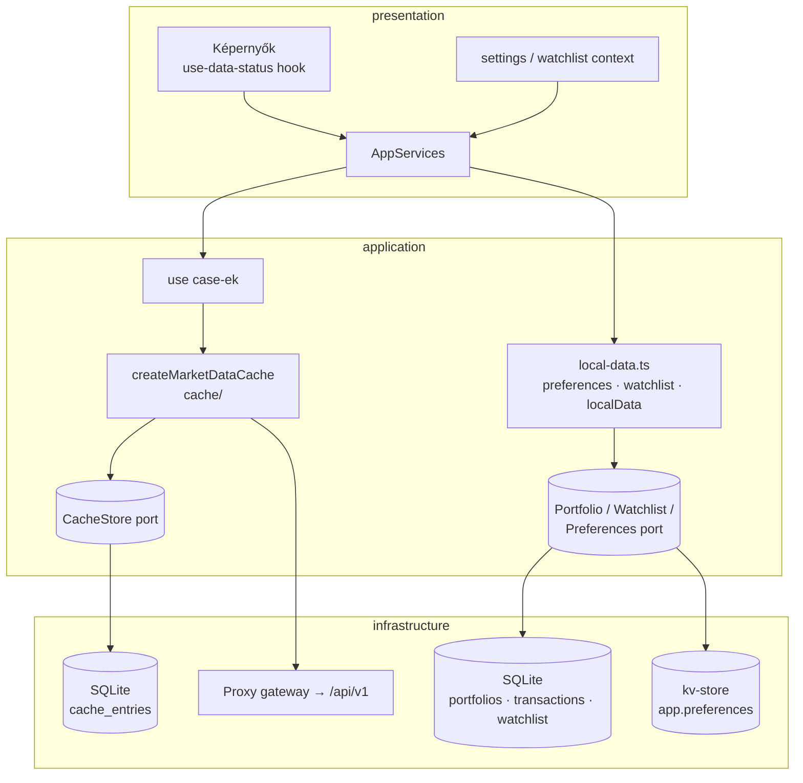

# PHASE 13 – Tárolás, cache és offline használat (kezdőbarát útmutató)

> Dátum: 2026-11-24 · Állapot: **KÉSZ** (Jest – valódi SQLite-tal – és `expo export` igazolva; eszközön még nem futott – KI-117) · Átadás: [../handoffs/phase-13-handoff.md](../handoffs/phase-13-handoff.md)
> Döntések: **D-082, D-083, D-084** (és a D-013 lezárása) – [../DECISIONS.md](../DECISIONS.md) · Szabályok: [../ARCHITECTURE.md](../ARCHITECTURE.md) 11–12.

Ez az útmutató lépésenként bemutatja, mi készült a PHASE 13-ban, miért, és hogyan ellenőrizheted.
- A **teljes, aktuális kód a repóban van** a megadott útvonalakon (kb. 5 000 új sor a `src`-ben, ebből ~1 900 teszt). Itt a lényeget mutatjuk; a fájlt a VS Code-ban nyisd meg (Ctrl+P, majd a fájlnév).
- **Két új csomag:** `expo-sqlite` és `expo-network` (`npx expo install`-lal, az SDK 58-hoz illő verzióval).

> **A legfontosabb szabályok:**
> 1. Offline a régi adat **soha nem „friss”**: a gyorsítótárból (cache) jövő tartalék legalább „elavult” (`STALE`), és mindig látszik az „Utoljára frissítve” időpont.
> 2. A cache **nem írja át** a lekérés idejét (`fetchedAt`) és a forrást – a provenance megmarad.
> 3. Hiányzó vagy sérült portfólióadatot **nem hagyunk ki csendben** (hamis P/L lenne): hibaüzenet jön.
> 4. Titkot (API-kulcsot) az app **nem tárol** – nincs is ilyen a kliensben (a kulcsok a proxyn vannak).

## Tartalom
0. Szakszavak röviden
1. Indulóállapot ellenőrzése
2. Áttekintés: mi készült és hol van
3. 1. lépés – Csomagok telepítése
4. 2. lépés – Melyik adat hova kerül (és miért nincs secure-store)
5. 3. lépés – Portok (interfészek) az application rétegben
6. 4. lépés – SQLite: séma és migráció
7. 5. lépés – Portfólió, figyelőlista, cache tárolók
8. 6. lépés – Beállítások a kv-store-ban, verzióval
9. 7. lépés – Cache-szabályok (TTL adatfajtánként)
10. 8. lépés – A cache motorja és az offline tartalék
11. 9. lépés – Kézi frissítés ≠ invalidálás ≠ háttérfrissítés
12. 10. lépés – UI: jelzések, lehúzás, Beállítások → Helyi adatok
13. 11. lépés – Adatmegőrzés, export, törlés
14. Tesztek és ellenőrzés
15. Kézi ellenőrzés emulátoron (a tulajdonos teendője – KI-117)
16. Gyakori hibák és javításuk
17. Befejezési feltételek

## 0. Szakszavak röviden

| Szó | Jelentés |
|---|---|
| **Cache (gyorsítótár)** | Korábban letöltött adat helyi másolata, hogy ne kelljen mindig újra letölteni. |
| **TTL** („time to live”) | Meddig számít frissnek egy cache-rekord. Lejárta után újra letöltjük. |
| **Offline tartalék** | Ha nincs hálózat, a korábban letöltött adatot mutatjuk – jelölve, hogy elavult lehet. |
| **SQLite** | Kis, fájlalapú adatbázis az eszközön. SQL-lel kérdezzük le. |
| **kv-store** | Kulcs–érték tároló („név → szöveg”), kis beállításokhoz. |
| **Migráció** | Az adatbázis szerkezetének verzióról verzióra emelése úgy, hogy a meglévő adat megmaradjon. |
| **Port / adapter** | A port egy interfész („mit tud”), az adapter a konkrét megvalósítás („hogyan”, pl. SQLite). |
| **Dekorátor** | Egy objektum, ami ugyanazt az interfészt adja, de „elé áll” egy másiknak (itt: a cache a hálózati gateway előtt). |
| **Provenance** | Az adat eredete: forrás, lekérés ideje, adatnap, frissesség. |
| **Invalidálás** | Cache-rekord érvénytelenítése (itt: törlése). |

## 1. Indulóállapot ellenőrzése

A projekt gyökerében (`c:\Users\lujzi\Documents\stock-etf-analyzer`, VS Code → Terminal → New Terminal):

```bash
git status
git branch --show-current
npm run check
```

Elvárt a fázis elején: tiszta munkakönyvtár, `phase-12` branch (a PHASE 12 ott volt, még nem a `main`-en), `npm run check` exit 0, **1447 teszt**. A PHASE 13 munkája a `phase-13` branchen van (`git switch -c phase-13` a `phase-12`-ből).

## 2. Áttekintés: mi készült és hol van



| Terület | Fájl(ok) |
|---|---|
| Domain: cache-jelzés, frissesség-plafon | [`src/domain/shared/provenance.ts`](../../src/domain/shared/provenance.ts) |
| Portok | [`src/application/ports/index.ts`](../../src/application/ports/index.ts) |
| Cache: szabályok, kulcsok, kodekek, motor, háttér | [`src/application/cache/`](../../src/application/cache/) |
| Beállítás- és figyelőlista-modell | [`src/application/preferences/user-preferences.ts`](../../src/application/preferences/user-preferences.ts), [`src/application/watchlist/types.ts`](../../src/application/watchlist/types.ts) |
| Use case-ek (beállítás, figyelőlista, helyi adatok) | [`src/application/use-cases/local-data.ts`](../../src/application/use-cases/local-data.ts) |
| SQLite, migráció, kv, memória | [`src/infrastructure/storage/`](../../src/infrastructure/storage/) |
| Hálózati állapot | [`src/infrastructure/system/expo-connectivity.ts`](../../src/infrastructure/system/expo-connectivity.ts) |
| Bekötés | [`src/config/container.ts`](../../src/config/container.ts), [`src/app/_layout.tsx`](../../src/app/_layout.tsx) |
| UI | [`src/presentation/state/`](../../src/presentation/state/), [`src/presentation/hooks/use-data-status.ts`](../../src/presentation/hooks/use-data-status.ts), [`src/presentation/view-models/data-status-notices.ts`](../../src/presentation/view-models/data-status-notices.ts), [`src/presentation/screens/local-data-card.tsx`](../../src/presentation/screens/local-data-card.tsx) |
| Tesztsegédek | [`src/testing/`](../../src/testing/) (Node SQLite, Expo-modul tesztdublőrök), [`jest.config.js`](../../jest.config.js) |

## 3. 1. lépés – Csomagok telepítése

**Cél:** tartós tárolás és hálózati állapot. **Ok:** az SDK 58 dokumentációja szerint mindkettő Expo-kezelt csomag, Expo Go-ban is működik.
**Hol futtasd:** a projekt gyökerében.

```bash
npx expo install expo-sqlite expo-network
```

**Elvárt eredmény:** a `package.json`-ban `"expo-sqlite": "~58.0.18"` és `"expo-network": "~58.0.5"`; az `app.json` `plugins` listájába bekerül az `"expo-sqlite"` (ezt az `expo install` teszi be). Ha `npm warn install-scripts … @parcel/watcher` figyelmeztetést látsz, az nem a mi csomagunké, figyelmen kívül hagyható.

## 4. 2. lépés – Melyik adat hova kerül (és miért nincs secure-store)

| Adat | Hely | Miért |
|---|---|---|
| Beállítások (bázispénznem, téma, AI-gomb, frissítési preferencia) | `expo-sqlite/kv-store`, kulcs: `app.preferences` | kicsi, egyben olvasott |
| Portfólió, tranzakciók, figyelőlista | SQLite-fájl `stock-etf-analyzer.db` | strukturált, sorrendezett, sok elem |
| Piaci adat cache (árfolyam, ártörténet, kimutatás, profil, osztalék, FX, keresés) | ugyanaz az SQLite-fájl, `cache_entries` tábla | szűrni és takarítani kell |
| Titok (API-kulcs) | **sehol a kliensen** | a kulcsok a proxy `.env.local`-jában vannak (D-004) |
| Weben | memória | az `expo-sqlite` web WASM-ot igényel; a web csak előnézet (KI-111) |

Az `expo-secure-store` (titkosított tároló) **nem került be**, mert nincs mit tárolni benne. Ha később lesz bejelentkezési token, az csak oda kerülhet (D-082/2).

A platformválasztás fájlnévvel történik (a Metro bundler a `.web.ts` változatot választja weben):
- [`src/infrastructure/storage/default-storage.ts`](../../src/infrastructure/storage/default-storage.ts) – natív: SQLite + kv-store + expo-network;
- [`src/infrastructure/storage/default-storage.web.ts`](../../src/infrastructure/storage/default-storage.web.ts) – web: memória.

## 5. 3. lépés – Portok (interfészek) az application rétegben

**Cél:** a use case-ek ne tudjanak az SQLite-ról (cserélhetőség, tesztelhetőség). **Fájl:** [`src/application/ports/index.ts`](../../src/application/ports/index.ts).

```ts
export interface CacheStore {
  get(key: string): Promise<Result<CacheRecord | null, AppError>>;
  put(record: CacheRecord): Promise<Result<void, AppError>>;
  delete(key: string): Promise<Result<void, AppError>>;
  list(filter?: { readonly listingIds?: readonly string[] }): Promise<Result<readonly CacheRecord[], AppError>>;
  markInvalidated(listingIds: readonly string[], at: string): Promise<Result<number, AppError>>;
  clear(): Promise<Result<number, AppError>>;
  prune(now: string): Promise<Result<number, AppError>>;
}
export interface WatchlistRepository { list(); add(item, addedAt); remove(listingId); clear(); }
export interface PreferencesRepository { load(); save(preferences); clear(); }
export interface ConnectivityMonitor { current(): 'online' | 'offline' | 'unknown'; subscribe(listener): () => void; }
// PortfolioRepository: + listPortfolios(), deleteAll()
```

**Ellenőrzés:** `npm run typecheck` hibátlan.

## 6. 4. lépés – SQLite: séma és migráció

**Cél:** a táblák létrehozása és későbbi bővítése adatvesztés nélkül.
**Fájlok:** [`migrations.ts`](../../src/infrastructure/storage/migrations.ts), [`database-provider.ts`](../../src/infrastructure/storage/database-provider.ts), [`sql-database.ts`](../../src/infrastructure/storage/sql-database.ts).

Hogyan működik:
1. Az adatbázis **lustán** nyílik meg (az első tárolói hívásnál), egyszer.
2. A `PRAGMA user_version` adja a jelenlegi sémaverziót (új adatbázisnál 0).
3. A függőben lévő migrációk sorban, **egyenként tranzakcióban** futnak (vagy minden lefut, vagy semmi).
4. Ha az adatbázis újabb verziójú, mint amit az app ismer, **nem nyitjuk meg és nem törlünk** – `STORAGE` hiba jön.

**Migrációs terv (szabályok új verzióhoz):**
- Meglévő migrációt soha ne módosíts – új elemet fűzz a `MIGRATIONS` lista végére `version: 2`-vel.
- Felhasználói adatot (portfólió, tranzakció, figyelőlista) migráció nem törölhet.
- A `cache_entries` tábla bármikor eldobható (újra letölthető).
- Ha a cache-payload szerkezete változik, emeld a `CACHE_PAYLOAD_VERSION`-t ([`src/application/cache/types.ts`](../../src/application/cache/types.ts)) – a régi rekordok maguktól érvénytelenné válnak.

Minta egy jövőbeli migrációra:

```ts
{
  version: 2,
  description: 'Figyelőlista: megjegyzés oszlop.',
  up: async (db) => db.exec('ALTER TABLE watchlist ADD COLUMN note TEXT'),
},
```

**Ellenőrzés:** `npx jest src/infrastructure/storage` → a „migráció” tesztek zöldek (üres DB, idempotencia, v1 → v2 adatmegtartással, hibás migráció visszagörgetése, újabb verzió elutasítása).

## 7. 5. lépés – Portfólió, figyelőlista, cache tárolók

**Fájlok:** [`sqlite-portfolio-repository.ts`](../../src/infrastructure/storage/sqlite-portfolio-repository.ts), [`portfolio-codec.ts`](../../src/infrastructure/storage/portfolio-codec.ts), [`sqlite-watchlist-repository.ts`](../../src/infrastructure/storage/sqlite-watchlist-repository.ts), [`sqlite-cache-store.ts`](../../src/infrastructure/storage/sqlite-cache-store.ts).

- **Portfólió:** a tranzakció JSON-ként tárolódik; visszaolvasáskor előbb zod-alakellenőrzés, majd a **domain** `createTransaction` függvénye validál (ugyanazok a szabályok, mint rögzítéskor – nincs duplikált üzleti logika). Ha egy tranzakció sérült: `STORAGE` hiba az azonosítóval, mert egy kihagyott tranzakció hamis pozíciót adna.
- **Figyelőlista:** sérült sor kimarad és törlődik (csak azonosítót tárol, nincs pénzügyi kockázat).
- **Cache:** minden provenance- és érvényességi mező külön oszlop (lekérdezhető); a payload JSON. Sérült sor → törlés, `null`.

## 8. 6. lépés – Beállítások a kv-store-ban, verzióval

**Fájlok:** [`user-preferences.ts`](../../src/application/preferences/user-preferences.ts), [`kv-preferences-repository.ts`](../../src/infrastructure/storage/kv-preferences-repository.ts).

A tárolt alak egy verziózott „boríték”:

```json
{ "schemaVersion": 2, "data": { "baseCurrency": "HUF", "themePreference": "system", "llmEnabled": false, "refresh": { "refreshOnReconnect": true } } }
```

- **v1 → v2 migráció:** a v1 (PHASE 12 alak, frissítési beállítás nélkül) beolvasva kiegészül az alapértékkel, és azonnal v2-ként visszaíródik.
- **Sérült érték:** alapértékek + a nyers szöveg az `app.preferences.corrupt-backup` kulcsra kerül.
- **Újabb verzió:** nem írjuk felül (mentéskor `STORAGE` hiba).

A UI hook-interfésze (`useSettings`) nem változott: induláskor betölt, módosításkor ment. Ha a felhasználó a betöltés vége előtt módosít, az ő választása marad.

## 9. 7. lépés – Cache-szabályok (TTL adatfajtánként)

**Fájl:** [`src/application/cache/cache-policy.ts`](../../src/application/cache/cache-policy.ts). Három határ a lekérés idejétől:

| Fajta | Friss (nincs új letöltés) | Utána STALE, majd EXPIRED | Megőrzés offline tartaléknak |
|---|---|---|---|
| Árfolyam | 15 perc | 3 nap | 30 nap |
| Ártörténet | 12 óra | 14 nap | 60 nap |
| Kimutatás | 7 nap | 120 nap | 400 nap |
| Profil / ETF-metaadat | 7 nap | 30 nap | 180 nap |
| ETF holdings | 30 nap | 90 nap | 365 nap |
| Osztalék | 1 nap | 30 nap | 180 nap |
| FX (legutóbbi) | 12 óra | 3 nap | 30 nap |
| FX (adott nap) | 365 nap | 10 év | 365 nap |
| ISIN → jegyzések | 30 nap | 180 nap | 365 nap |
| Keresés | 1 nap | 7 nap | 7 nap |

`[FELTÉTELEZÉS]` – a tőzsdei naptárat (nyitvatartás, ünnepnap) nem modellezzük (KI-110). Az „1 év máig” ártörténet kulcsa az ablak **hossza**, nem a dátum – így offline másnap is megtalálható ([`cache-keys.ts`](../../src/application/cache/cache-keys.ts)).

## 10. 8. lépés – A cache motorja és az offline tartalék

**Fájl:** [`src/application/cache/market-data-cache.ts`](../../src/application/cache/market-data-cache.ts). A use case-ek nem változtak: a composition root ([`container.ts`](../../src/config/container.ts)) a proxy gateway-ek elé teszi a cache-t (csak élő módban; demó módban nincs cache – KI-120).

Olvasási szabály:
1. Van friss, nem jelölt rekord → cache-ből (`cache_hit`), **nincs hálózati kérés**.
2. Ismerten offline és van rekord → tartalék, hálózat nélkül (nincs várakozás timeoutra).
3. Különben hálózat; siker → a rekord felülíródik.
4. Átmeneti hiba (nincs net, timeout, túl sok kérés, szerverhiba, napi kvóta elfogyott) + van rekord → **offline tartalék** az eredeti `fetchedAt`-tal, legalább `STALE`.
5. Végleges hiba (nem található, csomagkorlát) → a hiba megy tovább, régi adat **nem** „helyette”.
6. Nincs rekord és átmeneti hiba → hiba + „Korábban letöltött (offline) adat sincs ehhez.”

A kiszolgált érték provenance-e jelölést kap: `cache: { mode: 'cache_hit' | 'offline_fallback', storedAt }`. A domain szabály ([`provenance.ts`](../../src/domain/shared/provenance.ts)):

```ts
export function capFreshnessForCache(freshness: Freshness, cache: CacheServeInfo | undefined): Freshness {
  if (cache?.mode === 'offline_fallback' && freshness === 'FRESH') return 'STALE';
  return freshness;
}
```

Ezt a quote-, ártörténet- és FX-use case is alkalmazza, amikor a saját órájával újraszámolja a frissességet – így a meglévő „Elavult adat” jelzés offline automatikusan megjelenik.

## 11. 9. lépés – Kézi frissítés ≠ invalidálás ≠ háttérfrissítés

| Mechanizmus | Ki indítja | Mit csinál | Hol |
|---|---|---|---|
| **Kézi frissítés** | te (lehúzás, „Újrapróbálás”) | a jegyzés rekordjait jelöli → a következő olvasás a hálózatot próbálja; offline a tartalék marad | `localData.refreshListings` |
| **Invalidálás** | te (Beállítások → „Gyorsítótár törlése”), payload-verzióváltás, sérült rekord, megőrzési idő utáni takarítás induláskor | rekord(ok) **törlése** | `localData.clearCache`, `CacheControl.prune` |
| **Háttérfrissítés** | hálózat visszatérése (offline → online), ha a Beállításokban be van kapcsolva | figyelőlista + tranzakciós jegyzések árfolyamai, csak a nem friss rekordok, max. 20, legfeljebb 5 percenként | [`background-refresh.ts`](../../src/application/cache/background-refresh.ts) |

A normál megnyitás cache-first: **nincs lekérés minden renderkor**, és egyidejű azonos kérések egyetlen hálózati hívásra futnak össze.

## 12. 10. lépés – UI: jelzések, lehúzás, Beállítások → Helyi adatok

- [`use-data-status.ts`](../../src/presentation/hooks/use-data-status.ts): minden sikeres betöltés után lekérdezi, honnan jött az adat, és jelzést épít ([`data-status-notices.ts`](../../src/presentation/view-models/data-status-notices.ts)):
  - cache-ből: ℹ „Gyorsítótárból (cache) – Utoljára frissítve: …”;
  - offline tartalék: ⚠ „Offline adat – elavult lehet – Utoljára frissítve: …” (a **legrégebbi** felhasznált adat ideje).
- A részvény-, ETF- és portfólióképernyőn a lehúzás és az „Újrapróbálás” = kézi frissítés.
- Beállítások: „Frissítés” kártya (háttérfrissítés be/ki) és „Helyi adatok” kártya ([`local-data-card.tsx`](../../src/presentation/screens/local-data-card.tsx)): tárolás módja, cache-rekordok száma, legrégebbi cache-adat, „Gyorsítótár törlése”, „Saját adatok exportálása (JSON)”, „Minden helyi adat törlése” (kétlépcsős megerősítéssel).

## 13. 11. lépés – Adatmegőrzés, export, törlés

- **Megőrzés:** minden adat csak az eszközön (nincs felhő, nincs szinkron). A portfólió és a tranzakciók addig maradnak, amíg nem törlöd; a cache-rekordok a fajta megőrzési ideje után induláskor törlődnek.
- **Export:** `stock-etf-analyzer.user-data` v1 JSON – portfóliók + tranzakciók, figyelőlista, beállítások. Piaci adat (licenc, újratölthető) és titok **nincs** benne. Ma kijelölhető szövegként jelenik meg; fájlmentés és visszatöltés (import) később (KI-113).
- **Törlés:** „Minden helyi adat törlése” → portfólió, tranzakció, figyelőlista, beállítás és cache. **Visszavonhatatlan** – előtte exportálj.
- **Biztonság:** nincs app-szintű adatbázis-titkosítás (Expo Go-ban nem elérhető, KI-112); az Android/iOS eszköztitkosítás védi. Zárolt képernyő és eszköztitkosítás bekapcsolása ajánlott.

## 14. Tesztek és ellenőrzés

**Hol:** a projekt gyökerében.

```bash
npm run check
```

**Elvárt (2026-11-24, ténylegesen lefutott):** exit 0 – typecheck ✅, lint ✅, Prettier ✅, **1541/1541 teszt, 88 suite** ✅.

Csak a PHASE 13 tesztjei:

```bash
npx jest src/__tests__/market-data-cache.test.ts src/__tests__/offline-storage-integration.test.ts src/infrastructure/storage src/application/cache src/application/use-cases/local-data.test.ts src/presentation/view-models/data-status-notices.test.ts
npx jest src/__tests__/routes.test.tsx -t "PHASE 13"
```

| Tesztfájl | Mit igazol |
|---|---|
| `src/__tests__/market-data-cache.test.ts` (26) | TTL, adatfajtánként eltérő TTL, kérés-összevonás, offline tartalék eredeti `fetchedAt`-tal és soha nem FRESH, kvóta/csomagkorlát, NOT_FOUND, kézi frissítés, invalidálás, takarítás (legrégebbi rekordok), legrégebbi adat, sérült/régi payload |
| `src/infrastructure/storage/storage.test.ts` (25) | migráció, portfólió mentése/visszaolvasása újranyitás után (minden tranzakciótípus), sérült rekordok, figyelőlista, cache-tároló, beállítás-migráció és sérült beállítás – **valódi SQL-lel** |
| `src/application/cache/*.test.ts` | háttérfrissítés (hálózat-visszatérés, korlát, throttle, kikapcsolás), policy-konzisztencia, frissesség-plafon |
| `src/application/use-cases/local-data.test.ts` | export (piaci adat nélkül), teljes törlés, beállítás-validáció, v1 → v2 |
| `src/__tests__/offline-storage-integration.test.ts` (6) | kliens → cache → valódi proxy-handlerek: nincs új lekérés TTL-en belül, offline újraindítás, kézi frissítés, hálózat-visszatérés, portfólió + beállítás újraindítás után, teljes törlés |
| `src/__tests__/routes.test.tsx` (+5) | a valódi app: beállítás, figyelőlista, portfólió megmarad újraindítás után; export; teljes törlés |

A natív és a webes bundle (a projekt gyökerében, kimenet a scratch mappába):

```bash
npx expo export -p android --output-dir <ideiglenes-mappa>/export-android
npx expo export -p web --output-dir <ideiglenes-mappa>/export-web
```

Elvárt: mindkettő exit 0. A PHASE 13-ban: az Android bundle tartalmazza az `ExpoSQLite`-ot, a webes kliens nem; értékvak titokszkennelés: 0 találat. Az export-mappákat utána töröld.

## 15. Kézi ellenőrzés emulátoron (a tulajdonos teendője – KI-117)

1. Indítsd az emulátort, majd a projekt gyökerében: `npm run android`.
2. **Tartósság:** Portfólió fül → „Portfólió létrehozása” → rögzíts egy vételt (`DEMO@XNAS`). Figyelő: adj hozzá egy elemet. Beállítások: válts sötét témára. **Zárd be teljesen az appot** (Expo Go-ból is lépj ki), indítsd újra → minden megmaradt?
3. **Offline (élő módban kell, proxyval):** `.env.local`-ban `EXPO_PUBLIC_DATA_MODE=live`, `EXPO_PUBLIC_API_BASE_URL=<a dev szerver címe>`; nyiss meg egy részvényt, majd kapcsold be a **repülőgép-módot** az emulátoron, és nyisd meg újra → ⚠ „Offline adat – elavult lehet” sáv + „Utoljára frissítve” időpont? Az ár mellett „nem friss” jelzés?
4. **Hálózat vissza:** kapcsold ki a repülőgép-módot → a figyelőlista árfolyama frissül a háttérben (ha a Beállításokban be van kapcsolva).
5. **Beállítások → Helyi adatok:** export (a JSON kijelölhető), „Gyorsítótár törlése”, „Minden helyi adat törlése” (kétszeri megerősítés).
6. Az eredményt írd a PHASE 14 handoffba (vagy jelezd a következő chatben).

## 16. Gyakori hibák és javításuk

| Tünet | Ok | Javítás |
|---|---|---|
| `tsc`: „Type '"/"' is not assignable …” a `+not-found.tsx`-ben | elavult vagy félbeszakadt typed routes (`.expo/types/router.d.ts`) | töröld a fájlt, majd `CI=1 npx expo start --port 8094` ~60 mp-ig (Ctrl+C), utána `npm run typecheck` (KI-121) |
| Jest: „Cannot find native module 'ExpoSQLite'” | a tesztdublőr-leképezés hiányzik | `jest.config.js` → `moduleNameMapper` (`expo-sqlite`, `expo-sqlite/kv-store`, `expo-network`) és `setupFilesAfterEnv` |
| Route-teszt: a második renderelés üres / rossz útvonal | RNTL 14-ben az `unmount()` aszinkron | `await first.unmount()` |
| Route-teszt lefagy `setTimeout`-on | az expo-router tesztkörnyezet hamis időzítőket használ | mikrotaszk-ürítés: `for (…) await Promise.resolve()` vagy `waitFor` |
| Weben újraindítás után eltűnt a portfólió | a web memóriában tárol (KI-111) | natív eszközön (Android) próbáld |
| „A helyi adatbázis újabb app-verzióból származik” | régebbi app-verzió nyitotta meg az újabb adatbázist | frissítsd az appot; az adat nem törlődött |
| „Sérült tranzakció-rekord …” a Portfólió fülön | a tárolt tranzakció nem felel meg a szabályoknak | Beállítások → export (mentsd a szöveget), majd „Minden helyi adat törlése”, és rögzítsd újra |
| Offline jelzés demó módban nem jelenik meg | demó módban nincs cache (KI-120) | élő mód proxyval |

## 17. Befejezési feltételek

- [x] Tárolási megoldás kiválasztva és dokumentálva (D-082, D-083); kis beállítás / strukturált adat / titok elkülönítve (titok nincs a kliensen).
- [x] Watchlist, portfólió, tranzakciók, megjelenítési pénznem, frissítési preferencia és cache tartósan tárolva (natívon).
- [x] Cache policy adatfajtánként (quote, ártörténet, kimutatás, ETF-metaadat, holdings, FX + osztalék, jegyzés, keresés), eltérő TTL-lel.
- [x] Minden cache-rekord: lekérés ideje, forrás, időszak, adatminőség, érvényesség.
- [x] Offline: korábbi adat megjeleníthető, „Utoljára frissítve” + „elavult lehet”; soha nem friss-ként.
- [x] Kézi frissítés, invalidálás és háttérfrissítés elkülönítve; nincs lekérés minden renderkor.
- [x] Tesztek: invalidálás, legrégebbi adat, sérült storage, migráció, hálózat-visszatérés; portfólió mentése és visszaolvasása.
- [x] Adatmegőrzés, törlés, export dokumentálva és megvalósítva (export szövegként).
- [x] `npm run check` exit 0 (1541 teszt).
- [ ] **Eszközös ellenőrzés** (15. fejezet) – a tulajdonos teendője (KI-117).
